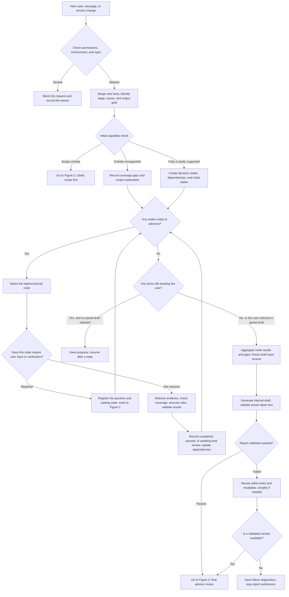
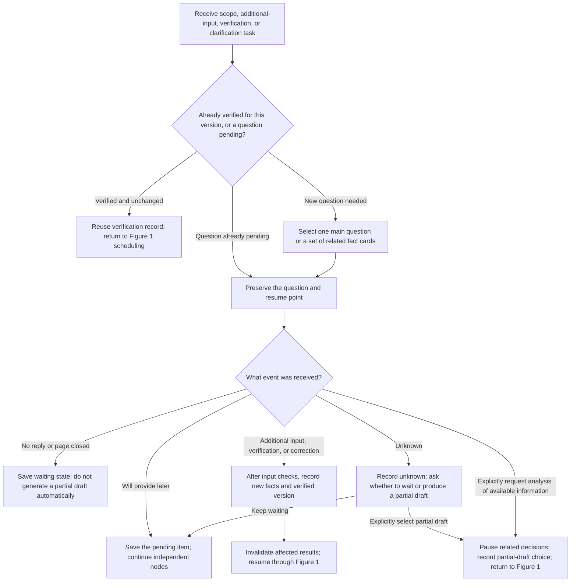
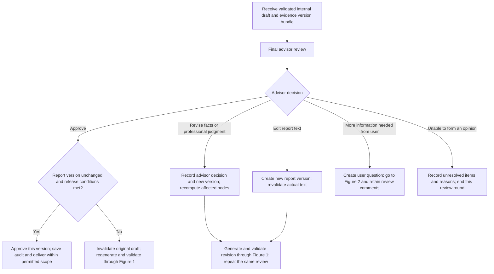
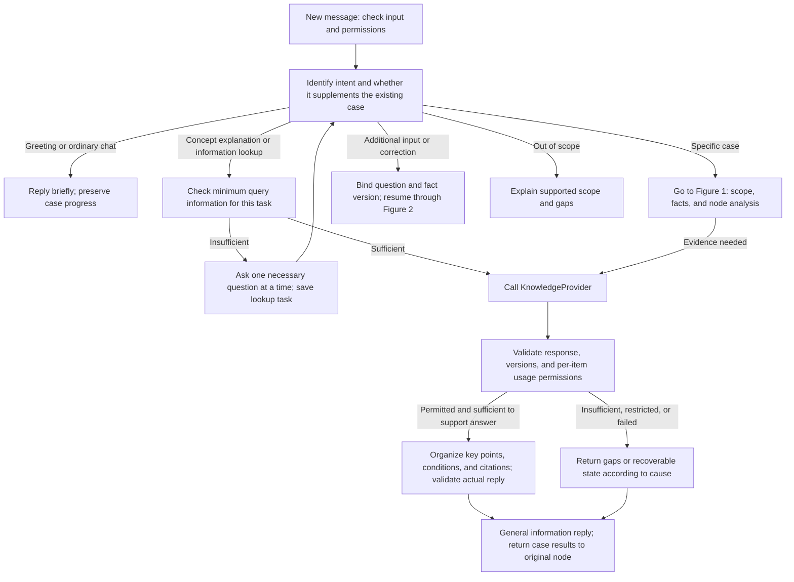
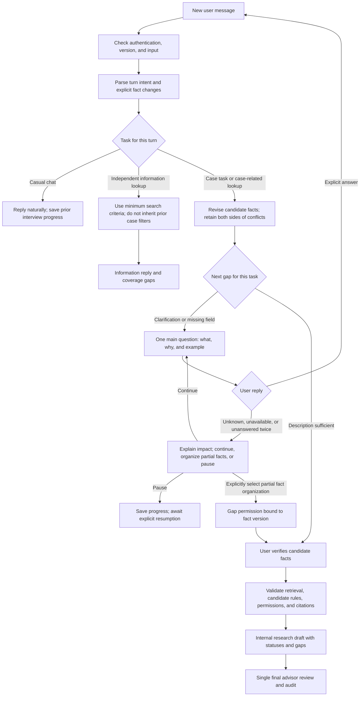

<a id="b-模块agent-咨询业务流程-v03对话入口与可插拔检索设计"></a>

# Module B: Agent consultation business process v0.3 (dialog entry and pluggable retrieval design)

| Item | Content |
|---|---|
| Revision date | 2026-10-02 |
| Status | The revised design draft has been reviewed according to the process; the business code and PRD have yet to be synchronized |
| Owner | Module B (Agent and business process) |
| First executable scenario | Hong Kong foreign-sourced dividends FSIE, L0 internal research prototype |
| File location | The original file name is retained to facilitate continued use of existing links; the content version is upgraded to v0.3 |

<a id="1-范围与运行原则"></a>

## 1. Scope and operating principles

This draft is based on the division of labor and subsequent process review on September 27, defining scenario routing, node scheduling, user questioning, basis retrieval, report verification and final advisor review. The first executable process still starts from Hong Kong's foreign-sourced dividends FSIE, and other capabilities are expanded according to independent rule packages. The current [PRD](../product/PRD.md) and [technology roadmap](TECHNICAL_ROADMAP.md) need to be synchronized when implementing this design.

For specific trigger conditions, actions and status, see [Agent business rules v0.1](AGENT_BUSINESS_RULES_V0_1.md), which corresponds to [Structured rule configuration](agent_business_rules.v0.1.json). These rules are the design contract to be plugged into.

**The workflow has one advisor review stage, after the internal draft is generated and validated.** During the process, the Agent will ask the user, check the extraction results and record the gaps. The advisor can return the revision in the final stage, and the revised draft will enter the same review stage again; one review stage does not mean that it can only be reviewed in one round.

The user is checking whether the case records are accurate and will not automatically obtain the `advisor_confirmed` status. Subjective judgments, unresolved conflicts and missing evidence will be handed over to the final advisor as matters to be reviewed. The system must not write unknowns as negative in order to advance the process, or treat paused nodes as if conditions have been met.

L0 Data boundaries sent to the model follow [D-002](../project/decisions/D-002-model-vendor-and-data-retention.md), using fictional or synthetic cases; candidate rules and hypothesis run results are marked with research markers. Currently [`policy.py`](../../packages/orchestration/policy.py) still prohibits solution optimization. Proposed/occurred is the case stage and also records the tax subject, relevant entities and jurisdictions, transaction date and user requested output.

| Request | Current processing |
|---|---|
| Hong Kong foreign-sourced dividends that have occurred | Collect actual facts and evidence to form an L0 research draft for final review |
| Proposed Hong Kong foreign-sourced dividends | Record plans and assumptions separately to form conditional research and analysis |
| General jurisdiction determination | First check the capability package for the region, topic and date; if there is no package, only the scope description and data requirements will be given. |
| Optimal tax plan or multi-country comparison | Record goals and realistic constraints; only supported issues will be processed, and unsupported optimization functions will not be executed. |

<a id="2-三张流程图"></a>

## 2. Three flowcharts

The following three diagrams are the processing flow of **specific case analysis**. All messages first pass through the conversation entry point in Section 10: ordinary chats do not enter the case diagram; general concept explanations and data inquiries follow a lightweight search path; supplements and corrections restore the original case. Lightweight paths also check material permissions, citations, and output boundaries and may not be used to circumvent factual and review requirements for specific case conclusions.

The three diagrams share the same case record and version number. When Figure 1 calls Figure 2 and Figure 3, the restoration position is saved; returning across figures does not mean restarting the entire case.

<a id="21-主流程处理节点汇总后生成报告"></a>

### 2.1 Main workflow: process nodes, aggregate, then generate a report



"Ready to advance" includes nodes that can perform analysis or register a new question; questions that have been registered and have not received a reply will not be registered again. After a node is completed or paused, it must return to the scheduler and is prohibited from jumping directly to report generation. The scheduler continues to process independent nodes, while dependencies of waiting nodes remain blocked. Questions can be queued in the background, but only one main question or set of related check fields is presented to the user at a time per case.

<a id="22-用户问答按事实版本核对并恢复"></a>

### 2.2 User Q&A: verify and resume by fact version



No reply does not mean "don't know", and the waiting time cannot replace the user's choice. When a new reply fails the permission or input check, this input is blocked and the original question to be answered is retained, and no fact update is performed. For matters "provided later", the system can advance other independent nodes in the background, but will remain in the pending status by default. When the user explicitly selects a part of the draft, the range of the selection is recorded; new blocking problems arise later, and the old selection cannot be used indefinitely.

<a id="23-最终顾问复核批准修订或退回"></a>

### 2.3 Final advisor review: approve, revise, or return



Approval is bound to the report version, fact snapshot, rule version, legal-source version, and validation results. Old approvals cannot be carried forward after the advisor modifies any part that affects the content or basis. When the advisor only changes the text, there is no need to rerun irrelevant rules, but the new text must be re-verified; when returning to Figure 1, the execution results that are still valid are skipped. `pending_review` is maintained when no advisor is available during the review phase and shall not be automatically approved.

<a id="24-图中各框如何理解"></a>

### 2.4 Meaning of each diagram box

| Diagram/box | Actual actions and exit conditions |
|---|---|
| Main flow: new cases, messages or version changes | Distinguish new cases, supplements, corrections and data updates, and locate recovery locations |
| Permissions, environment and input checks | Verify operator and data range; retain original case when rejecting current input |
| Block this request | Return reason codes and leave traces, do not write technical or permission errors as tax conclusions |
| Merge incremental facts and categories | Retain existing valid facts and only extract new content; reclassify only if there are major changes in goals |
| Initial competency check | Check whether the capability catalog supports region, subject, period and output type to avoid invalid long interviews |
| Scope information supplement | Ask only for enough information to select a capability package; recheck capabilities after returning |
| Record coverage gap | Generate the records required for scope description when the package is incapable, and do not falsify the analysis results. |
| Create nodes and dependencies | Divide the case into matters that require judgment and define prerequisites, facts and source requirements |
| Any nodes ready to advance / select a node | Scheduling according to fixed priority, advancing one executable action at a time |
| Does the user need to add or check? | Check the required facts and check versions of the current node without filling the entire dictionary. |
| Register the issue and wait | Write question ID and wait fields to prevent repeated questions; other independent nodes continue |
| Search, verification, rule and result verification | Call the tools in the order of Section 4. Each failure step has a clear node status. |
| Record results and update dependencies | Save node results and blocking reasons, unlock or block dependent nodes |
| Whether to still wait for user/save progress | Decide to continue waiting or form a partial draft according to user selection, save to restore the state |
| Summarize and freeze draft input | All nodes are accounted for, and the versions and gaps used in this report are locked. |
| Generate and verify internal drafts | Verify actual written words, figures, quotes, assumptions and gaps |
| Report Verification/Limited Revision | Only those that pass the verification can be submitted for review; if they fail, please revise or stop according to Section 6. |
| Revision check/save failure diagnostics | Revised and simplified drafts must also pass verification; if they still fail, stop submission and save the reason |
| Q&A: Version Verification Check | Identify whether the same value has been checked and whether there are unanswered questions |
| Reuse records/keep original questions | Skip repeated confirmation when there are no changes, and do not regenerate questions when waiting to be answered. |
| Select question or fact cards | One major question at a time; related fields can be displayed together for review |
| Event classification, waiting and to-do | Distinguish between non-reply, later provision, unknown and explicit request for partial draft |
| Record new facts and check records | Save the original value, new value, source and user-checked specific version |
| Invalidate and restore results | Only rerun affected nodes and their dependencies |
| Suspension of judgment and partial draft selection | Preserve unknowns and conflicts; record which gaps the user permits in this round’s partial draft. |
| Review: Receive version package | Advisors can view raw facts, references, calculations and outstanding matters |
| Final advisor Review/Decision | The single advisor review stage: approve, revise, request information, or end the round |
| Release condition checking and version approval | Verify that the version has not changed, the verification is valid and the release scope is allowed, and then save the approval record |
| Facts, judgments, or text modifications | Create new version; recalculate by impact or redo text validation only |
| Create supplementary questions | The specific questions returned by the advisor are collected by the Agent from the user |
| Unable to form an opinion | End this review cycle and keep the reason, do not record it as approved |

<a id="3-节点调度与事实充分性"></a>

## 3. Node Scheduling and Factual Sufficiency

The following fields and states are proposed business contracts and cannot be considered to have been implemented in the existing code.

Each judgment node has at least `node_id`, `issue_id`, `depends_on`, `required_facts`, `required_sources`, `status`, `reason_code`, `input_snapshot_id` and result references. Case status and node status are saved separately.

| Node status | meaning | Can it be scheduled again? |
|---|---|---|
| `ready` | The preconditions are met and analysis can be performed or user issues can be registered. | OK |
| `waiting_user` | Already have questions to answer | After a new reply or an explicit user choice changes the waiting state |
| `blocked_dependency` | The facts or judgment relied upon are not yet available | After upstream changes |
| `paused_gap` | Unresolved gaps in scope, facts, or sources | After the gap is filled or the version changes |
| `pending_final_judgment` | The final professional judgment of a advisor is required | After final review provides judgment |
| `completed` | Analysis of this version is completed | After an input or evidence change |
| `not_applicable` | According to the rules, it is determined that the node is not applicable, and the reason has been recorded | After the relevant facts change |
| `technical_error` | Retry exhaustion or tool contract error | After recovery event or explicit retry |
| `unsupported` | The capability catalog does not cover this issue | After the new capability package is enabled |

Nodes are sorted by scope blocking, conclusion blocking, supporting matters, and rule order. When multiple states appear at the same time, the highest priority fact affecting the current node is selected first, and then the action is determined based on the conflict, missing or unchecked status of the fact. After returning success, pause or failure once, the status must be written and rescheduled to avoid the same input looping without progress.

Node preconditions are defined by rule packages and cannot simply require "all upstreams pass": some upstream negative results will enable another branch. Only conclusions that depend on it are blocked while the upstream is pending; independent paths can still execute. Each dependency blocking record corresponds to the upstream node and the reason; when creating the node graph, check references and circular dependencies, and the exception graph must not stay silently in the waiting state. The model cannot treat `pending_final_judgment` as satisfying on its own.

"Sufficient for candidate analysis" requires that the node's required fields have allowed values and sources, key conflicts are clarified, the date used to select the rule version is available, and the environment policy is met. Missing values cannot be automatically filled into hypotheses. Hypotheses must have provenance, justification, and scope of application; L0 establishes a snapshot of the hypothesis from an explicit research strategy, and the original candidate state remains. User verification does not confer professional confirmation status.

Aggregation is allowed only when every node included in this round is completed, explicitly inapplicable, or paused with a recorded reason, and no node can advance further. If questions remain unanswered, wait by default; aggregation with those questions unanswered requires the user’s explicit selection of a partial draft. Mixed scope cases retain supported and unsupported issues respectively. If the whole case is not supported, only the scope description will be formed, and it must also be verified by the report text.

<a id="4-工具顺序与依据覆盖"></a>

## 4. Tool sequence and basis coverage

| Tool/Action | Trigger condition | Return and next step |
|---|---|---|
| `screen_input` | Each new input and file | `passed/flagged/blocked`; processed according to environment policy, blocking input and not forwarding to advisor in the process |
| `classify_case_scope` | New cases, scope to be clarified, or major changes in goals | Stages, issues, jurisdictional candidates, periods and output targets; classification does not equal legal conclusion |
| `check_capability` | After preliminary classification | `supported/partial/unsupported/need_scope`; early diversion according to the capability catalog |
| `extract_candidate_facts` | There is new content to work on | Incremental candidates, original text positioning, conflicts; unrelated verified facts must not be overwritten |
| `decide_next_action` / Queue | After every fact, node, or version change | Next node, action, reason code; return to waiting or summary when there is no new information |
| `record_user_fact_check` | User verification or correction | Verification records of specific values/versions; facts remain user statements |
| `retrieve_legal_sources` | The node facts are sufficient to construct the query | Legal units, editions, supporting and restricted materials corresponding to issues, dates and jurisdictions |
| `check_coverage` | The node search results have been obtained | `covered/gap/stale/conflict`; Verify whether the required basis is actually retrieved |
| `run_tax_rules` | The preconditions, fact snapshots and basis all satisfy the running strategy | Deterministic results or matters awaiting final judgment; do not pass subjective conditions on your own |
| `verify_node_result` | After the rule is run | Values, units, rule results, and reference checks; completing or pausing nodes |
| `draft_review_report` | Meet the aggregation conditions | A locked version of the internal draft, including all gaps and unresolved matters |
| `verify_report` | Every time a report is generated or modified | Check the actual text item by item; enter the final review only after passing |
| `review_report` | The verified version package is pending review | advisor decision, scope and version; the recalculation/return/approval path is shown in Figure 3 |

The capability catalog check confirms "whether there is such capability"; the case coverage check confirms "whether the basis required for this judgment is complete and applicable". The actual retrieval must occur between the two. Registration of a source does not mean that it supports a certain conclusion, and the presence of a citation does not mean that the quoted content can lead to that conclusion.

Each call is provided by the server-side trusted context with organization, user permissions, and case ID, and tools must not only trust the identity given by the model. Call records include cases, issues, nodes, request IDs, fact snapshots, rule and source versions, outcome status, and reason codes. Writes and retries use idempotent flags.

Temporary timeouts and rate limits can be retried within the budget; permission errors, parameter errors, lack of evidence, and the need for subjective judgment cannot be solved through blind retry. The model adaptation layer and the orchestrator share the retry budget to avoid layer-by-layer retries from amplifying the number of calls. Record technical errors after reaching the upper limit; if a partial draft includes failed nodes, explicitly identify technical incompleteness rather than claiming that no legal basis exists.

<a id="5-用户核对等待和恢复"></a>

## 5. User verification, waiting and recovery

Source/professional status of facts are stored separately from user verification records. Keep the existing `ai_candidate`, `client_statement`, `assumed`, etc. status, and note:

| Check/Question Field | Purpose |
|---|---|
| `fact_id + fact_version` | Indicate which fact and value the verification is aimed at |
| `acknowledged_value_hash`、`acknowledged_by/at` | Prevent the value from continuing to use the old check after it has changed |
| `source_refs`, original statement and correction statement | Keep what the user said and the basis for extraction |
| `question_id`、`question_type`、`asked_fact_versions` | Map scope, additions, reconciliations, and conflict clarifications to questions |
| `question_status` | Distinguish between to-be-answered, provided later, answered, and unavailable |
| `resume_node_ids`、`partial_draft_scope` | Save recovery locations and what pending items the user allows into the draft |

If the same fact version has been effectively verified, the question will not be repeated; when the value changes, a new conflict occurs, or new evidence that affects the judgment arrives, the affected part will be re-examined. When the new document simply repeats existing content, keep a verification record. The user verification interface can display relevant fields in batches and allow direct correction.

If there is no reply, only the waiting status will be saved; "Provide later" will save the to-do; "Don't know" will save the unknown, and ask whether to continue waiting or publish a partial draft first. Only change the publishing strategy after making a clear choice. When there is still a conflict after clarification, the evidence of both parties and the user's choice are retained, and one value cannot be selected by majority vote of the model.

During recovery, merge incremental facts according to the original case ID, invalidate related execution results and results that depend on them; re-execute the affected nodes and reuse other nodes that are still valid. Old facts, old reports, and old approvals remain historical versions. Concurrent replies and duplicate requests are handled by the expected version and request ID; writes using older versions are subject to rechecking and newer corrections cannot be silently overwritten.

<a id="6-报告生成校验与有限修订"></a>

## 6. Report generation, verification and limited revision

All publishing paths share the same check: full analysis, partial analysis, scope statement, gap list, and draft for professional judgment. They all generate the text first and then check the actual text. At a minimum, the report includes the scope of processing, status of itemized analysis, sources of facts and assumptions, supportable conclusions, citations, missing information, suspended items and matters awaiting final advisor judgment.

| Check | Failure example | Process |
|---|---|---|
| Values and units are consistent | According to the rules, the calculation is 800,000, and the report is written as 1 million. | Retest after correction |
| Citation support | The reference exists but does not support the conclusion | Supplement valid evidence or withdraw claims |
| uncertainty retention | "Unable to confirm yet" was changed to "Basically satisfied" | Restore the true state and check the relevant conclusions |
| Coverage and pending matters complete | Report missing an unsupported jurisdiction or suspended node | Fill the gaps; do not write partial analysis into overall conclusion |
| The environment and version are consistent | Using expired results or missing L0 identifier | Retake a valid snapshot to generate; retain publishing restrictions |
| Content output range | Report content mixed with other case data or without permission | Block the report from being submitted and do not deliver the text that fails the verification |

The recommended initial configuration is a maximum of two rounds of automatic revisions per draft version (default by design, adjustable through actual review). Recheck after revision and cannot be sent directly to the advisor. If it still fails, you can withdraw the unsupportable substantive claims and generate a simplified draft that clearly explains the gaps, but this simplified draft will also need to be re-verified. If the simplified draft still fails, mark `report_validation_failed`, save the diagnosis, and stop report submission; you must not bypass verification by sending the failed draft to a advisor.

Different verifications can be completed by a combination of programs, retrieval evidence checks and restricted model tasks; simply asking the generated model to answer "is it correct" does not constitute a basis for passing. The final verification result is bound to the report content hash and the input version. Any modification of the text after verification will invalidate the result.

<a id="7-最终复核与状态记录"></a>

## 7. Final review and status recording

The case workflow status, node status, rule results and report release status are saved separately. One `human_review_required` cannot be used to represent both mid-way transfer to manual and final pending matters at the same time.

| event | Case/report status and actions |
|---|---|
| Waiting for user | Save `waiting_user_response` (to be built) and questions to be answered; retain completed nodes |
| Nodes require subjective judgment | Node `pending_final_judgment`; the case continues to analyze other independent nodes |
| Internal draft passes text verification | Report `pending_review`, notify the single final advisor review stage |
| advisor asks for additional information | Record review comments and question ID, enter user Q&A, and keep the original manuscript unapproved |
| advisors change facts or professional judgment | Add a new version to invalidate relevant results and drafts, automatically recalculate and resubmit the same review process |
| advisor Approval | Verify that the approval object is still the current valid version, and save the advisor's identity, reasons, report hash and version package |
| Advisor cannot form an opinion | Record the reason, end this round and disapprove; it can be reopened with new information in the future. |
| Changes in facts or sources of law after approval | Mark the affected approval/report invalid and display the historical status; re-review the new version |

advisor approval cannot increase the environmental release level, nor can it automatically mark unverified rules as professionally verified. L0 Even if the advisor review is completed, the output range is still L0. The final review interface should display the original source text, factual version, calculation process and pending judgment list to prevent the advisor from re-assessing the case from the entire chat record.

<a id="8-设计走查与后续验收场景"></a>

## 8. Design walkthrough and subsequent acceptance scenarios

The following table is the expected behavior of subsequent joint debugging. This is only for design review and does not mean that the operation test has been passed.

| Scenario | expected behavior |
|---|---|
| Upload duplicate files after verification | Do not check the same fact version repeatedly, and do not repeatedly execute valid nodes |
| A new file changes an amount | Create a new fact version, recheck relevant values, and invalidate affected calculations and reports |
| One node lacks data and another node is independent. | Wait for nodes with missing data; continue with independent nodes; keep waiting if there is no partial draft selection |
| Upstream subjective judgment pending | Conclusions that rely on it are suspended, independent paths continue, and loose ends enter final draft |
| The user returns after leaving the page | The original case, questions to be answered, and recovery nodes are still there, and partial drafts are not automatically output. |
| The user does not know and selects a partial draft | Record selections, unknowns don't turn into negatives, and reports clearly list gaps |
| Half of the arguments are not supported | State boundaries early, support partial continuation, and final draft show coverage |
| Tool timeout | Retry within limits; when exhausted, report a technical failure rather than missing legal sources. |
| Rules correct but reports exaggerated | The actual text verification failed. Revise or withdraw the claim and re-verify it. |
| Report revision exhaustion still fails | Do not enter the review queue, do not deliver failed drafts, and save the diagnosis |
| The advisor changes the amount or judgment | Recalculate the affected nodes and return to the same consulting session after verifying the revised draft. |
| The input version has been updated during advisor approval | Refuse to approve the old version, regenerate the valid version and review it |

<a id="9-实施落点及模块交接"></a>

## 9. Implementation responsibilities and module handoff

The above tool name, new state and record structure are design contracts and need to be implemented. The existing [`queues.py`](../../packages/orchestration/queues.py), which assigns client statements, candidate facts and conflicts to advisors, must be changed to user verification and clarification, and identification of verification versions. The existing [`permissions.py`](../../packages/orchestration/permissions.py) still limits the fact confirmation status improvement, and users cannot directly write to `advisor_confirmed` for verification.

L0 can use the explicit research hypothesis strategy to generate restricted candidate analysis; the existing [`intake/cli.py`](../../packages/intake/cli.py) directly passes extracted values to the rule chain, and needs to be connected to status checks, snapshots and audits. If L1 adopts the same final review mode in the future, the pre-analysis contract subject to permissions must be implemented, and the L0 hypothesis channel cannot be used directly for real cases.

[`runner.py`](../../packages/rule_engine/runner.py)'s existing entire chain operation and final state merging need to be coordinated with node dependencies, pauses, and incremental invalidation; it returning a report does not demonstrate that this design has been implemented. The current fact dictionary marks `regulated_financial_entity_status` as a scope-blocking field, but `scope.required_facts` of the rule package is not listed and the rule owner must check and reconcile the coverage. The current API also requires entry for cases, conversations, fact checking, status recovery, and report review.

| B module delivery | Collaborators | Integration details |
|---|---|---|
| Scenarios, node scheduling and reason codes | A (front end) | To be answered, provided later, partial draft selection, fact cards and resume interaction |
| Capability Catalog, Retrieval and Coverage Contracts | C (knowledge base) | Support scope, applicable period, actual source return, exceptions and gaps |
| Version binding reports and verification results | A and advisor | Review interface for original evidence, assumptions, calculations and pending matters |
| revision loop for final review | Products and advisors | Approval, modification, return and inability to form opinions status and permissions |

Implementation priority: first unify fact-checking records and node status, then open up resumable scheduling and real retrieval, then access report text verification, and finally complete the version-binding advisor review loop. The scope of the first version will be expanded and the capability catalog and rule package will be updated separately.

<a id="10-本周对话入口与-b-的职责边界"></a>

## 10. This week’s dialogue entry and B’s responsibility boundaries

2026-10-02 Update: A’s page has met the access conditions, but C’s database has not yet been formed. B delivers Agent and business process design, retrieval contract, simulated retrieval behavior and joint debugging inspection standards in this round; A is responsible for the front-end pages and components, and C is responsible for the knowledge database and retrieval implementation. B defines the return status and content structure for A to connect.



When the model classification is ambiguous, clarify it first; when a sentence contains both greetings and business content, the business content is processed first, and the factual updates are not discarded. A pure greeting will not reset the original case, and a pure data query will not create a complete set of case fact queues.

Light replies are limited to information explanation and query results; the qualification, tax amount and professional judgment of the user's case must be returned to the case process. The case study draft remains pending final review, with no additional advisors involved and no automatic marking as approved.

<a id="11-本周五项任务的设计补充与完成边界"></a>

## 11. Design supplement and completion boundaries for this week’s five tasks

| work item | Already designed | Additions in this revision | Still to be developed or jointly debugged |
|---|---|---|---|
| How the system responds | Scope, conflict, gap, unknown handling principles | Section 10 Entrance; Business Rules Section 9 Scenarios and One-Sentence Behavior | Classification and reply processor |
| Necessary follow-up questions | Single main issue, deduplication, unknown does not equal negation, version verification | Business Rules Section 10 Minimum Input and Multiple Rounds Example | Field extraction, queue and state persistence |
| Receive searches and organize answers | Search, Coverage and Reference Verification Principles | KnowledgeProvider Contract; Business Rules Section 11 Reply Structure | Mock implementation with C real adapter |
| Missing evidence and call failures | Limited retries, separation of gaps from technical failures, final review | Business Rules Section 12 Status, Reason Codes and Prompts | Error mapping and recovery actions |
| Joint debugging and reducing waiting | Reuse, share budget, avoid duplication of processing | Section 13 Phased Acceptance; Mock Scenario in the Contract | A Real page joint debugging, C retrieval acceptance and time-consuming measurement |

What is completed this time is the design content and will not be recorded as the function has been implemented. The previous 47 configured branch checks are also not equivalent to dialogue or retrieval acceptance.

<a id="12-c-数据库尚未就绪时的接入安排"></a>

## 12. Access arrangement when C database is not ready yet

```text
Existing A pages → B agent and business workflow → KnowledgeProvider
                                    ├─ MockKnowledgeProvider: development/testing
                                    └─ CKnowledgeProvider: subsequent live integration
```

See [KnowledgeProvider interface and simulated retrieval design](KNOWLEDGE_PROVIDER_CONTRACT_V0_1.md) for the complete definition. B's business node only relies on the unified contract; C subsequently provides API, MCP or read-only database views, mapped by CKnowledgeProvider. Fields may be mapped, but permissions, versions, applicable periods, and coverage semantics must not be fabricated.

Server configuration selects the provider; neither the model nor user messages may select it. If the real service is unavailable, return a failure; do not switch automatically to Mock and present it as success. Mock uses only clearly labeled fictitious material and cannot support real tax conclusions. B's case facts, questions to answer, and execution status are kept independently, without waiting for C's knowledge base to provide conversational memory.

<a id="13-联调顺序与性能检查设计"></a>

## 13. Joint debugging sequence and performance check design

1. **Contract Check**: Verify required fields, status combinations, permissions, original text location and reference version according to interface documents and response samples.
2. **Mock process inspection**: Use fixed simulation scenarios to verify entry, questioning, answer structure, no matching, permission restrictions and fault recovery. Verify the actual inputs to the model, not just the final responses.
3. **Joint debugging with A**: B provides message type, status, problem and reference data; A is responsible for page access. B checks whether there are repeated calls, lost status or mismatched references under actual page operations.
4. **Retest after C**: Use the same test questions and real responses to verify the retrieval quality, permissions, versions and citations. Mock passes do not replace this step.
5. **Optimization after measurement**: The same request_id/trace_id is associated with routing, retrieval, model, verification time and number of calls; unmeasured data is empty and no zeros are written. Eliminate duplicate retrievals, duplicate extractions, and overly long contexts before evaluating segmented output.

Search results are only reused if the query semantics, range/date, necessary fact version, corpus version, permission policy, and access scope are still valid. If the model generation fails, the search results that are still valid can be reused; changes to key facts or source permissions require rechecking. Complete and verified responses are received first, and the streaming output is designed separately to prevent unverified substantive conclusions from being displayed in advance.

<a id="2026-10-02动态追问与场景入口细化"></a>

## 2026-10-02: Dynamic questioning and scene entrance refinement

The actual implementation of this round can be found in [Dynamic questioning design](../implementation/B_GUIDED_INTAKE_DESIGN_2026_10_02.md) and [User-facing field audit](../implementation/B_USER_FACT_FIELD_AUDIT_2026_10_02.md). Replace the original fixed field order: first identify the candidate scenarios, and then select the necessary description according to the current consultation goal; save the gap when information cannot be provided, and wait for the user to explicitly choose to continue/partially organize/pause.



"No new user message" is not an automatic advancement condition; professional judgment does not return to the midway advisory node. Query failure is separated from no match; the fact that the mixed message was successfully parsed can be saved first, query failure returns partial_failure explicitly, and the recovery position is retained.

<a id="2026-10-03三个入口与自由对话的首版实现"></a>

## 2026-10-03: The first version of three entrances and free dialogue is implemented

See [Unified orchestration development plan](../implementation/B_HYBRID_ORCHESTRATION_PLAN_2026_10_03.md) for detailed plans and [54-item scene matrix](../implementation/B_HYBRID_ORCHESTRATION_ACCEPTANCE_2026_10_03.md) for acceptance. Three shortcut entrances specify default tasks; the main input box first accepts valid inquiries, and then automatically selects a shared business subgraph based on the intention of this round. All paths continue to perform existing scenario assessment, fact/evidence checks, fallback handling, and single final advisor review.

At this stage, entry_hint, task status, unified budget and limited dynamic scheduling have been added. The shortcut button sends the entry prompt and enters the corresponding compiled subgraph. Modifying the pre-filled content in the input box will clear the entrance prompt, and the main input box will be processed according to the existing tasks and new intentions. Independent data queries in mixed tasks are separated by dependencies and case conflicts; new messages will not automatically clear the original interview progress. The analysis follows fact confirmation, partial draft authorization, versioning and final review thresholds.

In this round, 256 back-end items and 25 page regression items have passed, and the real model/C/PG has not yet been accepted. The dynamic range of the first version is the sequential scheduling of up to three tasks and one in-scope query rewrite after `no_match`; the data answer still uses the excerpt template. Actual documentation, switches and limitations are provided in Section 17 of the Detailed Plan passing engineering checks does not mean professional tax conclusions are ready for delivery.

Supplementary preparation for same-day evaluation: when explicitly required to list known information, use a read-only summary, return recorded statements and current task gaps, and retain the original questioning progress; not equivalent to partial, confirm or analyze. The amount is clearly corrected and checked to support units such as ten thousand/billion, and 2 million cannot be mistakenly recorded as 200. See [Evaluation instructions](../../evals/b_workflow/README.md) for the latest project regression and 62 multi-round scripts. The real model is still waiting for free keys or package authorization.
