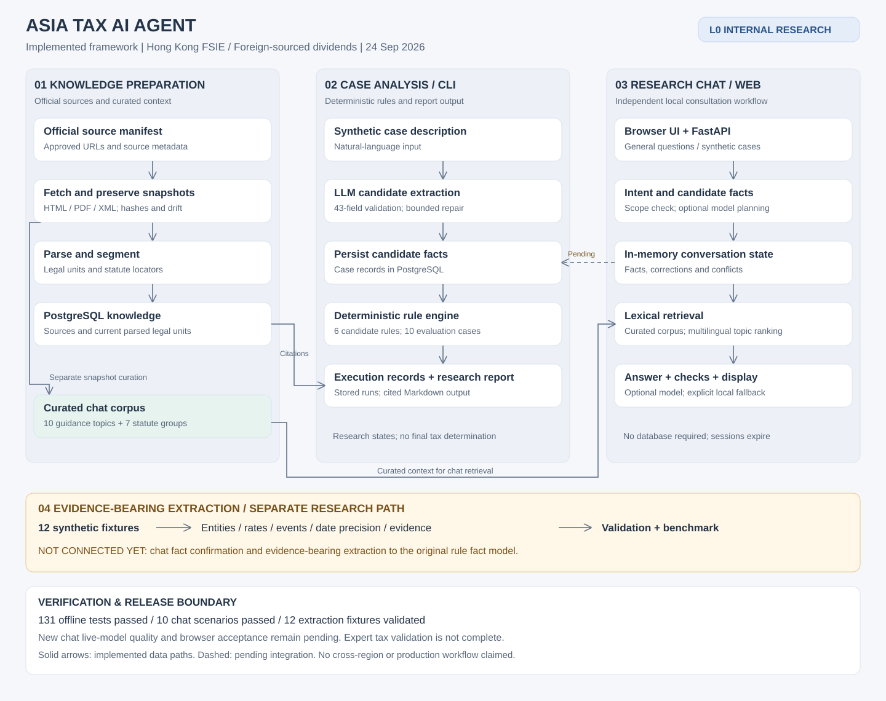
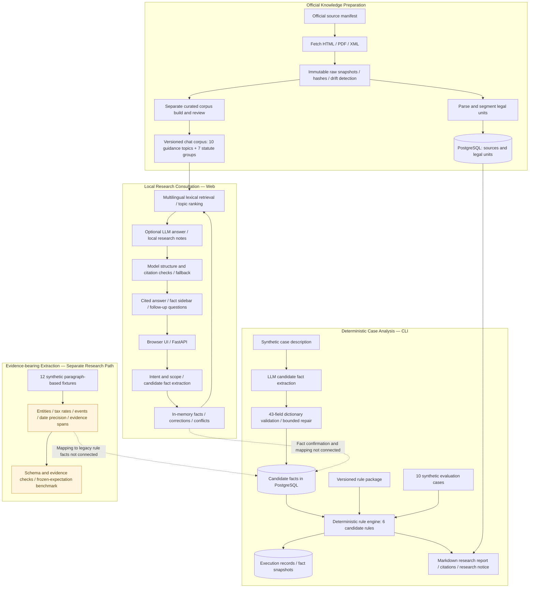

# Asia Tax AI Agent — Project Framework

Implementation snapshot: 2026-09-24. Scope: Hong Kong FSIE, foreign-sourced dividends, L0 internal research.

## Editable framework diagram

Solid arrows represent implemented paths. Dashed arrows represent integration work that is not implemented. Connections show data flow, not automatic scheduling.

## Implementation map

| Component | Implementation | Current boundary |
|---|---|---|
| Source ingestion | `packages/knowledge_pipeline/` | Manual invocation; raw snapshots are retained, while database legal units are rebuilt per source. No continuous legal-change review service. |
| Rule and case loading | `packages/knowledge_loader/` | Loads the versioned Hong Kong research package. |
| Original fact extraction | `packages/intake/extraction.py`, `packages/intake/cli.py` | Flat 43-field contract; model proposes candidate facts. CLI connects extraction, rules, persistence and reporting. |
| Rule execution | `packages/rule_engine/` | Six deterministic candidate rules; research-only terminal states. |
| Research reports | `packages/reporting/` | CLI intake renders its result directly; evaluation reports can be rebuilt from stored evaluation runs. |
| Chat application | `apps/api/`, `packages/consultation/` | Local browser application; expiring in-memory sessions; no rule-engine execution or persistent case file from chat. |
| Chat knowledge | `knowledge/hong_kong/fsie/chat_corpus.json`, `scripts/build_chat_corpus.py` | Separate curated official corpus; lexical retrieval, not vector search over all database units. |
| Evidence-bearing extraction | `packages/intake/grounded.py`, `packages/intake/benchmark.py` | Independent research contract and evaluation; no automatic projection into the original rule facts. |
| Model access | `packages/model_adapter/` | Compatible Chat Completions client. Chat explicitly opts in and uses at most two serial calls per turn, with local fallback. |
| Persistence | `packages/persistence/`, `alembic/` | PostgreSQL for original case/rule workflows; not required by the chat demo. |

## Verification and release boundary

- Rechecked on 2026-09-24: 131 offline tests passed; 10/10 local consultation scenarios passed; 12 synthetic extraction fixtures validated; knowledge-package validation passed.
- Nine live database/model integration tests were excluded from this check. The 2026-09-05 L0 acceptance record contains earlier integration evidence for the original pipeline.
- The new chat model path has substitute-client tests, but no recorded live supplier-model acceptance. Fixture validation does not measure model accuracy.
- All tax rules and research outputs remain professionally unverified. Expert review, production authentication, tenant isolation, backup recovery and client-data admission are not completed product workflows.
- Mainland China, Japan and South Korea remain planned extensions; this diagram does not claim implemented regional pipelines.

## Next integration step

Connect conversational fact confirmation and evidence-bearing extraction to one versioned case fact model, then invoke the deterministic rule engine and report workflow. Preserve evidence, corrections, missing facts and review status throughout that connection.
