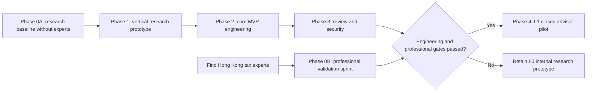

<a id="东亚税务-ai-平台香港-fsie-mvp-技术路线图"></a>

# East Asian Tax AI Platform (Hong Kong FSIE MVP) — Technical Roadmap

| Item | Details |
|---|---|
| Document version | v0.2 |
| Date | 2026-08-15 |
| Status | L0 research baseline and conditional L1 pilot roadmap confirmed; implementation pending |
| Related documents | [PRD](../product/PRD.md) |

<a id="1-技术目标"></a>

## 1. Technical objectives

Build a controlled, auditable East Asian tax platform: natural-language models understand cases and organize interviews, a versioned rule engine executes deterministic determinations, RAG supplies authoritative evidence, and tax advisors make subjective judgments and give final approval. The 2026 scope is mainland China, Hong Kong, Japan, and South Korea, with Hong Kong foreign-sourced dividends as the in-depth MVP.

The MVP uses a modular monolith to reduce early deployment, debugging, and data consistency costs. Clear module interfaces prepare for later service separation and additional jurisdiction knowledge packages.

Release levels follow the PRD: L0 is an internal research prototype, L1 a closed advisor pilot, and L2 production client capabilities. December 2026 defaults to L0 delivery. Hong Kong capabilities may enter L1 only after expert validation and all security and operational gates pass. L2 is outside the default 2026 scope.

<a id="2-已确认技术决策"></a>

## 2. Confirmed technical decisions

| Area | Decision | Rationale |
|---|---|---|
| Application form | Web case workspace | Supports interviews, fact confirmation, and collaborative review |
| Backend | Python API service | Suits rules, document processing, and the AI tooling ecosystem |
| Core database | PostgreSQL | Supports relations, transactions, JSON, full-text search, and extensions |
| MVP vector retrieval | pgvector | Keeps business data and initial legal vectors on the same data platform |
| Original files | S3-compatible object storage | Separates them from structured case data |
| Architecture | Modular monolith | Controls first-release complexity |
| Model integration | Provider adapter layer | Avoids coupling business logic to a single model |
| Deployment | L0 single-organization research environment; prefer isolated single-tenant L1 environments; managed PostgreSQL | Reduces operations costs and protects sensitive data |
| Rule management | Git-versioned rules + database release records | Reviewable, reversible, and reproducible |
| Search strategy | Keyword + vector hybrid retrieval | Handles statutory identifiers and semantic questions |
| Professional validation | Rules and cases store `unverified/verified/rejected` | Allows development first while preventing unverified results from entering client pilots |

PostgreSQL vector capabilities use open-source [pgvector](https://github.com/pgvector/pgvector). Any managed service providing full PostgreSQL may be selected; the database design is not tied to one vendor. For example, [Supabase's official documentation](https://supabase.com/docs/guides/database/overview) states that its database is full PostgreSQL.

<a id="3-逻辑架构"></a>

## 3. Logical architecture

```text
Web case workspace
    ↓
Authentication and application API
    ↓
Case orchestrator
    ├── Fact card service
    ├── FSIE rule engine
    ├── Legal source retrieval service
    ├── Report generation service
    └── Audit service

Data layer
    ├── PostgreSQL case data
    ├── PostgreSQL full-text search + pgvector
    ├── Original-file object storage
    ├── Git rule repository
    └── Expert case evaluation library
```

<a id="31-司法管辖区税务包"></a>

### 3.1 Jurisdiction tax packages

Platform code must not hardcode Hong Kong rules. All four jurisdictions use the same tax package interface:

```text
jurisdictions/
├── mainland_china/
├── hong_kong/
├── japan/
└── south_korea/

Each tax package contains:
├── jurisdiction metadata
├── official sources
├── source versions
├── tax topic taxonomy
├── candidate or verified rules
├── retrieval configuration
├── evaluation cases
└── report templates
```

Packages declare their content coverage level, last update, and professional validation status. Hong Kong reaches the in-depth MVP level. The conservative 2026 baseline for mainland China, Japan, and South Korea is `source-catalog baseline`, including official catalogs, shared metadata, topic classification, coverage gaps, and validation statuses. Extending all eight topics to `standard research package` is enabled only if a second full-time engineer and knowledge operations owner are confirmed by August 31.

<a id="4-模块边界"></a>

## 4. Module boundaries

<a id="41-案件编排器"></a>

### 4.1 Case orchestrator

Provide controlled tools for fact extraction, conflict detection, next-question selection, fact confirmation, rule execution, source retrieval, citation validation, reporting, and human escalation.

The initial release does not use multiple freely collaborating Agents, avoiding unpredictable loops, costs, and responsibility boundaries. Models must not modify rules, skip confirmation, treat unknown as negative, or invent legal evidence without sources.

<a id="42-事实卡服务"></a>

### 4.2 Fact card service

Store candidate, confirmed, unknown, conflicting, and assumed facts consistently. Each fact links to its information source, evidence, revision history, and affected rule nodes. Fact cards are the single source of case facts for all analyses.

<a id="43-规则引擎"></a>

### 4.3 Rule engine

- Use versioned decision tables for simple conditions.
- Use tested code for complex deterministic logic.
- Return `human_review_required` for economic substance adequacy, main purpose, and similar matters.
- Store rule version, input fact version, and node results for every run.
- Store professional validation status, validator, and validation time for rules.
- Run unverified rules only in research environments, with mandatory research watermarks on reports.
- Require unit tests, expert case regression, and expert approval for rule changes.

<a id="44-rag-与引用账本"></a>

### 4.4 RAG and citation ledger

Source processing: obtain originals, save hashes, parse structurally, segment by legal unit, attach authority/validity metadata, review, and index.

Generate queries from confirmed facts + the current rule node. Merge keyword/vector results, filter by authority and validity period, and rerank. Each conclusion stores its source, passage, rule node, validity period, and advisor confirmation status.

The Hong Kong FSIE package maintains a versioned source manifest. Each record includes at least `source_id`, title, publisher, source type, original URL, jurisdiction, language, publication date, `effective_from`, `effective_to`, capture time, content hash, authority level, associated nodes, supporting/limiting relationships, replacement versions, parsing status, professional validation status, and validation records.

Each analysis stores `legal_coverage_cutoff`. Materials published or effective after that date trigger impact checks. Until reviewed, affected nodes become `potentially_stale` and must not produce definitive professional conclusions. Engineering completeness checks the manifest, originals, hashes, parsing, indexing, and links; Hong Kong tax experts confirm professional completeness. Neither substitutes for the other.

<a id="45-报告服务"></a>

### 4.5 Report service

Reports combine only confirmed facts, rule results, human judgments, and validated citations. Models may improve wording but must not change rule results. Fact or rule changes automatically invalidate old reports while preserving their historical versions.

<a id="46-知识管理后台"></a>

### 4.6 Knowledge administration

Support source differences, authority levels, validity periods, rule mappings, review/publication, and viewing affected rules. Keep public authoritative and internal client materials in separate, isolated layers.

Maintenance service levels depend on change severity: major legal/core-rule changes immediately freeze affected nodes and require impact classification within 2 working days; check important FAQ, DIPN, filing, or official example updates weekly, with initial review within 5 working days; handle ordinary page/metadata changes monthly. Store a source owner, backup owner, and overdue-maintenance status for each jurisdiction. Overdue content must not remain labeled “up to date.” Machine translation cannot establish professional approval.

<a id="5-核心数据模型"></a>

## 5. Core data model

Suggested initial entities:

- `organizations`, `users`, `roles`.
- `cases`, `entities`, `income_events`.
- `facts`, `fact_versions`, `evidence`.
- `interview_messages`, `question_queue`.
- `rule_sets`, `rule_nodes`, `rule_executions`.
- `legal_sources`, `legal_passages`, `citations`.
- `analysis_runs`, `reports`, `report_versions`.
- `human_decisions`, `audit_events`.
- `evaluation_cases`, `evaluation_runs`, `evaluation_results`.

Every business table includes an organization identifier from day one. Deletion follows a controlled workflow; ordinary business operations cannot overwrite audit events.

<a id="6-安全与部署基线"></a>

## 6. Security and deployment baseline

- Single-tenant pilot or strictly isolated cloud environment.
- Role- and case-level permissions.
- TLS in transit, encryption at rest, and separate key management.
- Consistent retention policies across the database, object storage, and backups.
- Redacted sensitive logs and minimized model input.
- User data is not used to train general-purpose models by default.
- File type, virus, and prompt injection checks.
- Audit all downloads, exports, approvals, and knowledge/rule changes.
- Regular recovery drills.
- Review data processing for the deployment region and model provider before the pilot.

<a id="7-工程质量与评测门槛"></a>

## 7. Engineering quality and evaluation gates

<a id="71-自动化测试层"></a>

### 7.1 Automated testing layers

1. Fact extraction: entities, dates, amounts, ownership, and fund flows.
2. Conversation policy: priorities, repetition, unknowns, and contradictions.
3. Rule unit tests: normal cases, boundaries, missing data, and version compatibility.
4. Retrieval evaluation: recall, authority levels, effective versions, and citation locations.
5. Report tests: consistency of facts and citations.
6. Security tests: unauthorized access, tenant isolation, file input, and prompt attacks.
7. End-to-end cases: candidate cases during research; 30–50 gold cases reviewed by Hong Kong tax experts before the pilot.

Each release metric stores its test set version, denominator, formula, threshold, zero-tolerance failures, evidence location, and approver. Critical fact identification completeness is correctly extracted or explicitly queried expert-labeled critical facts ÷ all expert-labeled critical facts. One statute, provision, or link in the frozen release evaluation set that cannot resolve to the source manifest blocks the corresponding release.

L0 requires end-to-end regression on at least 10 versioned candidate cases. L1 uses 30–50 gold cases with an expert-confirmed coverage matrix. The three-jurisdiction `source-catalog baseline` requires at least 1 first-party official entry point per declared topic, 100% required metadata completeness, 0 broken links in the release snapshot, and nonempty coverage gaps/validation statuses.

<a id="72-发布阻断条件"></a>

### 7.2 Release blockers

Common blockers at all levels:

- A known error in any core deterministic rule.
- Blocking facts can be silently skipped.
- Unverifiable statutes or links in reports.
- High-risk cases fail to escalate to humans.
- Critical permissions or tenant isolation tests fail.
- Backups cannot be restored.
- Regression fails after rule, source, model, or prompt updates.
- Ordinary users can bypass research status, watermarks, or professional validation gates.

Additional L1 blockers: core rules, human judgment boundaries, or gold cases lack Hong Kong tax expert validation; deployment region, authentication, model data processing, backup recovery, or pilot case data workflows lack approval. Expert unavailability does not stop L0, but confines it to internal research.

<a id="8-分阶段路线图"></a>

## 8. Phased roadmap

Engineering can start the L0 internal research prototype without a Hong Kong tax expert. Use two tracks: engineering continues, and the expert track finishes before the L1 closed advisor pilot. Real advisor trials start only after both tracks converge.

2026 calendar mapping:

| Deadline | Platform and Hong Kong | Mainland China, Japan, South Korea |
|---|---|---|
| August 31 | Common tax package specifications, database, and source pipeline | Identify official entry points and topic lists |
| September 20 | Hong Kong vertical research prototype | Build source catalogs and metadata for three jurisdictions |
| October 18 | Hong Kong MVP feature freeze | Complete source-catalog baselines; expand standard research packages if resources are confirmed |
| November 8 | Meet Hong Kong L1 gates or explicitly retain L0 | Retain L0 without completed expert validation; do not enter an L1 closed advisor pilot |
| December 6 | Integration, security, and release candidate | Unified retrieval, versions, and status display across four jurisdictions |
| December 18 | East Asia Release 1 acceptance | Stop new scope; fix blockers only |



<a id="阶段-0a--无专家研究基线23-周"></a>

### Phase 0A — Research baseline without experts (2–3 weeks)

Deliverables:

- Candidate decision boundaries based on official sources.
- Candidate fact model and rule node list.
- Official source catalog, authority hierarchy, and versioning standards.
- Initial 10 candidate cases, explicitly not professional gold standards.
- Repository, tests, database migrations, and security baseline.

Exit criteria: all sources and candidate rules are traceable; research mode and validation statuses cannot be bypassed; the corresponding milestone records `pass` or `pass-with-approved-degradation`.

<a id="阶段-1--纵向研究原型23-周"></a>

### Phase 1 — Vertical research prototype (2–3 weeks)

Deliverables:

- Natural-language case creation.
- Candidate fact extraction and basic fact cards.
- Minimal dynamic follow-up workflow.
- One end-to-end candidate FSIE decision path.
- Retrieval of a limited set of official materials and internal reports with research watermarks.
- 3–5 structured walkthroughs using fictional cases, testing interactions and report structure, not tax conclusions.

Exit criteria: at least 10 candidate cases finish reliably with explainable results; 3–5 walkthrough records are complete and not labeled professional gold standards. These criteria do not establish tax correctness.

<a id="阶段-0b--香港税务专家验证冲刺12-个有效工作周"></a>

### Phase 0B — Hong Kong tax expert validation sprint (1–2 effective working weeks)

This may run in parallel with engineering phases 1–3 but must finish before phase 4. Searching and scheduling delays do not count toward effective working weeks.

The team first supplies an expert review package:

- Candidate FSIE decision tree with itemized official evidence.
- Open professional questions and boundary cases.
- Candidate fact fields and follow-up ordering.
- Candidate rules, human judgment nodes, and report wording.
- 30–50 candidate cases and system outputs.

Experts approve, modify, or reject rules, confirm human judgment boundaries, and convert cases into professional gold standards.

Exit criteria: professionals with Hong Kong corporate tax experience provide written confirmation of core rules, judgment boundaries, and gold cases, recording validators, dates, and versions.

<a id="阶段-2--mvp-核心34-周"></a>

### Phase 2 — Core MVP (3–4 weeks)

Deliverables:

- Complete foreign-sourced dividend rule nodes.
- Legal source acquisition, parsing, hybrid retrieval, and citation ledger.
- Fact confirmation, conflict handling, and unknown handling.
- Rule/report versions.
- Complete internal review drafts.
- At least 10 versioned L0 candidate cases; if preparing for L1, expand to 30–50 and convert to gold cases after expert confirmation of the coverage matrix.

Exit criteria: rule, retrieval, and end-to-end engineering gates pass. If phase 0B is incomplete, retain the L0 internal research prototype.

<a id="阶段-3--复核安全和运营23-周"></a>

### Phase 3 — Review, security, and operations (2–3 weeks)

Deliverables:

- Advisor/reviewer workflows.
- Permissions, audit, backups, and recovery.
- Knowledge/rule review and publication.
- Exception stopping, stale-content handling, and impact analysis.
- Monitoring, error classification, and cost records.

Exit criteria: L0 permission, security, and recovery tests pass. For L1, professional review and security checks on the final pilot architecture must also pass.

<a id="阶段-4--l1-封闭试点24-周"></a>

### Phase 4 — L1 closed pilot (2–4 weeks)

Deliverables:

- Limited trials by actual advisors.
- Completion time, revision rate, citation acceptance rate, and error type records.
- Improved interview ordering, rule mappings, and report templates.
- Review report on continued L1 operation and progression to later product stages.

Entry criteria: phase 0B professional validation and phase 3 engineering/security gates all pass.

Exit criteria: PRD pilot success metrics are met, with no uncontrolled high-risk error categories.

Active engineering and pilot work runs from mid-August 2026 through December 18. Searching, contracting, and scheduling Hong Kong experts do not block the L0 internal research prototype or source packages for the other three jurisdictions, but determine whether Hong Kong can progress from L0 to the L1 closed advisor pilot.

<a id="9-mvp-后演进"></a>

## 9. Evolution after the MVP

<a id="p1--2026-东亚-release-1"></a>

### P1 — 2026 East Asia Release 1

Beyond the Hong Kong MVP, complete `source-catalog baseline` for mainland China, Japan, and South Korea, with unified official source search, validity periods, content coverage, and professional validation status display. Extending all eight topics to `standard research package` is enabled only if additional engineering and knowledge operations resources are confirmed on time.

<a id="p2--release-1-后增强"></a>

### P2 — Enhancements after Release 1

Add file-based fact extraction, collaboration, and export, and expand to foreign-sourced interest, non-IP disposal gains, intellectual property income, and additional rule-based jurisdiction scenarios. Each capability package requires independent rules, sources, and gold cases.

<a id="p3--2027-亚太扩展"></a>

### P3 — 2027 Asia-Pacific expansion

After East Asia Release 1 acceptance, add other Asia-Pacific jurisdictions according to client demand and the expert network. Each maintains an independent source library, rule package, fact extensions, report templates, and evaluation set. Expanding map coverage must not weaken source or validation requirements.

<a id="10-关键风险与技术控制"></a>

## 10. Key risks and technical controls

| Risk | Control |
|---|---|
| Model hallucinations | Structured outputs, citation validation, stop without evidence |
| Regulatory changes | Hash/difference detection, validity periods, reviewed publication, regression |
| Automated subjective judgments | Explicit human nodes and mandatory approval |
| Rule/source inconsistency | Impact detection, suspension of related conclusions, expert review |
| Data leakage | Isolation, least privilege, encryption, de-identification, provider review |
| RAG retrieval omissions | Hybrid retrieval, authority filtering, gold queries, recall evaluation |
| Excessive technical complexity | Modular monolith, PostgreSQL first, split services according to bottlenecks |
| Cross-jurisdiction rule contamination | Independent knowledge packages, rule namespaces, and jurisdiction test sets |

<a id="11-实施前决策门槛"></a>

## 11. Decisions required before implementation

| Decision | Latest date | Interim default | Accountable owner | Blocked if undecided |
|---|---|---|---|---|
| Case sources and de-identification | 2026-08-20 | Fictional cases only | Product/privacy lead | Any real or anonymous case import |
| Model provider and retention terms | 2026-08-31 | Synthetic data only; retain provider adapter | Technical/privacy lead | Pilot data entering models |
| Tenant isolation strategy | 2026-08-31 | Single-organization L0; retain `organization_id` | Technical lead | Permission model and database interface freeze |
| Authentication | 2026-09-20 | Controlled local L0 accounts | Technical/security lead | L1 permissions/audit acceptance |
| Report language/templates | 2026-09-20 | Chinese body, English legal source names | Product lead | Report template feature freeze |
| Deployment region, keys, backups | 2026-10-18 | No real pilot data deployment | Technical/security lead | L1 environment setup/security tests |
| Hong Kong experts and rule approver | Before L1 | All candidate rules remain unverified | Product/professional validation lead | L1 closed advisor pilot |

If deadlines pass without decisions, affected workflows automatically remain at L0 or stop. Temporary architecture cannot be used to claim L1 security acceptance.
