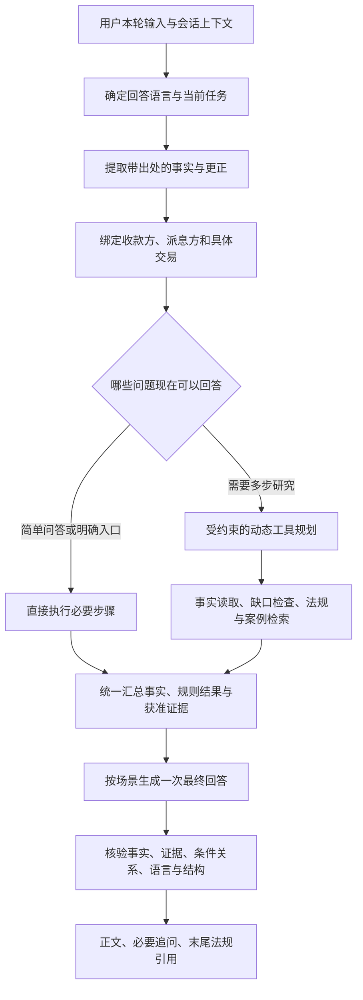

# Agent 回答质量优化方案

日期：2026-10-17。状态：核心流程改造已在本地实施，已进行真实网页回归；完整多交易数据模型、全量质量评测和税务专业验收仍未完成。实施范围、证据及限制见 [实施记录](2026-10-17-answer-quality-implementation.md)。本文件保留为目标方案，不代表每项验收都已通过。

## 目标与证据

主要目标：回答准确对应用户的问题与当前交易，事实不补猜，结构按任务变化，内容不重复，法源可核对，英文提问全程得到英文回答。

依据两轮独立测试：后端使用临时 SQLite 的23条案例评测；随后通过本地网页实际输入相同20条对话和3个完整业务案例。前一轮的13条基本达到、4条部分达到、6条明显问题，仅属于该后端单次人工评阅，不能当作网页通过率，也不能当作税法准确率。网页结果与后端有差异，验收以网页实际交互为必要环节。

关键网页证据：

| 场景 | 网页实测结果 | 会话 |
|---|---|---|
| T09 参与豁免 | 两组近义解释整段重复，来源列表也重复 | http://127.0.0.1:8000/#1bc157d0-bc00-4f61-82ef-38d26b9bf126 |
| T14/T15 更正与汇总 | 明确将20%改为3%，仍记为冲突；显示内部枚举与字段迁移说明 | http://127.0.0.1:8000/#4e8f9aec-bdca-4da1-97f1-99943b7dfdd2 |
| T20 方案与材料清单 | 用户已提香港公司，仍问查哪个地区，没有交付清单 | http://127.0.0.1:8000/#eeab07d7-c60c-43fe-8f9a-3233ebf33c3c |
| B01 新加坡股息 | 月份补成每月1日；多个缺口清单重复；直接断言实体类别 | http://127.0.0.1:8000/#6e9dbf91-e495-44d4-acb8-c3ad6ec891d0 |
| B02 内地股息 | 补猜日级日期，混合中英文摘要，调度停止后没有完整业务解释 | http://127.0.0.1:8000/#fca39091-6185-4238-8a53-a18b72128ed3 |
| B03 两笔拟议股息 | 将新加坡派息方与日本公司22%持股混在一起，未先区分两笔交易 | http://127.0.0.1:8000/#0981afe1-639b-4d38-a48f-42413aceef2e |
| T17 网页连接 | 出现认证不可用、存储不可用，页面重试后取得答案 | http://127.0.0.1:8000/#6a8d83f6-76a8-4475-9e20-9eaaeb407279 |

网页部分快照与截图保存在 Git 忽略的 `data/local-setup/`。已有评测报告记录了更多案例。引用存在和引文逐字匹配不能证明法律推理正确，条件关系仍需要专门复核。

## 目标流程：工具提供材料，统一生成最终回答

复杂业务推理保留可审计的领域规则计算。模型可以选择需要读取或查询的材料、解释条件、组织回答；事实确认、分析授权、来源许可和最终复核仍由服务端控制。

## 一、先修复事实和交易绑定（P0）

### 1. 保留事实来源与日期精度

- 每项抽取事实记录用户原文片段、所属交易、事实类型、精度与状态。用户陈述、假设、模型推断和法律判断不能混为同一种事实。
- “August 2025”保存为年月级信息，不得写成 `2025-08-01`。第一阶段可将其保留为精度明确的上下文记录，不填写必须为日级 ISO 的既有规则字段；后续增加完整的部分日期类型。
- 只有规则确实需要具体日时才追问。不得用收取日期推算累算日期，也不把计划付款保存为已发生付款。
- 人员、办公室和“投资控股公司”等描述不能自动生成纯股权持有身份、实质充分性或税务居民资格的最终判断。
- 取值虽然格式合法，但找不到支持其数值、精度或主体的原文时，应退回待核对状态。

验收：B01/B02无新增日级日期；原文未明确的直接持股关系和实体分类不自动填入。

### 2. 将更正与矛盾分开

- 对“刚才说错了，只持有3%，不是20%”识别为针对本次交易持股比例的明确更正，更新当前值为3，旧值留在历史记录。
- 保留字段关联与原文校验，补充“持有”等实际表达；不能仅看到“改”就允许任意字段覆盖。
- 真正出现主体不明、多个候选值、多个交易或缺乏明确更正意图时才提出澄清。
- 修订使依赖旧事实的确认及报告失效，保留原有审计机制。

验收：T14记录3%；T15按3%汇总，其他事实保留。模糊冲突仍需澄清。

### 3. 引入明确的交易上下文

- 每笔交易绑定收款方、派息方、持股关系、日期与资金路径。对B03先拆分日本→新加坡、新加坡→香港，再按用户目标决定研究对象。
- 100%和22%绑定各自股权关系，不能因为共用集团背景而互相覆盖。
- 用户要求“先区分两笔交易”时先交付区分，不应先启动一整套单交易访谈。
- 未能确定规则判断对象时，可先整理两笔交易的已知与待定事项，再追问哪个对象需要深入分析。

验收：B03明确显示两笔拟议付款，不把新加坡派息方与日本公司22%股权拼成一笔交易。

## 二、统一回答语言，英文提问全部用英文回答（P0）

增加服务端确定的 `reply_locale`，与前端界面语言 `ui_locale` 分开。确定顺序：

1. 用户明确指定的本轮输出语言，例如“请用英语回答”。
2. 当前有实质内容的问题所用语言；英文问题即使在中文界面提交，回答也用英文。
3. “3%”“OK”等不足以确定语言的简短续答，继承当前会话的回答语言。
4. 仍无法确定时使用界面语言作为默认值。

同一个 `reply_locale` 必须传给路由、事实摘要、缺口检查、澄清、规则解释、检索解释、失败提示和最终渲染。英文回答中的标题、列表、字段名、状态、人读枚举、引用说明和追问全部用英文。不能只翻译模型正文而保留中文模板。

法条编号、实体名称不因翻译丢失身份。中文法源默认作为独立折叠原文保留，英文回答正文用英语解释并链接出处；不得把英译文本冒充逐字原文来做引文校验。用户明确要求展示原始中文时按该明确要求处理。

语言检测只处理正常输入和用户明确要求，不因法条原文、被引用的历史消息或一个中文公司名称改变回答语言。前端语言按钮也不应被回答语言自动改写。

验收用例至少覆盖：英文问题+中文界面；中文问题+英文界面；英文追问接中文历史；中文追问接英文历史；英文错误、范围说明与事实摘要；明确指定语言；数字续答；英文问题引用中文材料。

## 三、优化编排与工具职责（P1）

### 1. 按用户目标选择流程

- 问候、明确事实更正、单一日期追问不增加无关工具步骤。
- 三个按钮作为起点，用户后续自然语言可以补充事实、转换任务或提出独立法规查询。
- 对T04/T20等先利用已有香港、公司等明确上下文；只有真正缺少且影响回答的信息才追问。一次优先问1—2项，必要时不超过3项。
- 事实不足不代表无法回答一般规定或给出有条件的材料清单；正式个案结论与一般研究答复使用不同的前置条件。
- 保留用户明确提出的多个子问题和完成状态，防止工具成功但任务遗漏。

### 2. 工具返回结构化材料，不返回可直接拼接的完整答案

- `read_case_facts`返回事实记录，`check_fact_gaps`返回当前目标相关缺口；二者不分别输出两份用户可见清单。
- 法条、指引和案例检索返回获准的证据、来源身份、定位、期间及覆盖说明。法条编号、Case 68的来源标题与资料类型使用已经核实的来源元数据，不让模型根据缺少标题的正文猜其身份。
- 规划器继续只读取完成状态、证据数量和缺口等必要观察，不把资料正文当指令。
- 检索结果按来源、版本、定位和文本标识归并。多工具取得同一条文时保留不同工具的追溯记录，用户界面展示一份来源。

### 3. 查询范围使用独立约束

- 法域、主题、明确案例/法条编号、适用期间、交易关联作为结构化约束维护，查询措辞可以在这些约束内变化。
- 不简单要求所有查询中的数字与原句完全相同，也不因合法同义改写直接终止；确实引入新法域或新案例仍拦截。
- B02的拒绝原因先补足诊断：记录实际提议、期望约束、触发哪项检查。当前只有`tool_scope_rejected`不足以确认是模型越界还是误拦，不能直接放宽校验。
- 可恢复的同范围参数错误最多修复一次；无法修复时保留已完成材料并说明尚未回答的部分。

### 4. 预算为最终回答留出空间

先保留现有45秒、4次工具动作、3次检索和真实回答路径6次模型调用的上限，在分配时预留一次最终生成调用及可配置时间窗口。证据足够就停止扩展，不为增加调用次数反复查同一问题。

把当前“每次检索各生成一份答案”的生成开销移到最后统一生成，有望改善重复和资源分配；具体耗时变化必须用同组案例实测，不能预先当作性能收益。

## 四、一次生成、集中校验、统一渲染（P1）

最终生成器读取：当前问题、已明确绑定的事实、任务完成状态、领域规则结果及获准入模的官方原文。输出结构化段落及支持证据，再由程序渲染。

每条回答内容注明属于直接答复、用户事实、条件式说明、待确认信息或下一步。需要法律依据的内容必须附可核对证据；用户事实不伪装成法源，普通澄清也不为凑格式补引用。

集中检查：

- 是否回答了当前问题和明确子问题，而不是输出工具日志。
- 是否把不同交易、不同事实精度或用户未提供的信息写成已知。
- 是否重复表达同一结论、列出两份同义缺口清单，或同时呈现被替代的失败结果和成功结果。
- 豁免、经济实质、参与要求和抵免等条件关系是否前后自洽；逐字引文验证继续保留，不能将其视作推理正确性证明。
- 是否存在内部字段、迁移说明、枚举值、原始列表字符串或调度术语。
- 是否全程符合本轮回答语言，且引用确实位于最终正文末尾。

优先用结构化约束和规则做检查。模型复核只针对复杂条件关系或被检测到的问题，在同一预算内最多一次局部修复，不添加无限自我反思循环。

核验失败时保留可支持的部分，简短说明剩余部分未能查证。需要展示摘录时选择与问题相关的完整句段，原文按原样保留并可展开；不再默认把前500字符硬截断作为主回答，不将两个互相替代的版本并列展示。

所有追问、限制和未完成事项在渲染前合并进正文；最后统一追加引用，禁止之后再追加调度提示。

## 五、按场景约定输出结构（P1）

| 场景 | 主要结构 | 篇幅原则 |
|---|---|---|
| 一般概念、简单是非 | 直接回答 → 必要条件/例外 → 依据 | 默认1—3段，不输出完整事实表 |
| 境外股息个案咨询 | 当前能判断什么 → 关键事实及条件 → 缺失信息与下一步 → 依据 | 不确定之处就地说明，不把整份字段字典铺出来 |
| 梳理事实 | 已记录/已更正事项 → 影响本次目标的缺口 → 下一项追问 | 事实表只放用户需要核对的信息，金额与币种一并展示 |
| 法条、裁定、日期查证 | 找到的条文/案例/日期 → 与问题相关的原文 → 简短解释及适用限制 → 依据 | 精确请求优先给精确内容，不用长篇税制介绍替代 |
| 方案与材料清单 | 可研究的路径 → 各路径所需材料及用途 → 仍待确认/专业判断 → 依据 | 材料清单回答“准备什么、用来核对什么”，不承诺最终免税 |
| 资料不足、超范围、临时失败 | 哪一部分无法确认 → 已能提供的帮助 → 一项可执行的下一步 | 不整段拒绝所有问题，不显示内部错误码 |

不用固定的六七个标题套所有问题。内容简单时直接用自然段，真正需要对照时才用表格。复杂答复通常保留3—4个有内容的区块，不填空标题、不重复总结。

英文结构示例：`What we can say now`、`Facts to confirm`、`Next steps`、`References`。只保留当前场景需要的区块，不能在中间再插入中文“已提供的信息”“待补与待核对”。

## 六、网页展示与连接体验（P2）

- 为每个事实字段增加独立的中英文展示名和枚举文案，不再把开发描述当标签。数组展示为列表，金额格式统一，月份显示为月份。
- 统一去重后的来源卡片；精准问题展开对应的句段或日期片段，避免仅列大量条款按钮。
- 对页面连接故障区分认证、存储、模型、检索四类错误；定位真实原因后设置有限重试，不把它们算作模型回答质量不合格。
- 重试保留原输入和请求标识，利用既有幂等语义避免重复消息或重复写入。只对确认可重试的故障自动重试；失败说明使用本轮回答语言或尚无会话时的界面语言。
- 每次网页测试记录输入、可见回答、会话链接、截图和失败/重试状态。不得把临时SQLite评测结果替代网页实测。

## 实施顺序与代码落点

| 批次 | 改动 | 主要落点 | 完成条件 |
|---|---|---|---|
| 第一批 P0 | 回答语言独立解析；日期来源/精度；明确更正；交易绑定 | `packages/chat/service.py`、`packages/chat/facts.py`、`packages/agent/dialogue.py`、会话状态及请求契约 | 英文问题不出现中文生成内容；T14/T15、B01/B02/B03关键事实通过 |
| 第二批 P1 | 工具结构化结果、任务覆盖与范围约束、最终生成预算 | `packages/agent/hybrid.py`、`tool_harness.py`、`tools.py`、`policy.py`、`task_state.py`、`budget.py` | 工具结果不直接拼成回答；合法查询可续行；重复检索和越界仍受控 |
| 第三批 P1 | 场景回答计划、单次整合、集中校验、引用末尾 | `packages/agent/grounded.py`、`knowledge.py`、`responses.py`、`packages/chat/answers.py`、`expenses.py` | T09/T11不再整段重复；缺口只列一次；全部回答分支语言一致 |
| 第四批 P2 | 字段展示、来源卡片和连接重试；完整网页验收 | `apps/web/src/workspace.ts`、语言资源、回答/来源组件、请求重试逻辑及相关API | 网页可读且无内部字段；失败可恢复；保留截图和逐条记录 |

部分工作存在依赖：语言契约和事实契约先确定；工具返回结构再确定；最终生成与前端使用相同契约，避免各层自行猜状态。P0不通过时不将复杂个案回答视为可交付。

## 验收与回归

1. 将本次失败内容转为固定的回归用例，包括明确的原文、期望事实和禁止补猜值；有意义的测试检查业务结果，不仅检查trace包含哪个节点。
2. 原20条对话及3个完整业务案例在网页重新运行，保留原来的会话顺序。增加语义等价的中英文配对，不修改原始案例来迎合实现。
3. 增加英文问题+中文界面的全链路测试：普通问答、事实更正、汇总、缺口、未找到、超范围、工具失败和引用回退。数字续答继承语言，明确语言切换及时生效。
4. 对P0高风险用例及复杂业务案例重复运行，检查模型波动；后端定向回归与真实网页测试分开报告。
5. 增加只读证据契约、事实确认、专业复核、幂等、重复工具阻断、预算耗尽与已完成结果保留的回归，防止为了可读性破坏已有约束。
6. 条件关系、交易主体与税务结论由领域规则检查和专业人员抽查；不把模型自评或引用存在作为唯一评分。

发布门槛：本次年月补日、更正失败、交易混淆等P0样本全部通过，人工核对中不再出现虚构事实；英文配对用例所有生成区块均为英文；T09/T11无重复结论和重复来源；所有有法源的正文以引用结束。整体案例“主要诉求完整达到”目标不低于90%，这是后续验收目标，并非当前成绩。对暂时无资料可回答的场景，完整交付是说明限制与有效下一步，而非编造答案。

同时记录回答切题率、事实一致性、语言一致性、引用/支持关系、重复段落、追问必要性、任务覆盖率、整轮耗时、模型调用数和网页连接成功率。连接错误、资料覆盖不足与模型内容错误单独统计。

本方案先提升事实与交付质量，再根据同组测试结果决定是否调整规划步数、模型调用上限或增加更多Agent角色。当前不以增加Agent数量作为质量改善的前提。
