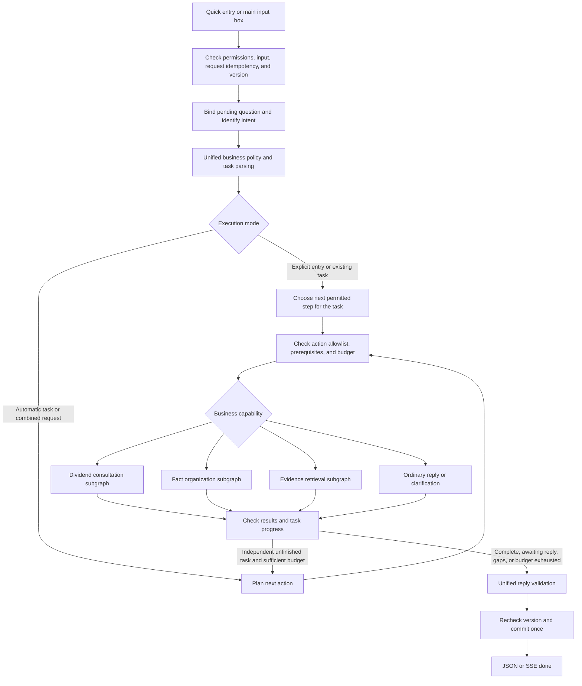

<a id="b三个业务入口与自由对话的统一编排开发方案"></a>

# B: Unified Orchestration Plan for Three Business Entries and Free Conversation

Date: 2026-10-03. **Design and initial execution record: engineering/local integration complete; actual model, C, and PostgreSQL acceptance pending.** Changes were uncommitted/unpushed; section 17 records scope.

Based on local `feat/b-agent-workflow`. A owns pages/interactions; B Agent/workflow/interfaces/validation; C corpus/rights/retrieval. Scope remains Hong Kong corporate foreign-sourced dividend FSIE research. Advisors intervene only finally.

<a id="1-目标与验收范围"></a>

## 1. Objectives and acceptance scope

Shortcuts select default workflows; main input automatically interprets messages, pending answers, mixed tasks, and next steps within budget. Both use the same components, case state, and rules.

Fixed workflows mean fixed business steps/prerequisites, not fixed questions: skip knowns and adapt to goals. Free conversation chooses registered actions dynamically, with program-enforced permissions/evidence/fact/review gates.

Deliver entries/contracts/tasks/routing/three subgraphs/bounded scheduling/fallbacks/acceptance. Exclude general multinational rules, multitransaction graphs, arbitrary code/SQL, background jobs, automatic approval, and freely generated long tax reports. Retain verifiable extracts/templates so dynamic routing does not expand output capabilities.

<a id="2-核查基线哪些已有哪些新增"></a>

## 2. Audited baseline and additions

| Capability | Existing implementation | This round |
|---|---|---|
| Shortcuts | workspace.ts presets; App.tsx fills input only | Entry hints, A wiring, old-request compatibility |
| Intent | service.py turn_prompt/validate_turn: chat/research/intake/clarify/unsupported | Retain five intents; task parsing supplements validation |
| Turn graph | workflow.py route→facts→retrieve→compose→validate | Shared nodes, subgraphs, scheduler |
| Interviews | dialogue.py guided-intake-0.2 | Retain fields/unknowns/conflicts/pause/partial rules; task ownership |
| Retrieval | contracts/providers/knowledge; Mock/legacy/C | Shared budgets/deduplication/task context |
| Analysis/review | ChatService.confirm/run/review, analysis.py, review.py | Retain admission; write-free steps avoid nested commits |
| Persistence | ChatStore JSON/revision/receipts | Add states/receipt hashes, one authority |
| Dynamic loop | Not implemented; code routes after classification | Bounded propose/check/execute/observe |
| 47 BR rules | Documents/config, some Python behaviors | Trace groups without claiming a complete DSL |

This is the prechange baseline: 199 Python tests, including 42 guided tests, and 20 browser cases with retests. Section 17 records additions. Engineering results are not actual model/C/professional acceptance.

<a id="3-技术选型与总体结构"></a>

## 3. Technical architecture

- Retain FastAPI, Pydantic v2, model adapter, SQLAlchemy, pinned LangGraph; no dependency upgrades for refactoring.
- Parent graph handles admission/routing/scheduling/precommit checks; three subgraphs execute tasks.
- Harness is B's action/context/budget/deduplication/recovery/tracing module, not another purchased framework.
- Existing structured JSON adapter supports planning; native calls may follow without provider switches/arbitrary discovery.
- One case transaction per completed turn; waiting saves tasks/questions and ends HTTP, without another checkpointer.

LangGraph supports workflows/agents/subgraphs. Wrap subgraph I/O so children cannot arbitrarily mutate global state: [workflows/agents](https://docs.langchain.com/oss/python/langgraph/workflows-agents), [subgraphs](https://docs.langchain.com/oss/python/langgraph/use-subgraphs).



Full drafts pass admission/report validation before sole final review. Chat, source summaries, and fact lists are not automatically submitted/approved.

<a id="4-分清四种概念"></a>

## 4. Four distinct concepts

| Concept | Field/values | Meaning |
|---|---|---|
| Entry hint | auto/dividend_consultation/fact_intake/reference_lookup | Current entry, not facts/analysis consent |
| Intent | chat/research/intake/clarify/unsupported | Existing message classification |
| Task | consultation/fact_intake/reference_lookup | Ongoing objective; greetings need no task |
| Case goal | scope/receipt/participation/substance/full_analysis | Required facts/rules in the existing fact system |

Do not overload mode with all meanings. auto retains tasks. Send entry_hint on shortcut-triggered initial send, then server tasks provide continuity.

A may retain the Foreign Dividends label or rename it Dividend Consultation. It maps to dividend_consultation without writing income/company/Hong Kong/full_analysis facts. Only topic may be preselected; facts require user statements.

Edits clear hints; if A retains a selected task, show it explicitly. New instructions override stale hints; ambiguity gets one scope question.

Dedicated source search bypasses free-conversation planning; free input here means the main chat.

<a id="5-统一意图识别与决策顺序"></a>

## 5. Common intent/decision order

All entries apply the same order, using deterministic clear controls and validated model interpretation otherwise:

1. Check access/model consent/length/receipts/revision before model/C calls.
2. Read task/active pending/facts/frozen report. Exact replies bind only valid unpaused questions; same field/new ID does not accept old cards.
3. Identify pause/resume/partial/correction/new-case/switch/mixed intents; create validated uncommitted patches.
4. Resolve tasks: explicit instruction, valid pending response, initial hint, task context, then clarification. Greetings/thanks do not cancel tasks.
5. Separate actual case statements, general inquiries, hypotheticals. Only explicit current-case facts enter patches, never reference cases/buttons/retrieval.
6. Calculate task dependencies; conflicts block dependent tasks only. Independent sources continue.
7. Check scope/required facts/coverage/versions before actions.
8. Aggregate, ask at most one main question, then stop; models must not answer it themselves.

**Refinement:** old conflict+research usually deferred the whole query. Now uses_case/dependencies distinguish case-specific suspended queries from independent retrieval, optionally adding one conflict question to the final response. Do not indiscriminately replace all conflict handling.

uses_case is model-proposed/program-validated. Apply case filters only for explicit current-case references or bound tasks. Independent identifiers inherit no old dates/amounts/identity.

<a id="6-三个业务子图"></a>

## 6. Business subgraphs

<a id="61-股息咨询-consultation_graph"></a>

### 6.1 consultation_graph

Entry → general/own-case distinction → retrieval for general questions; identification/goal-specific facts for cases → questions/preparation → evidence → answer/draft.

- Concepts/catalogs need no four-field interview; specific rules/rates/conditions require retrieval.
- Reuse four identification fields for own cases, then descriptions. Identification is not eligibility.
- Missing facts trigger one question. Explicit partial summaries list facts/gaps; incomplete reports still need partial_consent and confirmation.
- Analysis requires explicit request, latest `/confirm`, sufficient dependencies or accepted gaps. Shortcuts/ordinary agreement/model judgments cannot substitute.
- Only Hong Kong corporate dividends are implemented. Explain unsupported individuals/income/jurisdictions while continuing supported independent subtasks. General queries remain limited by C coverage, not global by default.
- Preserve support/opposition and professional open matters for final review; without advisors remain pending.

Finish with a validated answer or explicit waiting/confirmation/gap/final-review status, not an endless attempt to satisfy every case condition.

<a id="62-事实整理-intake_graph"></a>

### 6.2 intake_graph

Entry → general checklist versus own case → candidates → correction/conflicts → goal gaps → one question → persist/list.

- General preparation gets a checklist; specific statutory requirements need citations, not a personal interview.
- Own fact lists show statements/sources/unknowns/deferred/conflicts/impacts; eligibility/adequacy remain candidates.
- Retain cash/noncash, actual/planned, tax descriptions; no unsupported thresholds.
- Save all valid volunteered fields, ask one next item. unknown never no/0; unavailable material deferred.
- At most two active displays per question in the same valid task/fact context. Explicit resumption may redisplay without meaningless penalties.
- Organizing does not analyze or confirm automatically. Offer fact checks before deciding analysis.

Finish with the requested summary, organized facts awaiting checks, or waiting. Early stopping permits a gap-marked summary, not complete analysis.

<a id="63-依据检索-reference_graph"></a>

### 6.3 reference_graph

Entry → query/scope → necessary clarification → C → rights/applicability → coverage → extracts/citations/gaps.

- Ask only necessary jurisdiction/topic/identifier/period. Overviews may lack transaction dates; no company/amount/ownership form.
- Clarify jurisdiction for generic dividends. Explicit Hong Kong/topic supports public search but cannot become client facts.
- Existing SearchRequest HK/dividend defaults require a new scope-validating builder. Other jurisdictions must not inherit defaults; unsupported Provider coverage is a gap.
- Independent uses_case=false; case queries send only approved filters, not all 53 fields/history.
- Enforce separate display/model rights. Display-only originals or derivative summaries must never enter planner, summary, history, or observations.
- First no_match permits one in-scope keyword rewrite, never altered jurisdiction/entity/period/identity. Rewrites do not bypass rights/version failures.
- Output points, applicability/conditions, citations, gaps. Extracts/templates are not mature generated legal interpretation.

Finish with usable sources, explicit gaps, or technical errors, not a full interview by default.

<a id="7-harness-的动态动作与执行限制"></a>

## 7. Harness actions and execution limits

Models receive filtered context/allowed_actions and propose structured next steps. Pydantic and policy revalidate. No direct Python/SQL/arbitrary URL/database writes.

| Action | Prerequisites | Result/stop |
|---|---|---|
| reply_chat | Chat/help without evidence-required tax claims | Validate/end |
| clarify_request | Ambiguous task/scope | One question/end |
| collect_facts | Own case or explicit supplement/correction | Patch/gap/question proposal; stop when asking |
| lookup_reference | Explicit supported query | Filtered results; one justified additional lookup |
| prepare_analysis | Explicit draft request | Route missing confirmation to A; never call confirm |
| run_analysis | Latest confirmation/request/scope/consent/budget | Shared write-free analysis, validate pending-review draft |
| finish | Results or explicit disposition for tasks | Common validation/commit/return |

pause/resume/new_case are validated user controls, primarily deterministic, not arbitrary model actions. review/approve are unavailable tools.

Do not allow run_analysis until refactored; use existing `/confirm`/`/analyze`. Calling current ChatService.run inside graphs risks nested transactions/stale revision commits.

Stop on answer, user wait, confirmation, unsupported/restricted scope, no new evidence, budget, unrecoverable failure. Continue only with a concrete actionable unfinished subtask, not model claims that more work could improve things.

<a id="8-运行预算上下文与去重"></a>

## 8. Budgets, context, deduplication

Initial defaults require actual model/C measurements; not performance promises. Fixed/auto share budgets, never reset by subgraphs.

| Item | Initial limit | Exhaustion |
|---|---|---|
| External work | 45 seconds; reserve ~5 for commit/response before JSON client's 65-second timeout | Cancel interruptible work, validated results/remaining items |
| Models | 4 total, including parsing/planning/one repair | Deterministic finish, no reset |
| Per-model time | min(configured, remaining), adjusted after 2026-10-04 timeouts; turn remains 45 seconds | model_failed; retained steps per section 11 |
| Action dispatch | 4 total across subgraphs/analysis | Persist pending/end |
| Mixed tasks | 3 sequential | Ask priorities, retain excess descriptions |
| Actual searches | 3 including initial/rewrite/retry | Distinguish final no-match/failure |
| Same-query retries | 1 within search/time totals | Recoverable failure; no rights/contract retries |
| Original reads | 14 by reference/purpose, including analysis | Explicit gaps |
| Search time | min(default 3000ms, remaining); reads get real client timeouts | Check during calls, not before only |
| Main questions | 1 per response, at most 2 active attempts per item | Unknown/unavailable immediately offers choices |
| Report revision | BR-35 two rounds, BR-36 one simplification; no new free-generation repair | No cycle-budget reset/failed drafts |

recursion_limit is an exception guard, sized/tested for legal graph paths; existing 10 is not a model/search budget.

Pass budgets through nested analysis/related_rulings; wrappers count all Provider calls. Cancel not-started steps. Running synchronous work that cannot stop immediately must not commit or trigger more work after cancellation.

Same-turn keys include owner, case_id where relevant, snapshot, scope, normalized query, dates, filters, purpose. Reuse successful matches; retries consume remaining quota. Cross-turn caching is off initially; future cache validates corpus/policy versions/references.

Planner context contains necessary history/tasks/allowed facts/question/results. Display and model originals have distinct projections. Retrieved instructions cannot change modes/approve/ignore rules. Log actions/reasons/time/versions/IDs, not hidden reasoning/unapproved originals.

<a id="9-任务状态与等待恢复"></a>

## 9. Tasks, waits, recovery

Facts remain Case.facts, questions Case.dialogue. Case.orchestration stores control/summaries only, not independently editable duplicate facts/pending.

```json
{
  "orchestration": {
    "schema_version": "0.1.0",
    "active_task": {
      "id": "server-task-id",
      "kind": "fact_intake",
      "status": "waiting_user",
      "origin": "shortcut",
      "uses_case": true,
      "facts_hash": "server-computed",
      "pending_question_id": "existing-dialogue-question-id"
    },
    "suspended_task": null,
    "queued_tasks": [],
    "last_run": {
      "request_id": "uuid",
      "status": "waiting_user",
      "reason_code": "fact_collection",
      "policy_version": "hybrid-0.1",
      "actions": ["collect_facts"]
    }
  }
}
```

Task states: active/waiting_user/waiting_confirmation/paused/completed/blocked_gap/failed. Analysis retains report review status. Keep A's top-level workflow enums, adding task_results details rather than unknown blank UI states.

One active/one paused, mixed queue at most three; no unlimited stack. Explain switches/retain summaries; ask priorities for a third ongoing task. Queues are conversational next steps, not background execution.

pending binds task_id/question_id/revision/related snapshot. Revision changes recheck dependencies; chat alone must not invalidate questions. partial_consent binds fact hashes and lists all gaps; modes do not expand consent.

Resume priority: valid active answer → explicit resume/retry → switch → independent interruption → chat. Isolated yes/unknown after pause never fills old facts. Clear complete fact descriptions may resume subject to correction/conflict checks.

<a id="10-a-的接口与页面衔接"></a>

## 10. A interfaces and pages

<a id="101-请求扩展"></a>

### 10.1 Requests

Extend the same JSON/SSE message endpoint optionally:

```json
{
  "revision": 12,
  "request_id": "00000000-0000-4000-8000-000000000001",
  "text": "Help me organize the facts of this dividend.",
  "data_approved": true,
  "entry_hint": "fact_intake",
  "reply_to_question_id": null
}
```

Missing entry_hint means auto with current tasks intact. Cards send valid reply_to_question_id; stale IDs require alignment without writes. Free text may still parse strictly against active pending.

Receipt hashes include text/entry_hint/question ID/data approval/operation. Same ID/payload returns committed results without external calls; different payload gives 409 request_payload_conflict. Preserve original text/hints on retry; edits use new IDs.

<a id="102-返回扩展"></a>

### 10.2 Responses

- Case.orchestration for recovery; Message.question adds task_id.
- workflow.entry_hint/effective_task/policy_version records intended/actual routes.
- task_results has kind/status/reason_code/result_ref for facts-saved/query-failed combinations.
- Questions keep top-level waiting_user; retrieval causes remain in research.reason_code/retrieval_reason_code. error_code/retryable must not disappear behind questions.
- JSON/SSE done are authoritative. No unvalidated streaming. Optional progress states queued/running/tool_finished require A compatibility first.

A adds hints/stale-hint clearing, original retry payload, task/resume UI, one question, partial successes, existing confirmation/analysis controls without redesigning layout.

<a id="103-分析与确认"></a>

### 10.3 Analysis/confirmation

Independent `/facts`, `/confirm`, `/analyze`, review routes apply identical policies. Share analysis_eligibility, not looser duplicated gates.

Fact confirmation, partial consent, model data consent, and report approval are distinct. Main chat may request analysis; initial confirmation remains an explicit existing UI action. Contextual agreement is not `/confirm`.

<a id="11-写入并发取消与兜底"></a>

## 11. Writes, concurrency, cancellation, fallbacks

Subgraphs propose results only. commit_prepared atomically saves valid patches/tasks/messages/conflicts/receipts. Claim saved only after commit.

| Situation | Behavior | Return/persistence |
|---|---|---|
| Initial model/JSON failure | No facts; one budgeted repair | model_failed/model_not_configured; keep draft |
| Later planner failure after valid steps | End loop, deterministic summary | Valid patch may commit, partial_failure, explicit unexecuted tasks |
| Missing/unknown/deferred | One question/impact/options | waiting_user, never C guesses of client facts |
| Conflict | Preserve both, block dependencies | Independent retrieval continues |
| no_match | One rewrite, then gaps | Normal business reply, not fake outage |
| C timeout/unavailable | Bounded retry, no Mock | Pure queries knowledge_unavailable; mixed valid facts may commit with partial_failure |
| Unknown/denied rights, bad version/hash | Exclude/gaps | No broader identity/bypasses; separate rights |
| Conflicting evidence/judgment | Differences/conditions, suspend | Final review only |
| Unsupported | Specific notice, supported independent work | unsupported task, no HK defaults |
| Repeated action/no progress | Stop/reuse | no_progress, no new-ID budget reset |
| Budget | No new work, validated results/recovery | budget_exhausted, not full completion |
| Concurrent changes | Reject stale snapshot/reload | 409, no overwrite |
| Cancellation/disconnect | No precommit writes/more work | Resolve commit race through request_id; no rollback promise |
| Changed facts | Conservative invalidate, later finer dependencies | Retain report, no approval reuse |
| Invalid reports | Remove unsupported content, bounded BR-35–37 | No advisor substitute for program validation |

A precommit crash makes no intermediate-save promise; replay can recompute. Postcommit replay reads receipts. Cross-process per-tool recovery needs a separate run ledger; one final commit is not incremental durability.

<a id="12-既有-47-条业务规则的继承矩阵"></a>

## 12. Inheritance of the 47 business rules

Policy returns rule_id/decision/reason_code/fact-version dependencies, not hidden reasoning. Preserve BR meanings; new rules use HY-*, without presenting JSON as an implemented DSL.

| Rules | Existing basis | New location/boundary |
|---|---|---|
| BR-01–03 | API/input/data rights | admission, all entries |
| BR-04–07 | Scope/identification; no general multi-issue packages | task_resolver/scope, supported subtasks only |
| BR-08–09 | No full DAG | Validate registered queue order/types, not arbitrary DAG |
| BR-10–15 | Pending/conflicts/gaps/confirmation | intake/admission, candidates/confirmed are not professionally verified |
| BR-16–18 | Provider/rules | reference/analysis common coverage/admission |
| BR-19–21 | review_tasks/output checks | analysis/validate, final review only |
| BR-22–25 | Single flow/partial drafts, incomplete general aggregation | At most three dependent tasks with explicit results/dispositions |
| BR-26–29 | Unknown/consent/corrections/versions | dialogue/task recovery with task/question IDs |
| BR-30–31 | Bounded retrieval retry | Shared nested budgets, no retry multiplication |
| BR-32–34 | Report versions/hashes/checks/review | Common pipeline |
| BR-35–37 | Full automatic revision/simplification absent | Retain limits, stop invalid templates without unrestricted repair |
| BR-38–41 | Reviewer/hash/approval gates | Final service, no mode bypass |
| BR-42–45 | Advisor editing/return UI incomplete | Retain final workflow plan, no intermediate human tasks |
| BR-46–47 | Invalidation/same-value avoidance | Conservative invalidation; same-turn reuse only, full source dependencies later |

HY-01 hints only; HY-02 active pending binding; HY-03 independent query isolation; HY-04 dependency-specific blocks; HY-05 shared budgets; HY-06 stop after one question; HY-07 subgraph proposals only; HY-08 idempotency; HY-09 rights across planning context; HY-10 task completion is not report approval.

<a id="13-c-接入与知识边界"></a>

## 13. C boundaries

Retain [KnowledgeProvider](../architecture/KNOWLEDGE_PROVIDER_CONTRACT_V0_1.md). B does not design C tables or connect browsers to databases. HTTP/MCP are Provider transports, not task/tax logic.

Retain schema_version=0.1.0 and five fact_filters. Keep task/budget metadata in B. New regions/filters need separately versioned agreements. Owner/case_id come from trusted server context, not models.

C acceptance covers jurisdictions/topics/periods, actual/planned/unknown, locations/versions/hashes, rights, retries, coverage, timing/deadlines. Mock is not actual acceptance; outages do not permit synthetic tax evidence.

<a id="14-文件落点与开发工作包"></a>

## 14. Files and work packages

Original packages below; section 17 records implementation. Actual subgraphs compile inside hybrid.py with shared methods, without a subgraphs directory.

| Phase | Locations | Acceptance | Dependencies |
|---|---|---|---|
| P0 contracts | task_contracts.py, old-intent/reply/receipt examples | Enums/priorities/state mapping/BR/HY review | Existing code |
| P1 tasks/entries | API/service/store, task_state.py | Entries/old requests/refresh/pause/bindings/idempotency | A buttons, API first possible |
| P2 shared/subgraphs | policy.py, proposed subgraphs/{consultation,intake,reference}.py, workflow.py | Same business results for equivalent button/auto paths, regression | P0/P1 |
| P3 bounded loop | harness.py/budget.py/Provider wrappers/parsing | Mixed tasks/lookups/budgets/no-progress/recovery | P2, controlled models first |
| P4 analysis/context | analysis_eligibility/write-free analysis, analysis.py/knowledge.py | Same dynamic/button gates, nested budgets/rights | P2/P3 |
| P5 A/evaluation | workspace.ts/api.ts/useWorkspace.ts/App.tsx/Welcome.tsx, datasets | JSON/SSE/entries/switch/failure/old cases/actual understanding | A/models; Mock C initially |
| P6 actual C/release | Contracts/timings/environment gates | Actual rights, PG concurrency/review, clear scope | C/permitted sources |

P0–P2 independently acceptable first, then P3. Until P4, planning may only prepare_analysis and guide buttons. Each stopping point must work with checks, not defer validation wholesale.

Estimated B work: P0–P2 3–4 days, P3–P4 2–3, P5 1–2, excluding A/C waits/model tuning/professional changes. P6 depends on services, no fixed date.

<a id="15-验收启用与回退"></a>

## 15. Acceptance, enablement, rollback

See [matrix](B_HYBRID_ORCHESTRATION_ACCEPTANCE_2026_10_03.md). Retain 199 backend/page paths; new tests target task/budget/rights risks, not implementation mirrors.

Separate controlled/Mock deterministic tests, actual-model understanding/extraction/choices, and actual C retrieval/versions/rights/applicability.

Freeze at least 60 synthetic multi-turn scripts covering all behavior groups, paraphrases, negations, mixed expressions. Two project reviewers agree actions; professionals judge tax conclusions separately. Record routing accuracy, clarification quality, erroneous writes, repeated questions, completion, P50/P95, calls. Target ≥95% routing and zero unauthorized approval/unknown-negative/boundary violations, not a production error guarantee.

Server switches: FSIE_AGENT_ORCHESTRATION=legacy|hybrid and FSIE_AGENT_DYNAMIC_PLANNER=false|true. Normal defaults legacy/false. Local launcher hybrid with actual planning disabled/controlled models. Browser/models cannot change switches.

Lazy-init old cases; preserve dialogue/facts/reports. legacy rollback projects active pending/deferred_query, retains unsupported tasks explicitly paused, and prevents isolated yes binding. Do not ignore new state, change Provider, overwrite facts, or approve reports.

Completion: all required initial matrix items pass, no core regression, accurate actual-model/C/PG status. Without model acceptance, dynamic planning stays test-only; without C, synthetic marking remains prominent.

<a id="16-与既有文档的关系"></a>

## 16. Related documents

- [Guided intake](B_GUIDED_INTAKE_DESIGN_2026_10_02.md): retain semantics, add task/dependency refinements here.
- [Field audit](B_USER_FACT_FIELD_AUDIT_2026_10_02.md): fact provenance/fields.
- [Business rules](../architecture/AGENT_BUSINESS_RULES_V0_1.md): preserve BR-01–47; section 12 maps implementation.
- [Workflow](../architecture/AGENT_BUSINESS_WORKFLOW_V0_1.md): evolve entries/scheduling, retain final review.
- [Original plan](B_AGENT_IMPLEMENTATION_PLAN_2026_10_02.md): historical results, hybrid separately recorded.

<a id="17-2026-10-03-首版执行记录"></a>

## 17. 2026-10-03 initial execution record

Workspace `Asia-Tax-AI-Agent-B`, branch `feat/b-agent-workflow`, based on `Zhihong-Wu@7054c45323abf7d63d9725f03f81dab892c98110`. Local changes uncommitted/unpushed.

| Package | Completed engineering | Pending |
|---|---|---|
| P0/P1 | entry_hint/question IDs/task projection/payload hashes/idempotency/old cases | Actual PG concurrency/deployment |
| P2 | Parent/three compiled graphs, shared facts/questions/retrieval/checks | Actual model expressions |
| P3 | Up to three parsed tasks, sequential independence, one no-match rewrite, budgets/reuse/pause | Online planning quality |
| P4 | Shared admission/write-free report_proposal, final gates, history/planner rights | Professional correctness/reviewer assignment |
| P5 | A entries/hint clearing/retries/recovery/multiple results/failures/JSON-SSE | Actual multi-turn frozen set |
| P6 | C adapter/contracts/fixtures/read deadlines/size limits | Actual C semantics/coverage/timing |

New `packages/agent/{task_contracts,task_state,policy,hybrid,harness,budget,analysis_policy}.py`; integrated service.py/streaming.py/API and existing A components. Begin with `docs/implementation/B_AGENT_LOCAL_RUN_AND_HANDOFF.md`.

Entries map to dividend_consultation/fact_intake/reference_lookup; main auto. Hints never become facts/consent. Preparation questions are not actual cases. One question then stop, skip knowns, distinguish unknown from no.

Dynamic scope is bounded task selection/additional retrieval. Initial parsing proposes three tasks; later actions finish/lookup_reference/prepare_analysis, checked by code, with actual additional search limited to one no-match rewrite. Preserve jurisdiction/dates/numbers/cases; no confirmation/approval. One active/one paused/bounded queue, ask focus on overflow rather than overwrite.

Turn limits: 45 seconds, 4 models, 4 actions, 3 searches, 14 reads including nested analysis/repairs/retries. Per-model maximum 15 seconds in this execution record; C search uses request deadlines, reads max 1 second. Chunk reads check duration/2 MB. Same-turn scoped retrieval reuses results; safe observations omit originals. Synchronous deadlines are not process-level cancellation; deployment needs gateway/database timeouts.

Independent queries omit case conflicts/filters; dependent tasks resolve gaps first. Mixed valid facts may save after search failure with partial_failure; pure failures remain technical errors. Retain initial valid answers, multiple bundles, unfinished tasks; one rewrite must not replace the entire response. Keep prior fact/consent/version/review constraints.

Validation:

- `.venv/bin/python -m pytest -q -m 'not integration'`: **256 passed, 11 deselected**, comprising 54 hybrid + 3 deadline + 199 original.
- Full Playwright under `FSIE_TEST_ORCHESTRATION=hybrid`: **25 passed**, including 5 entry/retry additions.
- TypeScript/Vite and whitespace checks passed.
- Safe configuration check found no actual model. No online calls; controlled planning outputs only. No real C; 11 real PG tests not run.

Not a declaration that every H01–H54 layer passed. Actual understanding/questions/decomposition/planning, C rights/versions/coverage, and professional correctness require external acceptance. Normal legacy/false retained; manual pages test engineering. Answers remain extracts/conditions/gaps, without long generated legal explanation or a general 47-rule DSL.
