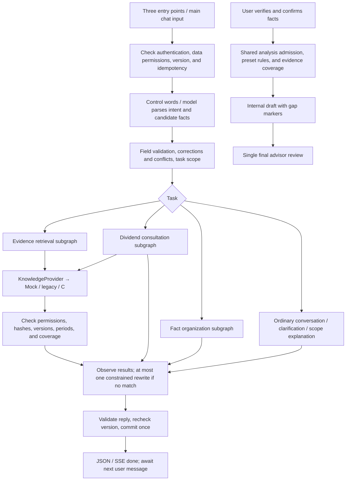

<a id="b-模块交接agent业务规则与-ac-联调"></a>

# B Module Handoff: Agent, Business Rules, and A/C Integration

Updated: 2026-10-04. Owner: Zijian (B). Branch: `zijian-Luo`.

Team entry point for implemented workflows, operation/integration, and joint decisions. Historical designs/rules/acceptance remain linked below. Delivery is a Hong Kong corporate foreign-sourced dividend FSIE research prototype. All professional open matters go to **one final advisor review stage**.

<a id="1-分工与交付范围"></a>

## 1. Responsibilities and scope

| Member | Responsibility | Cooperation needed |
|---|---|---|
| A | Frontend/authentication/interactions/state | Preserve messages, send entry/question IDs, show facts/citations/gaps/failures; later review/upload pages |
| B | Orchestration/rules/questions/outputs/review | Validate candidate facts/tasks, call C, check results, persist cases |
| C | Corpus/laws/cases/index/retrieval/rights/versions | Confirm/implement KnowledgeProvider with locations, versions, permissions, applicability, gaps |

Delivered: shared LangGraph parent/three subgraphs, bounded scheduling, identification, goal-based questions, conflicts/corrections, replaceable retrieval, structured extracts, frozen reports/final API, A compatibility, multi-turn evaluations. A receives necessary wiring only; B neither owns frontend design nor C database schemas.

<a id="2-当前能力与证据边界"></a>

## 2. Capabilities and evidence limits

- Engineering runs with model/Mock doubles. Actual model evaluations retain production parser/LangGraph/API; identity/C retrieval alone are synthetic.
- After A merge on 2026-10-04: 286 Python passed, 11 actual PostgreSQL not run; 26 page tests, TypeScript/Vite, knowledge package passed. Later PR records govern changed counts.
- Free models handled some conversations/language switching/extraction/questions. Continuous workflows remain rate-limited/timed out; mixed corrections exposed failures. **No complete actual-model workflow pass; engineering regression is not online acceptance.** Failures: `evals/b_workflow/runs/`.
- Actual C/quality/full database deployment/cross-account review/professional correctness remain pending.
- 47-rule JSON is a design baseline partially implemented as Python policy, without a general DSL interpreter.
- Answers mainly use authorized extracts/conditions/gaps. Complete generated legal explanation, fact comparison, and ruling applicability reasoning remain future work.
- Chat is text-only, maximum 4000 characters. PDF/DOC/DOCX upload/parsing/OCR is absent; installed PDF libraries do not establish upload integration.

<a id="3-技术结构与一次消息的处理"></a>

## 3. Architecture and one message

Retain FastAPI, React/Vite, SQLAlchemy, Pydantic, existing OpenAI-compatible adapter; use LangGraph. The harness enforces action allowlists, budgets, observations, and stopping.



ChatStore persists facts/revisions/conflicts/questions/tasks/confirmation snapshots/reports/receipts. LangGraph executes one turn and saves/ends while waiting. No separate node checkpoint/background autonomous system.

<a id="4-三个入口与主对话框"></a>

## 4. Three entries and main input

| Entry | `entry_hint` | Default direction | Later behavior |
|---|---|---|---|
| Foreign dividends | `dividend_consultation` | Dividend consultation/preparation | General rules retrieve; own cases collect/question by goal, analyze only after confirmation |
| Organize facts | `fact_intake` | Facts/gaps/material checklist | General preparation need not interview; own facts become candidates, one main question |
| Consult sources | `reference_lookup` | Legislation/guidance/cases | Only necessary jurisdiction/period/identifier; no full case or irrelevant old filters |
| Main input | `auto` | Current message/task | Chat, follow-up, corrections, pause/resume, mixed tasks under common rules |

Hints are neither facts nor analysis consent. A clears hints after edits; explicit instructions override them. Three preset openings can be deterministic; later descriptions require models. Models propose intents/facts, programs authorize actions.

Dedicated source-panel search directly retrieves, unlike main-chat task scheduling.

<a id="5-场景识别与期望行为"></a>

## 5. Scenario behavior

| Scenario | Behavior | Limits |
|---|---|---|
| Greeting/thanks/language/help | Natural reply | No search/facts/approval |
| Concepts/tax conditions | General non-tax knowledge may answer; rates/rules/eligibility retrieve | No model-memory case conclusions |
| Unclear purpose | One brief scope question | No default full form |
| Own case | Explicit current-message candidates | No facts from buttons/hypotheticals/reference cases |
| Supplements | Valid changes, skip knowns | Multiple facts accepted, one main question |
| Explicit corrections | Validate spans/new values, version | Consistent large-number units/percentages/months; invalidate old analysis |
| Unexplained differences | Preserve conflict, clarify | No overwrite; independent inquiries continue |
| Unknown/unavailable evidence | unknown/deferred and impacts | Never no/zero/not satisfied; no infinite questions |
| Facts-only summary | Read-only knowns/gaps | No confirmation/partial consent/pending cancellation |
| Pause/topic/resume | Preserve tasks/questions | Isolated yes does not answer paused questions; no client overwrites |
| Unsupported cases | State coverage, continue supported independent queries | No Hong Kong corporate defaults for individuals/other jurisdictions |
| Analyze | Latest confirmation/scope/gap consent | Explicit partial consent; confirmation is not approval |

Identify `recipient_type`, `income_type`, `analysis_jurisdiction`, `consultation_goal` first. Complete identification is not a final tax conclusion.
Collect scope/entity/group/time; receipt funds/noncash; participation percentages/method/period/taxes; substance personnel/premises/activities/expenditure by goal. Names/full accounts are not default questions. Eligibility/adequacy remain unresolved professional matters.

<a id="6-业务规则怎么设置和修改"></a>

## 6. Rule configuration/change process

| File | Purpose |
|---|---|
| `docs/architecture/agent_business_rules.v0.1.json` | 47 BR design conditions/actions/limits |
| `packages/agent/dialogue.py` | Fields/dependencies/unknowns/deferred/summary/consent/corrections/questions |
| `packages/agent/policy.py` | Scope/claim filters/rewrites/reason mapping |
| `packages/agent/task_state.py`, `task_contracts.py` | Entries/task continuity/pause/candidates |
| `packages/agent/analysis_policy.py` | Shared chat/button admission |
| `packages/agent/knowledge.py`, `review.py` | Evidence/output validation/final review |
| `knowledge/hong_kong/fsie/rules.json`, `packages/rule_engine/` | Source-located candidate tax rules |

Write scenarios/triggers/expected behavior/counterexamples → identify BR/HY/code → revise policy/contract → risk-based checks → integrate → version rules/evaluations. JSON edits do not execute rules automatically; prompts cannot expand permissions/remove gates. New thresholds require sources/professional validation, not arbitrary B additions.

<a id="7-prompt-写法与模型调用位置"></a>

## 7. Prompts and model calls

**Parsing:** `packages/chat/service.py::turn_prompt/plan_turn`. Latest message, necessary history, facts as context, active question, task projection, field catalog. JSON undergoes Pydantic/field validation:

```json
{
  "intent": "intake",
  "reply": "Received the additional information about the recipient entity.",
  "facts": {"recipient_type": "company"},
  "query": "",
  "uses_case": true,
  "task_kind": "fact_intake"
}
```

Required intent/reply/facts/query; optional action/corrections/uses_case/task_kind/tasks. HK is jurisdiction; dividend/fsie topics require explicit support, and ruling/case source types are not topics. Extract current actual statements only; unknown is not negative; no guessed dates/inferred eligibility/control fields such as expert_decision_status. Mixed correction/query handles changes first.

**Postretrieval planning:** `packages/agent/harness.py::plan_next`. Default rewrite allows one in-scope rewrite after first no_match. Input is task/query/allowed actions/result metadata/budget only:

```json
{"action":"lookup_reference","query":"Hong Kong FSIE dividend Case 68 ruling"}
```

finish/lookup_reference/prepare_analysis remain program-checked. rewrite primarily rewrites; tools uses plan_tool (supplement below). Neither is unrestricted autonomy. Preserve jurisdiction/year/identifier/facts/identity. No original text in observations.

**Historical extraction:** `packages/intake/extraction.py`, structured candidates/bounded repair, is CLI extraction, not uploads. compose uses verifiable templates; no accepted generated comprehensive legal-conclusion node exists.

Review prompts with rules/evaluations. The streamlined catalog retains all fields/types/enums/units/descriptions/judgment markers. Context reduction must not remove constraints. Display-only originals must not return through history.

<a id="8-兜底预算和给-a-的状态"></a>

## 8. Fallbacks, budgets, A statuses

| Situation | Status/error | Action |
|---|---|---|
| User answer needed | waiting_user + question | One main question, ID/reason |
| Confirmation needed | awaiting_confirmation / confirmation_required | Explicit fact check |
| Incomplete draft not authorized | partial_confirmation_required | Explain gaps, explicit partial choice then confirmation |
| No matches | no_match | Missing evidence, one in-scope rewrite; not nonexistent law |
| Retrieval failure | retrieval_failed / knowledge_unavailable | Retryable technical failure distinct from no-match |
| Unknown/restricted rights | evidence_restricted | Independent rights; unapproved text neither displayed nor modeled |
| Bad date/version/hash/coverage | evidence_insufficient / paused_gap | Exclude evidence, gaps, suspend conclusions |
| Model/format failure | model_failed | Keep input/saved case, retry; not success |
| Budget exhausted | execution_budget_exhausted / budget_exhausted | Stop, retain validated/unfinished work |
| Version/request conflicts | revision_conflict / request_payload_conflict | Reload, retry original; changed payload needs new ID |
| Old question | question_changed | Reload without old binding |
| Unauthorized review | review_forbidden | Preserve report, require authorized advisor |

Shared turn budget: 45 seconds, 4 model calls, 4 actions, 3 searches, 14 evidence reads. At most one technical query retry within totals. At most three sequential tasks, one active/one paused. Model deadline is min(configured, remaining). No reset. Synchronous sockets may slightly exceed checkpoints until timeout; deployment needs service request deadlines.

A accepts results on SSE done{case}; errors are explicit, no unvalidated intermediate tax answers. After disconnect, GET verifies actual commit. No character-by-character tax answer streaming yet.

<a id="9-c-的数据库如何接入"></a>

## 9. C database integration

<a id="91-接入层"></a>

### 9.1 Adapter

KnowledgeProvider defines search_evidence(request, trusted_context) and get_evidence(reference, purpose, trusted_context). Mock, legacy, C HTTP implementations are server-selected; no failure→Mock fallback.

```dotenv
FSIE_AGENT_ORCHESTRATION=hybrid
FSIE_AGENT_DYNAMIC_PLANNER=false
FSIE_AGENT_PROVIDER=c
FSIE_AGENT_C_URL=http://127.0.0.1:9000
FSIE_AGENT_C_TOKEN=your-private-service-token
```

Local HTTP is loopback only; remote HTTPS required. **/search and /evidence are proposed**, not claimed delivered. B adapts differing fields/protocols; rights/coverage/versions require joint agreement. A browser never needs C database passwords.

<a id="92-查询与证据响应"></a>

### 9.2 Queries/evidence

Synthetic POST /search example:

```json
{
  "request": {
    "schema_version":"0.1.0",
    "request_id":"synthetic-request-1",
    "trace_id":"synthetic-trace-1",
    "query":"Hong Kong FSIE rules for foreign-sourced dividends",
    "intent":"case_analysis",
    "jurisdiction":"HK",
    "topic":"dividend",
    "entity_type":"company",
    "applicable_date":"2026-01-15",
    "date_status":"actual",
    "fact_filters":[{"field_name":"recipient_type","value":"company"}],
    "kind":"law",
    "locators":["s.15H(1)"],
    "limit":7,
    "deadline_ms":3000
  },
  "trusted_context":{"owner":"user:synthetic-user","case_id":"synthetic-case"}
}
```

SearchResult returns matching request_id/trace_id, provider=c, retrieval ID, corpus version, synthetic flag, status/coverage. Evidence needs evidence_id/source_version_id/unit_id/source_id, original SHA-256, title, jurisdiction/topic/location/periods/verification_status/model_use/display_use/policy_version. Rights allowed/denied/unknown; missing means unknown.

POST /evidence takes the three-ID reference, purpose, trusted_context and returns matching reference/text/content_hash. Distinguish absent versions, denials, missing text, technical errors. Hashes/versions match metadata.

Authoritative definitions: `packages/agent/contracts.py`, `docs/contracts/knowledge_provider_v0_1/*.schema.json`. Fixtures: `docs/architecture/knowledge_provider_mock_fixtures.v0.1.json`; adjust provider/identities/versions, retaining synthetic flags for synthetic materials.

Filters only income_type/source_analysis/entity_hk_business_status/receipt_location/recipient_type. Do not send 53 fields, all history, or unnecessary identity. Independent queries omit old dates/filters. actual/planned requires dates; unknown is not today.

C verifies B identity/case access; B trusted_context is not arbitrary client authority. Original-text permissions and historical revocation remain joint decisions.

<a id="93-案例与法条进入判断的位置"></a>

### 9.3 Role of cases/statutes

`packages/chat/analysis.py::analyze` joins confirmed facts, rules, locations, retrieval. Compute candidates, then verify applicable statutory coverage; missing/unverified/synthetic evidence suspends conclusions. C source_id must align with the package manifest or be excluded; new IDs/locators require joint versioning.

Cases are attached, without complete similarities/differences/applicability comparison, and do not alter deterministic outputs. A separate comparison node needs evidence/limits/final review; keyword hits do not establish applicability.

<a id="94-建议联调顺序与验收"></a>

### 9.4 Integration order

1. Agree I/O/IDs/locations/dates/rights/coverage/errors and freeze the contract.
2. Provide synthetic C service; verify identities/hashes/rights before sensitive data.
3. Test sufficient/no-match/display-only/unknown-rights/bad version-hash/insufficient coverage/failure/date mismatch.
4. A independent provision/case search then confirmation/analysis; locatable citations, correct gaps, refresh recovery.
5. Measure actual timings/duplicates/searchable scope and record passed/pending scenarios before dynamic rewrites.

<a id="10-队友如何运行和配合"></a>

## 10. Running and cooperation

Get the branch after saving existing work:

```sh
git fetch origin
git switch --track origin/zijian-Luo
python3 -m venv .venv
.venv/bin/pip install -r requirements-b-agent.lock
.venv/bin/pip install --no-deps -e .
cd apps/web
npm ci
```

**Engineering demo:** synthetic model/identity/C boundaries, never production:

```sh
# Repository root, terminal 1
FSIE_TEST_ORCHESTRATION=hybrid FSIE_TEST_DATABASE_PATH=data/team-demo.sqlite .venv/bin/python tests/chat/serve_browser.py
# apps/web, terminal 2
FSIE_WEB_API_URL=http://127.0.0.1:8001 npm run dev -- --port 5174
```

Open http://127.0.0.1:5174. Three shortcuts/predefined inputs work; arbitrary language needs actual models. If unavailable, check processes/ports//api/session; cached pages do not establish a running backend. Reuse database paths to retain data.

**Actual model:** private `.env` contains A FSIE_AUTH_* and FSIE_MODEL_BASE_URL/FSIE_MODEL_API_KEY/FSIE_MODEL_NAME plus hybrid/provider switches. Start dynamic_planner=false, enable only after baseline validation. Run uvicorn apps.api.main:app --host 127.0.0.1 --port 8000; frontend proxies 8000. OPENROUTER_API_KEY is evaluation-only and does not configure the page. No committed keys; only authorized model inputs. Configure trusted CAs instead of disabling TLS.

A retains JSON/SSE, adds entry_hint/reply_to_question_id, reads Case.dialogue/identification/fact_gaps/orchestration/workflow and Message.research_results/answer. Retry original ID/payload, never edited drafts.

Final review: `POST /api/cases/{case_id}/analyses/{report_id}/review`, revision/request_id/report_hash/decision/note. Require reviewer_ids plus case access. A needs review UI; cross-account assignment unfinished. Mock/missing rules/evidence cannot approve. Fact changes stale reports and require reconfirmation/analysis.

<a id="11-后续迭代与尚未对齐的决定"></a>

## 11. Future iterations and open decisions

| Priority | Issue | Owners | Next work/acceptance |
|---|---|---|---|
| P0 | Actual C IDs/rights/versions | B+C | Freeze/test eight branches; retain synthetic markers until real acceptance |
| P0 | Actual model timeout/rate/semantic failures | B; A supplies environment | Pin model/budgets/scenarios, retain failures, complete one continuous journey before expansion; repair corrections/scope/routing |
| P0 | Final reviewer accounts/UI | A+B | Decide assignment, test allow/deny/return/invalidation before UI |
| P1 | Upstream generator within B permissions | A+B | A answers.py/context/citations retained, not directly wired; current shared JSON/SSE uses filtered extracts. Integrate only model+display-permitted evidence, test citations/cancellation/budgets |
| P1 | PDF/DOC/DOCX input | A+B; designate storage owner | Agree types/sizes/counts/rights/retention; PDF text/DOCX first, OCR later, old DOC separately |
| P1 | Files→facts | B+A | Upload/parse/located candidates/user checks/questions; files are not instructions/confirmation; conflicts keep both sources |
| P1 | Attachment API/failures | A+B | attachment_id, processing/ready/failed, causes/locations; distinguish encrypted/corrupt/scanned-empty, no unconditional whole-file model input |
| P1 | Attachments versus C corpus | B+C+A | Separate rights/versions; no client files into law corpus; decide storage/revocation/deletion |
| P1 | Question-driven explanations | B+C | Model+display-permitted evidence, structured claims/citations; no guessed conclusions |
| P1 | Similar case comparison | B+C | Fields/provenance/differences, human-reviewed examples rather than keyword hits |
| P1 | Rules/fact sufficiency | B+advisors, C sources | Check thresholds/missing nodes/periods and evidence needed to resume |
| P1 | PostgreSQL/migrations/RLS | A+B+C | Actual deployment/migrations/isolation, not SQLite demos |
| P2 | Output/waiting | A+B+C | Measure first, then validated streaming; cancel/retry/refresh without duplicates |
| P2 | Configurable rules/concurrency | B | Extract repeated logic; durable request leases and consistent versions |

Before each capability, align the user task, owner, contracts, rights/retention, success/failure examples, and acceptance on one page. Buttons, fields, and plausible model output do not establish end-to-end completion.

<a id="12-检查命令与资料导航"></a>

## 12. Checks and navigation

```sh
.venv/bin/python -m pytest -q -m 'not integration'
.venv/bin/python scripts/validate_fsie_package.py
.venv/bin/python scripts/evaluate_b_workflow.py --validate-only
# Real free model, after setting OPENROUTER_API_KEY in private .env; start small, at most 4 calls
.venv/bin/python scripts/evaluate_b_workflow.py --dataset evals/b_workflow/v0.1/model_e2e.json --select BWF-E2E-001 --max-calls 4 --output evals/b_workflow/runs/team-e2e.json
# apps/web
npm run build
FSIE_TEST_API_PORT=8011 FSIE_TEST_WEB_PORT=5184 FSIE_TEST_PYTHON=../../.venv/bin/python PLAYWRIGHT_CHANNEL=chrome npm test -- --workers=2
```

Page tests use installed Chrome, CI Playwright Chromium. Online evaluations need private keys/quota/explicit C test mode and do not run in every CI. Dataset: 62 scripts/135 steps plus empty-case subset. Retain historical runs; subset success is not full-suite acceptance.

- [Workflow](../architecture/AGENT_BUSINESS_WORKFLOW_V0_1.md)
- [47 rules/boundaries](../architecture/AGENT_BUSINESS_RULES_V0_1.md)
- [Guided intake](B_GUIDED_INTAKE_DESIGN_2026_10_02.md)
- [Field audit](B_USER_FACT_FIELD_AUDIT_2026_10_02.md)
- [Hybrid plan/results](B_HYBRID_ORCHESTRATION_PLAN_2026_10_03.md)
- [KnowledgeProvider contract](../architecture/KNOWLEDGE_PROVIDER_CONTRACT_V0_1.md)
- [Operation/configuration/API](B_AGENT_LOCAL_RUN_AND_HANDOFF.md)
- [Evaluation/history](../../evals/b_workflow/README.md)

<a id="本次上游兼容记录"></a>

### Upstream compatibility

Merged A `a2ccacc` (Zhihong-Wu), retaining mainland dividend catalogs, located/context retrieval, citations, and generator tests. A catalog does not enable B mainland case analysis. Messages retain shared prepare/commit and validated SSE done; cancellation does not persist. Empty-fact intake may clarify rather than always becoming chat. A generator remains a future capability, not a route around B permissions.

<a id="自由对话工具循环补充"></a>

## Free-conversation tool loop supplement

See [selection/implementation](B_TOOL_HARNESS_DESIGN.md). Added tools.py, ToolDecision, and tool_harness.py LangGraph plan/execute. Tools: read_case_facts/check_fact_gaps/search_law/search_guidance/search_cases/prepare_analysis; finish ends. All retrieval uses KnowledgeProvider with different type parameters.

Requires hybrid + dynamic_planner=true + harness_mode=tools; default rewrite remains. Ordinary chat/fixed entries/pending/explicit partial consent retain original flows. Predecomposed queues execute once without another planner. No arbitrary SQL/browsing/files/automatic approvals.

Planner sees tasks/field names/call logs/metadata, not originals. Validate actions/scope/signatures before execution; observe/stop afterward. Retain shared JSON/SSE preparation/commit, rollback switches, no new frameworks/MCP.

Added 31 loop checks plus one production-prompt/parser/API evaluation with simulated transport, covering sequences, read-only behavior, repetition, unauthorized access, identifiers/periods/rights/admission/budgets/result retention. Two online tool scripts: preflight 2026-10-04 gave 2 blocked/0 model calls due to missing private OpenRouter key, not online success.
