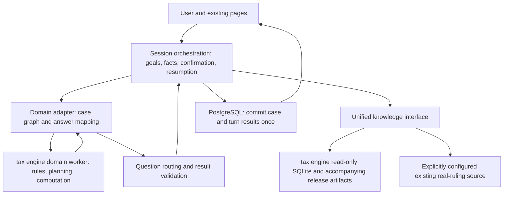

# Session and Tax Engine Integration Plan (Source-Audited Revision)

> Historical design objectives/original checks. The [merged handoff README](../setup/README.md) governs current implementation/configuration/testing; see [acceptance](COMBINED_INTEGRATION_ACCEPTANCE.md) for actual completion/environment blockers.

Date: 2026-10-11. Latest tax engine release obtained; local rules, engine, and sample checks passed. Initial planning, saving, read-only knowledge, and page integration implemented; see [initial workflow](TAX_ENGINE_BRIDGE_MVP_2026_10_11.md). Unified fact migration/full acceptance pending.

## 1. Integration in plain language

The session orchestrator converses, remembers cases, handles corrections, persists progress, and generates reviewable reports. The tax engine models companies/ownership/funds as graphs, compares structures/tax bounds, and identifies answers affecting options. Knowledge supplies original evidence/parameters.

One assistant presents the system. The session orchestrator sends snapshots to the tax engine, receives questions/results, asks users, saves answers, and resubmits. Fixed contracts connect them; the session orchestrator alone commits case state once per turn.

PostgreSQL retains cases; tax engine SQLite/CSV retain versioned knowledge/parameters. Connect services without migrating the entire corpus initially.

The tax engine delivers domain orchestration for structure search, impact analysis, questions, ex-ante calculations, and ex-post requests. `771e452` resolves missing data; next integrate facts/questions/knowledge/reports/databases.

## 2. Obtained materials and verification

| Item | Verified | Integration implication |
|---|---|---|
| Session branch | session baseline, 1de0163bfd718fe8a5e3017a5f32af6b0954b97e; local B matches | Session baseline unchanged |
| Tax engine baseline | 771e4524961bcc36718db1c9331e7a5f4cda0ce7, Align official data with engine and add reproducible handoff | Code/data/handoff uploaded |
| Acquisition | Official GitHub fixed-commit codeload/media LFS | Independent Asia-Tax-AI-Agent-tax-engine-source-771e452 snapshot; old workspace untouched |
| Database | 243703808 bytes, SHA-256 2756d2862330cb746d4103f0e690182fdc9fe7b2436a4ac738b156416aeca143 | LFS match, integrity_check=ok |
| Contents | 396 documents, 8438 clauses, 390 parameters, 31 interpretation IDs | Ready for next integration |
| Rules/engine | `python3 -m tax_graph.rules` passed; check_engine 94 candidates, 0 defects | Previous reference-related startup blocker resolved |
| Fields/extractor | check_fields/check_extract passed locally | Collection document/checks available |
| Cases | Meridian returns missing-fact questions | One executable planner path, not final structure |
| Handoff | `official/HANDOFF.md`, `handoff_audit.json`, `tax_graph/README.md`, logs/dependencies/cases/`tax_graph/信息收集.md` | Uploaded; full checks still need release-gate reproduction |
| Combined system | Local planner bridge/read-only service/case state/page, not pushed | Canonical migration/full reports/production PostgreSQL remain integration work |

### 2.1 Previous failures

`c8a4cf7`: 74 missing parameters, 8 statutory references, 146 compiler error lines. Historical audits/tax_engine_2026_10_11/release_audit.json, missing_references.csv, compile_errors.txt remain for comparison, not current `771e452` gaps.

### 2.2 Verification limits

Independent source/LFS snapshot checked. Local reruns cover rules/engine/fields/extractor/one Meridian case. Initial combined workflow covers B API/local SQLite/planner/HTTP contracts/page build. Full battery, vectors, complete handoff audit, production PostgreSQL, actual model/browser multi-turn, and professional tax acceptance were not completed. Upstream `tax_graph/validation/` is additional evidence.

## 3. Actual tax engine capabilities and choices

| Code | Responsibility | Integration |
|---|---|---|
| model/scenarios | Companies/ownership/flows; holding/ip/services/repatriation/financing/inbound_services/combinations | Explicit graph/goals; controlled holding first |
| planner.plan | Enumerate candidates/bounds/decision-changing questions | Domain planner; B asks answerable questions |
| engine/rules | Compilation/applicability/tax/unresolved matters | Deterministic results with rule/evidence versions |
| ex_ante | Candidate tables/conditions/comparison | Later exploration, not default planner |
| ex_post/claims | Paid/closed matters, refunds/exposures | Separate phase-two entry/acceptance |
| llm/extract | Two-stage location/evidenced extraction | Retain B initially, avoid competing extractors; live-model evaluation later |
| official/tools/search | Exact/BM25/optional vectors/relations/locations | Independent read-only service |

Two distinctions:

1. planner._key compares hi then lo; ex_ante.Row.key compares lo then hi with different table filtering. Initial planning explicitly uses hi-first and records objective_version; CLI --table is not equivalent.
2. Questions sort by region group/kind/impact/key, not global tax-saving impact. Preserve upstream order/dependencies/impact. B goals/conflicts/deduplication do not exactly reproduce upstream multi-question forms.

## 4. Unified entry and responsibilities

B alone writes sessions/cases; tax engine receives snapshots/returns domain results; knowledge returns sources. No tax engine callbacks/second conversation state. B controls final approval.

Share turn budget/request_id. One real plan call performs candidate calculation/questions; do not plan then evaluate everything again. Recompute on input changes or explicit reconfirmation. Existing structures use a separate fixed-graph entry.

### 4.1 Three purposes

- assess_current: described companies/income, fixed structure, no unrequested moves/new holding companies; initial Hong Kong FSIE use.
- plan_structure: explicit comparison request, bounded role/jurisdiction/time/flow/action changes, hi-first. Optimal means within this template candidate set only.
- review_paid: paid-tax/timing/closed matters; phase-two ex_post/claims with separate field/deadline checks.

These are proposed modes, not existing upstream HTTP endpoints. First acceptance covers existing-structure FSIE plus explicit holding comparison. Only an actual multi-turn tax engine planner/writeback case establishes dual-orchestration integration.

## 5. Mapping cases through a shared format

B has flat facts; tax engine uses roles/ownership/flows/addressed Answers. Add CaseSchema v2 rather than independently editable duplicate facts.

### 5.1 Single fact source and migration

Add schema_version=2, stable domain_state.entities/holds/flows IDs, canonical_fact_records in chat_cases.document. Facts contain address/typed_value/unit/status/source/confirmed_at/revision. Bind stable entity/edge IDs; versioned role_map projects HOLD/OP/up1 names.

Old facts become derived compatibility views. Migrate each old field to explicit entity/flow once; unclear ownership stays unmapped, never copied across companies. All old APIs use one updater, rebuilding views in the same save. Retain v1 reads/pre-migration snapshots and budget migration explicitly.

tax engine Case/Answers.data are request projections, not separately editable stores. actions record intent/plan hash; rulings record professional status/object/evidence; library binds releases, not client facts. Distinguish derived tax facts, assumptions, designed structures, confirmed client facts.

### 5.2 Initial mapping examples

| B information | tax engine position | Required meaning |
|---|---|---|
| Entity location/type | Case.roles[HOLD/OP].loc/type | Separate location/incorporation/management/residence; check upstream inferences |
| Ownership/acquisition/cost | Case.holds[(HOLD,OP)] or hold:HOLD>OP.ratio/since/cost | Percentage units; unknown must not become template 100 |
| Income/amount/date/currency | Graph.FlowEdge / Event / Case.flows | Explicit units/time; no CNY/today/1-year defaults |
| Receipt attributes | flow:up1.receipt_kind, etc. | Actual flow binding, no cross-flow reuse |
| Group metrics | group.<field> | Year/scope/units, not single-entity values |
| Paid/closed state | Case.settled / closed, Event.as_at | Retain compatibility; later ex-post acceptance |

Dictionary includes types/enums/units/precision/time/source/scenarios/projections/dependencies. Separate false, unknown, unasked, deferred, conflict; unknown never false/0. Deferral is scheduling, not necessarily tax engine unknown, which may eliminate candidates.

Cross-currency sums require dated/sourced conversion rules. Prefer same-currency synthetic cases first. Define/test amount transport/display precision/float tolerances rather than assuming precision.

## 6. Connecting questions to chat

Retain tax engine key/kind/region/why/impact/forms/source_hint. Add question_id/input_hash/based_on_revision/candidate_scope/answer_schema/dependency_group. One main question per turn, multiple volunteered fields accepted.

| tax engine kind | Recipient | B behavior |
|---|---|---|
| blocking/data | User | Actual facts, candidates, current confirmation rules |
| joint | User | Preserve dependency group; sequential questioning must not drop a jointly material field |
| action | User | Willingness, not completed historical action |
| ruling | Professional queue/evidenced judgment | User yes is not favorable ruling; retain unknown/bounds without evidence |
| library | Source maintainers | Missing calendars/law; do not repeatedly ask users for system knowledge gaps |

Conditional drafts may retain unresolved rulings for final review. No finite bounds means blocked/no plan, not invented answers. Test actual unknown semantics separately for ruling/action/blocking.

Code differences: non-yes actions take the unfavorable branch; only ruling yes creates a favorable tick, while no/unknown do not. Keep undecided actions deferred in B; actions.unknown is not neutral. Adverse rulings cannot simply become rulings.no with a claim of exact execution. Initially unsupported/pending review until explicit three-state contracts/tests.

Corrections invalidate dependent questions/confirmation/analysis; reject stale question_id. Outcome(questions, plan, evaluations, note) usually has questions or plan. Neither may mean all candidates excluded, not success.

## 7. Database responsibilities

| Location | Authority | Writes/publication |
|---|---|---|
| PostgreSQL chat_cases | Conversation/facts/intent/review/reports/receipts | B single writer, owner+UUID+revision, atomic |
| official.sqlite | Laws/units/relations/published parameter projections | Immutable release, read-only |
| Same-release CSV/files | Params reads params.csv; decisions/forms/calendars/fields | Joint code/database release/validation |
| Existing sources/legal_units | Actual independent rulings | Explicit routing/component versions; no synthetic cases as evidence |

Params reads CSV, not SQLite's param table. Bind code_commit, DB/CSV hashes, rules/interpretations/calendars/dictionary/mappings/dependencies. SQLite-only or Params-only changes are not a complete engine switch.

Proposed releases/<release_id>/ includes code/build, official.sqlite, CSV/docs, release.json, coverage/policies/maps. Startup checks reference closure, CSV/DB consistency, compilation. Failures mean domain_ready=false; knowledge may independently be ready.

engine.RULES/facts have module caches. Use release-specific workers, started/warmed from fixed directories. Validate new releases before routing new requests; old reports/in-flight runs stay pinned. Do not swap CSV in one process and claim isolation. Read-only knowledge connections per thread/worker.

Persist integration_run: run_id/trace_id/facts_hash/case_revision/goal/objective/explicit_dates/release_id/engine-rule-parameter-map-policy versions/input-output summaries/evidence IDs-hashes/timings/gaps/failures. Reproduce original versions; missing releases return version_unavailable.

## 8. Services and results

B/UI 8000, knowledge/domain gateway 8010. Isolate knowledge/domain startup so compilation failure does not disable retrieval. These proposed APIs extend B's strict CKnowledgeProvider boundary:

| API | Purpose |
|---|---|
| GET /health, GET /capabilities | Separate knowledge_ready/domain_ready, release, scenarios/channels/blockers |
| POST /search, POST /evidence | Search/exact locations/same-version reads; exact+BM25 first, graph after checks |
| POST /ground | Internal/separate citation checks; retain ambiguous multiple matches |
| POST /domain/plan | plan_structure; one actual planner.plan |
| POST /domain/evaluate | assess_current fixed graph within accepted scope |
| POST /domain/review | Later ex-post entry |

DomainRequest v1: request_id/deadline/schema_version/mode/scenario/objective/Case/Answers/explicit on-as_at-today/facts_hash/release_id/map version. B supplies today; distinguish transaction/analysis/query dates.

Responses: needs_input|ready|blocked|unsupported|error plus question semantics, bounds/conditions/candidates/exclusions/citations-parameters/engine_input_hash. Convert frozenset regions to array entries; ISO dates, explicit JSON tuple/enum representations. Infinity/-Infinity use value=null + bound_status, never illegal JSON or zero. Do not send entire evaluations to the frontend.

Add report_kind=structure_plan showing existing/candidate graphs, flow/jurisdiction taxes, modeled bounds, actions, judgments, unmodeled items, evidence/versions. Keep FSIE schema/renderer separate, not tax engine objects inside old node lists.

Render guaranteed as the modeled upper tax bound under stated conditions, including planned actions, never actual tax guarantees. Show objective/candidate scope.

## 9. Knowledge integration work

1. **IDs:** explicit map between B manifest hk_hkel_iro_cap112 and tax engine hk.cap112.en. Same law does not mean same text version; avoid dropped search hits.
2. **Subprovisions:** 21 NODE_LOCATORS plus thresholds versus possibly whole-section tax engine units. Map parents/spans/hashes/versions/basis. Parent-only is ancestor, not exact.
3. **Text/hash:** canonical replacement may leave stale search.Hit snippets/spans; reread final cite_id and locate. Hash actual UTF-8 returned text; lock release/span.
4. **Dates:** search valid_to exclusive, rule effective_to inclusive, B mostly closed intervals. Expose [from,to), retain originals, convert inclusive ends only when confirmed. Test first/last/next/unknown days.
5. **Budgets:** share B 45 seconds/3 searches/14 reads. Merge/deduplicate verified child spans in common parents. Test whether 21+ citations fit; gaps explicit, no resets.
6. **States/usage:** distinguish hits, locations, applicability, professional validation, task coverage. Enforce display/model separately; engineering never sets professional verified.
7. **Cases:** kind=ruling routes to configured actual sources. Missing cases are gaps, not synthetic battery substitutions.
8. **Contracts:** extra=forbid requires synchronized v0.2 parsers and explicit v0.1 compatibility. Add release/native_source_id/canonical_cite_id/mapped_locators/span/mapping_version/applicability/gap reason_codes.

Queries/reads omit full cases/conversations. B constructs authenticated context and holds service credentials. Distinguish insufficiency/failure/version unavailability; never fall back to Mock.

## 10. Turns, deadlines, commits

1. Read owner case/revision; validate request/question IDs; replay receipts without recomputing committed requests.
2. Validate candidate types/units/conflicts/ownership/confirmation and freeze snapshot.
3. Pin purpose/dates/release/maps, project Case/Answers; mapping failure prevents erroneous partial calls.
4. One tax engine plan or fixed executor; count candidates/time/computation against shared budgets.
5. Route questions; at most one main user question, professional/library queues separately; retrieve/validate evidence for available results.
6. Formal research drafts require latest confirmation or valid partial consent. Exploratory candidates are not confirmed reports.
7. One revision-checked commit of facts/tasks/pending/results/integration_run/receipt. Concurrent changes return 409 without stale writes. JSON/SSE share it.

Upstream candidate enumeration lacks integration-ready hard cancellation. Bound candidates/queues/remaining time and terminate/cancel timed-out workers, discarding results; HTTP timeout alone must not leave unlimited background computation. If legitimate cases exceed 45 seconds consistently, explicitly adopt asynchronous jobs, not hidden unlimited requests.

## 11. Implementation, deliverables, gates

| Step | Work | Passing evidence |
|---|---|---|
| P0 release | New data/interpretations/dependencies/examples, local checks | Full formal handoff rerun/version registration; separate professional review |
| P1 knowledge | Read-only service/maps/v0.2 | Actual search→evidence→hash→page, explicit statute/ruling routes |
| P2 case/UI | Canonical graph, legacy projection, typed questions/actions/rulings/library/results | Migration/recovery/corrections/unknowns/stale questions/concurrency |
| P3 domain | Pinned workers, planning/fixed modes, serialization/deadlines | Actual complete examples; bounded/unbounded/no candidates/failures explainable |
| P4 multi-turn | B→tax engine→user→B→tax engine→report→PostgreSQL | Both initial scenarios, evidence/confirmation/versions/replay |
| P5 expansion | IP/services/finance/ex_post/vectors/extractor | Separate professional examples/coverage, capability switches |

P0 upload/integrity/compilation passed locally on `771e452`; formal full audit/versioning remains. Begin P1/P2/P3; P4 requires real integration.

tax engine supplied the earlier 74 parameters, 8 references, D14–D31, dependencies/cases/package `信息收集.md`. Later updates retain closure; professional interpretations need separate review.

Integration owns shared facts/types/routing/HTTP/results/maps/isolation/budgets/persistence/scripts; these are not all tax engine delivery gaps.

Generate battery.py cases in suitable test environments and deliver a fixed representative set: complete/sparse/conflict/unknown/paid/closed. Verify nonzero cases before check_planner. Empty-directory zero defects is not acceptance; generators/gold files do not prove execution.

Estimates from the locally compiling release: P1 2–3 person-days, P2 3–4, P3 2–3, P4 2–3, total 9–13. Excludes professional waiting/P5; reestimate migration/performance surprises. Old knowledge-only 5–8 days is not full dual-orchestration effort.

Proposed locations: apps/knowledge_api, packages/official_adapter, packages/agent/domain_contracts.py, domain_adapters, question_arbiter, chat fact/analysis/storage, frontend questions/structure_plan renderer. config/integration centralizes configuration; separate audit/release scripts. Pin tax engine in an isolated branch without immediate whole-tree merge.

## 12. Minimum acceptance matrix

| Check | Required observation |
|---|---|
| Release closure | Full compilation, no missing parameters/references; CSV/DB match; interpretation records |
| Nonempty tests | Fixed count >0; complete/sparse planners; retain failure details, not exit code alone |
| Actual knowledge | HTTP reads, IDs/spans/hashes/time/rights agree |
| Existing Hong Kong structure | No automatic companies/moves; bounded existing-structure result |
| holding planning | Explicit candidate scope/hi-first; actual tax engine questions/results |
| Engine comparison | Same facts/date/scope/question only; qualitative FSIE nodes are not group-wide taxes; explain differences |
| Addresses/units | Separate two companies/flows; catch 10 versus 0.1, currencies/dates |
| Unknowns/intent | Separate unasked/deferred/unknown/false; action yes is not completion; ordinary users cannot approve favorable rulings |
| Joint dependencies | Collect both jointly material fields, no incorrect deduplication |
| JSON | frozensets/dates/infinities/no candidates serialize; no plan is not ready |
| Missing library | No repeated user questions; impacts/gaps, blocked if necessary |
| Coverage/budget | Check 21+ locations; insufficient 14-read budget leaves gaps; no hidden retries |
| Revisions | Invalidate confirmation/actions/questions/reports, recompute new hash |
| Concurrency/replay | 409, one commit, refresh, common JSON/SSE semantics |
| Dates/versions | Explicit today/on/as_at, correct endpoints, old reports read old releases |
| Failure/isolation | Compilation disables domain only; actual cancellation; no silent Mock/other-engine substitution |
| End to end | Dedicated PostgreSQL, actual SQLite/CSV/tax engine/models with records; doubles not actual acceptance |

At least 10 multi-turn scripts: normal/missing facts/declined actions/professional gaps/library gaps/corrections/pause-resume/replays/concurrency/timeouts. Record versions/calls/sample counts/time/failures. Battery checks invariants; conclusions need independently reviewed examples.

## 13. Switches/rollback

Use implemented B settings: hybrid/fixed entries, local 8010 C, then rerun the same cases for dynamic planner/tools. Dedicated integration PostgreSQL stays isolated.

Proposed FSIE_DOMAIN_MODE=legacy|domain_shadow|domain, FSIE_KNOWLEDGE_RELEASE=<release_id>, SUPPORTED_DOMAIN_SCENARIOS=<allowlist>. Unified mode prevents mismatched planner/executor versions. An unavailable tax engine errors explicitly; shadow differences remain internal, not contradictory formal outputs.

Rollback retains v2 reads/single writer before switching old domain paths. Unsupported structures pause without loss. Never flatten v2 multiple entities lossily into v1. Old reports remain pinned, not overwritten by recalculation.

## 14. Evidence and work boundaries

- [tax engine release](https://github.com/ZhihongWu-dev/Asia-Tax-AI-Agent/commit/771e4524961bcc36718db1c9331e7a5f4cda0ce7)
- [Handoff](https://github.com/ZhihongWu-dev/Asia-Tax-AI-Agent/blob/771e4524961bcc36718db1c9331e7a5f4cda0ce7/official/HANDOFF.md)
- [Operation/examples](https://github.com/ZhihongWu-dev/Asia-Tax-AI-Agent/blob/771e4524961bcc36718db1c9331e7a5f4cda0ce7/tax_graph/README.md)
- [Planner](https://github.com/ZhihongWu-dev/Asia-Tax-AI-Agent/blob/771e4524961bcc36718db1c9331e7a5f4cda0ce7/tax_graph/planner.py)
- [Compilation](https://github.com/ZhihongWu-dev/Asia-Tax-AI-Agent/blob/771e4524961bcc36718db1c9331e7a5f4cda0ce7/tax_graph/rules/compile.py)
- [Parameters](https://github.com/ZhihongWu-dev/Asia-Tax-AI-Agent/blob/771e4524961bcc36718db1c9331e7a5f4cda0ce7/tax_graph/params.py)
- [Search/time](https://github.com/ZhihongWu-dev/Asia-Tax-AI-Agent/blob/771e4524961bcc36718db1c9331e7a5f4cda0ce7/official/tools/search.py)
- [B orchestration](https://github.com/ZhihongWu-dev/Asia-Tax-AI-Agent/blob/1de0163bfd718fe8a5e3017a5f32af6b0954b97e/packages/agent/hybrid.py)
- [B analysis/filtering](https://github.com/ZhihongWu-dev/Asia-Tax-AI-Agent/blob/1de0163bfd718fe8a5e3017a5f32af6b0954b97e/packages/chat/analysis.py)
- [B storage](https://github.com/ZhihongWu-dev/Asia-Tax-AI-Agent/blob/1de0163bfd718fe8a5e3017a5f32af6b0954b97e/packages/chat/store.py)

Added local integration code/[initial workflow](TAX_ENGINE_BRIDGE_MVP_2026_10_11.md) without changing remote branches/existing business databases. Controlled API/service/local case integration passed; full battery/production PostgreSQL/actual multi-turn/professional acceptance remained incomplete. tax engine capability descriptions derive from code and independent new-release sample checks.
