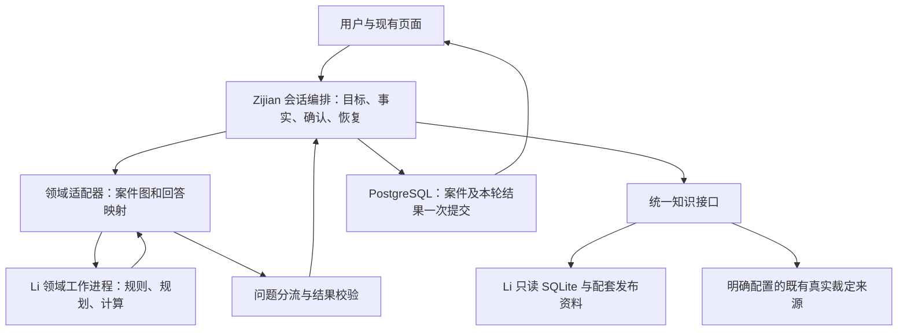

# zijian × LiZiheng 编排与数据库联调方案（源码核验修订版）

> 本文保留设计阶段的目标和原始核验结果。当前实现、配置和测试入口以 [合并交接 README](../../README_MERGED.md)为准；实际完成范围和环境阻塞见 [集成验收记录](COMBINED_INTEGRATION_ACCEPTANCE.md)。

日期：2026-10-11。状态：Li 最新发布物已取得并通过本地规则编译、引擎和样例抽查；第一条结构规划、案件保存、只读知识接口和页面联调链路已经落地，详情见 [第一条联调链路](LI_BRIDGE_MVP_2026_10_11.md)。统一事实迁移和两套系统的完整验收仍待完成。

## 1. 用大白话说，这次要怎么接

Zijian 负责和用户对话、记住案情、处理中途改口、保存进度和生成可复核的报告。Li 负责把公司、持股关系和资金流组成图，比较结构、计算税额范围，并指出哪些问题的答案会改变方案。知识库负责提供这些判断所用的原文和参数。

用户只面对一个助手。助手收集信息后，把当前案情交给 Li；Li 返回缺什么或算出了什么；Zijian 决定怎么向用户提问并保存答案，再把新案情交回 Li。双方通过固定格式交换数据，每轮只由 Zijian 提交一次案件状态。

数据库各自保留擅长的用途：PostgreSQL 保存案件，Li 的 SQLite 和配套 CSV 保存版本化知识及参数。通过服务把它们连起来，首期不搬迁整个知识库。

Li 已交付实际领域编排代码，能力包括结构搜索、影响分析、追问、事前计算和事后请求处理。最新提交 `771e452` 已补齐此前缺失的配套数据；下一步是两套系统的事实、问题、知识、报告与数据库接口联调。

## 2. 这次取得了什么，验证到了哪一步

| 项目 | 当前核实结果 | 对整合的意义 |
|---|---|---|
| Zijian 远端分支 | zijian-Luo，1de0163bfd718fe8a5e3017a5f32af6b0954b97e；本地 B HEAD 一致 | 会话集成基线未更新 |
| Li 远端分支 | LiZiheng，771e4524961bcc36718db1c9331e7a5f4cda0ce7，提交 Align official data with engine and add reproducible handoff | 源码、配套数据和交接材料已上传 |
| 获取方式 | GitHub 官方 codeload 固定提交归档和 media LFS 实体 | 独立快照位于工作区 Asia-Tax-AI-Agent-LiZiheng-771e452；未覆盖原工作区 |
| 新数据库 | 243703808 字节；SHA-256 2756d2862330cb746d4103f0e690182fdc9fe7b2436a4ac738b156416aeca143 | 与 LFS 指针一致；SQLite integrity_check=ok |
| 内容量 | 本地查到 396 文档、8438 条款、390 参数、31 个不同口径 ID | 当前知识/口径版本可用于下一步联调 |
| 规则编译与引擎 | 本地 `python3 -m tax_graph.rules` 通过；`check_engine` 显示 94 个候选、0 缺陷 | 前次缺引用导致的引擎启动阻塞已解除 |
| 字段和提取器 | `check_fields`、`check_extract` 本地运行通过 | 信息收集文档和相关检查可用 |
| 案例 | 本地运行自带 Meridian，返回待补事实问题单 | 证明这一样例的 planner 路径可执行；尚未形成最终结构方案 |
| 上游交接 | `official/HANDOFF.md`、`handoff_audit.json`、`tax_graph/README.md`、验证日志、依赖、案例及 `tax_graph/信息收集.md` | Li 所负责的发布材料已上传；报告中的完整检查尚需按上线门槛复现 |
| 两套系统的连接 | 集成侧本地已新增 Li planner 桥接、只读知识服务、现有案件内的结构状态和页面；尚未提交远端 | 旧平面事实到共同事实模型、完整报告、正式 PostgreSQL 联调仍由集成侧实现 |

### 2.1 前一版本故障记录

`c8a4cf7` 上曾有 74 个缺失参数、8 个缺失法条引用，编译报错 146 行。完整旧版清单保留在 audits/li_2026_10_11/release_audit.json、missing_references.csv、compile_errors.txt，仅用于版本对照。这些数字不代表当前 `771e452` 的缺项。

### 2.2 新版核验边界

新源码与真实 LFS 数据库已在独立快照中核对。此次本地复跑覆盖规则编译、引擎、字段、提取器和一个 Meridian 规划器样例。后续第一条联调链路覆盖 B API、本地案件 SQLite、Li planner、知识服务 HTTP 契约与页面构建；没有复跑上游完整 battery、向量检索、全部交接审计，也没有完成正式 PostgreSQL、真实模型、浏览器多轮和税务专业结论的验收。Li 的 `tax_graph/validation/` 提供了更多运行记录，属于上游交接证据。

## 3. Li 的真实能力与整合取舍

| Li 代码 | 已读到的职责 | 整合方式 |
|---|---|---|
| model / scenarios | 公司、持股、资金流；holding、ip、services、repatriation、financing、inbound_services 及组合模板 | 显式案件图和目标；先开放 holding 的受控场景 |
| planner.plan | 遍历候选结构、计算上下界、寻找会改变方案的问题，返回问题单或方案 | 作为领域规划器；由 B 转成用户可回答的问题 |
| engine / rules | 规则编译、适用条件、税额及未决事项 | 确定性领域计算；结果必须携带规则与证据版本 |
| ex_ante | 候选表、未决条件、事前方案比较 | 后续开放表格探索，不直接当默认 planner 使用 |
| ex_post / claims | 围绕已缴、关闭事项分析可请求返还/暴露等结果 | 第二阶段独立业务入口，不能作为首期已验收能力 |
| llm/extract | 分两步定位材料、提取带原文证据的字段 | 首期沿用 B 提取，避免两套提取互相覆盖；文档和确定性检查已上传；生产模型接入后再评测 |
| official/tools/search | 精确、BM25、可选向量、显式关系扩展、引文定位 | 独立只读知识服务 |

两点不能忽略：

1. planner._key 先比较税额上界 hi，再比较下界 lo；ex_ante.Row.key 先比较 lo，再比较 hi，且候选表还有自己的筛选逻辑。二者优化目标不同。首期结构规划明确使用 planner 的 hi-first 目标，记录 objective_version；CLI --table 不作为等价替代。
2. planner 的问题按地区组、问题种类、impact、key 排序，不是全局按节税影响排序。适配器保留原始排序、依赖及影响值；B 的用户目标、冲突处理、去重属于会话规则，不能声称完全复刻了原 planner 的多题问卷。

## 4. 统一入口与职责

B 独占会话与案件写入权；Li 只接收快照、返回领域结果；知识服务只提供资料。Li 不回调聊天接口，不创建第二套对话状态。报告批准继续由 B 最终复核流程控制。

每轮共享 B 的总预算与 request_id。结构规划调用一次真实 plan 即完成本轮候选计算和问题生成；不能先 plan 再重复全量 evaluate。只有输入改变或用户要求重新确认输出时才重新计算。评估现有结构采用单独的固定图计算入口。

### 4.1 区分三种业务目的

- assess_current：分析已经描述的公司与这笔收入。固定案件结构，不擅自设计迁移或新增控股公司。首期用于 HK 境外股息流程。
- plan_structure：用户明确要求比较/调整结构。限定允许变化的角色、地区、期限、现金流和行动，使用 hi-first；“最优”仅指本次模板候选集合内。
- review_paid：围绕已有缴税、时间和关闭事项作事后分析。第二阶段接 ex_post/claims，并单独验证时效和字段。

这三个是拟新增的服务模式，并非声称上游已提供这三个 HTTP 接口。第一轮同时验收前两种：一条保留现有结构的 FSIE 案件，一条明确请求结构比较的 holding 案件。只有第二条真实使用 Li planner 并完成多轮回写，才算双编排联调完成。

## 5. 案情如何映射：先补共同的数据格式

B 现状主要是平面 facts；Li 接收角色、持股边、收入流和地址化 Answers。需要新增 CaseSchema v2，不能把同一个字段在两边各保存一份、各自修改。

### 5.1 唯一事实源与迁移

在 chat_cases.document 中添加 schema_version=2、domain_state.entities/holds/flows 的稳定 ID，以及 canonical_fact_records。每条事实包含 address、typed_value、unit、status、source、confirmed_at、revision。地址绑定稳定实体/边 ID，再由版本化 role_map 投影为 Li 的 HOLD、OP、up1 等角色名。

旧 facts 仅作为从 canonical_fact_records 派生的兼容视图。迁移时把旧字段一次映射到明确的主体/收入流；归属不清进入 unmapped，禁止自动复制给多家公司。所有旧 API 的事实写入必须改走同一个更新器，然后在一次保存中重建兼容视图。保留 schema v1 读取与迁移前快照；此迁移纳入工期，不把扩展 JSON 当作免费完成。

Li 的 Case、Answers.data 是请求时派生对象，不另持久化成可独立编辑的事实副本。actions 保存用户的行动意向及对应方案哈希；rulings 保存专业判断状态、适用对象和依据；library 绑定发布资料，不作为客户事实。派生税务事实、建模假设、待设计结构与客户已确认事实分别标记。

### 5.2 首期映射示例

| B 中的信息 | Li 请求中的位置 | 必须明确的语义 |
|---|---|---|
| 实体所在地、类型 | Case.roles[HOLD/OP].loc/type | 所在地、注册地、实际管理地、税收居民身份分别记录；检查上游自动推导规则 |
| 持股比例、取得日期、成本 | Case.holds[(HOLD,OP)]，或 hold:HOLD>OP.ratio/since/cost | 比例以百分数表示；未知比例不能接受模板 100 占位为客户事实 |
| 收入类型、金额、日期、币种 | Graph.FlowEdge / Event / 对应 Case.flows | 显式币种和时间含义，禁止静默沿用 CNY、今日、1 年等默认值 |
| 汇入方式等收入属性 | flow:up1.receipt_kind 等 | 必须绑定实际那一笔流，不能跨流套用 |
| 集团指标 | group.<field> | 标明年度、范围与单位，不复制单体数据充当集团指标 |
| 已缴/关闭状态 | Case.settled / closed，Event.as_at | 首期保留兼容，事后流程另验收 |

字段字典包含类型、枚举、单位、精度、时间语义、来源、适用场景、读写投影与依赖。布尔假、未知、未问、暂缓、冲突分别表示；unknown 不能变成 false/0。暂缓只影响会话调度，不能直接写成 Li 的 unknown，因为后者可能排除候选结构。

跨币种合计必须有明确的汇率日期、来源和折算规则；第一轮优先同币种合成样例。适配金额的传输格式、显示精度与引擎浮点误差需给出容差并测试，不能默认为金额处理已精确。

## 6. 追问怎样接入现有聊天

Li Question 的 key、kind、region、why、impact、forms、source_hint 全部保留；另外增加稳定 question_id、input_hash、based_on_revision、candidate_scope、answer_schema、dependency_group。会话每轮呈现一个主要问题，可一次收取用户主动提供的多个字段。

| Li 问题类型 | 发给谁 | B 的处理 |
|---|---|---|
| blocking / data | 用户 | 问真实案情，回答进入候选事实，按现有规则确认 |
| joint / 有组合影响的数据 | 用户 | 保留联合依赖组；分轮问时不能把第二项误判为无影响而删掉 |
| action | 用户 | 问是否愿意采取该方案行动；yes 不是行动已发生，不改历史事实 |
| ruling | 复核队列/有依据的专业判断 | 普通用户说 yes 不等于获得有利裁定；无依据时保留 unknown 和上下界 |
| library | 资料维护端 | 标记缺日历/法规资料；不要让用户被迫回答系统自己缺什么 |

ruling 未决可以在明确标记条件的研究稿中保留；最终顾问复核时处理。若本次组合未决导致无有限边界，返回 blocked/无法形成方案，不强制虚构答案来保证出稿。对传给 Li 的 unknown 必须测试其实际分支含义：ruling、action、blocking 的 unknown 行为不同，不能统一转换。

代码已显示具体差异：actions 中除 yes 以外的值会走行动的不利一侧；rulings 只有 yes 会生成有利判断，no 与 unknown 都不生成这个 tick。因此“用户暂时没决定”应在 B 保留 deferred，不能直接发送 actions.unknown 当作中性值；正式不利裁定也不能直接映射成 rulings.no 并声称已精确执行。后者首期标 unsupported/待复核，待补显式三态判断契约及回归样例后再开放。

用户改口后按依赖使旧问题、确认和分析失效；过期 question_id 拒绝提交。Li 返回 Outcome(questions, plan, evaluations, note)：questions 与 plan 通常互斥；无问题且无 plan 也可能是所有候选被排除，不能误判为成功。

## 7. 两个数据库怎样一起用

| 位置 | 权威内容 | 发布/写入方式 |
|---|---|---|
| PostgreSQL chat_cases | 会话、事实、意向、复核状态、报告、请求回执 | B 单写，owner+UUID+revision；一次原子提交 |
| Li official.sqlite | 法条、检索单元、来源关系及发布时的参数/口径投影 | 不可变版本，只读在线查询 |
| 同 release 的 CSV/配套文件 | Params 实际读取的 params.csv；decisions、forms、日历、字段等 | 与数据库和代码共同发布、共同核验 |
| 现有 sources/legal_units | 已有真实裁定等独立来源 | 显式路由并记录组件版本；合成测试样例不进入依据库 |

关键修正：引擎的 Params 直接读 CSV，并非直接读 SQLite 的 param 表。发布包必须同时绑定 code_commit、DB/CSV 哈希、规则、口径、日历、字段字典、映射和依赖版本。只更新 SQLite 或只切 Params 不能代表全引擎切换成功。

拟定 releases/<release_id>/ 包含源码/构建产物、official.sqlite、必要 CSV 和文档、release.json、覆盖与来源策略、映射。启动先做引用闭合、CSV/DB 一致性和规则编译；不通过则 domain_ready=false。知识检索可独立 ready，但不能因此标整个领域服务 ready。

engine.RULES 和 facts 中存在模块级缓存，领域端首期采用“一发布版本一组工作进程”，从指定目录启动并预热。新版本通过校验后切新请求，旧报告及在途请求仍绑定旧版本；不在同一 Python 进程内临时换 CSV 冒充版本隔离。知识连接按线程/工作进程分配并只读打开。

每轮保存 integration_run：run_id、trace_id、facts_hash、case_revision、goal/objective、explicit_dates、release_id、engine/rule/parameter/map/policy versions、输入输出摘要、证据 ID/hash、耗时、缺口和失败原因。报告必须能按原版回放；旧版丢失返回 version_unavailable。

## 8. 服务接口与结果格式

B/UI 8000；知识/领域网关 8010。知识检索与领域工作进程隔离启动，使引擎编译失败不拖垮可用的资料查询。以下全部是待实现接口；沿用 B CKnowledgeProvider 客户端边界并升级严格契约。

| 接口 | 用途 |
|---|---|
| GET /health、GET /capabilities | 分别报告 knowledge_ready/domain_ready、release、支持场景、通道、阻塞原因 |
| POST /search、POST /evidence | 检索、精确定位、同版本原文回读；首期 exact+BM25，graph 检验后启用 |
| POST /ground | 服务内部或独立端点检查引用；多处命中保留 ambiguous |
| POST /domain/plan | 只用于 plan_structure；调用一次真实 planner.plan |
| POST /domain/evaluate | assess_current 固定图计算；限制已验证范围 |
| POST /domain/review | 后续事后分析入口 |

领域请求使用 DomainRequest v1：request_id、deadline、schema_version、mode、scenario、objective、Case 投影、Answers 投影、明确的 on/as_at/today、facts_hash、release_id 和映射版本。today 由 B 注入，不依赖工作进程当前日期；交易日、分析基准日、系统查询日不能混用。

领域响应使用 status=needs_input|ready|blocked|unsupported|error，并携带原始问题语义、计算上下界、条件、候选摘要、排除原因、引用/参数依赖、engine_input_hash。将 frozenset 地区键改为数组中的 regions 字段，日期用 ISO，元组/枚举用明确 JSON 类型。Infinity/-Infinity 用 value=null + bound_status 表示，不能产生非法 JSON 或把无限上界显示为 0。不传整个 evaluations 对象给前端。

结构报告新增 report_kind=structure_plan，展示现有/候选结构、各收入流和地区税额、模型上下界、行动前提、未决判断、未建模事项、依据和版本。现有 FSIE 报告保留自身 schema/renderer，不能把 Li 对象直接塞入旧节点列表。

上游字段 guaranteed 在界面表述为“本模型和列明条件下的税额上界”，包括计划行动完成等前提；不得展示为实际税务结果保证。排序依据和候选范围必须可见。

## 9. 知识接缝：仍需实际补的工程

1. **来源 ID。** B analyze 会按旧 manifest source_ids 过滤；hk_hkel_iro_cap112 与 Li hk.cap112.en 需显式 source_map。区分同一法规与同一文本版本，避免检索有结果却在报告中被丢掉。
2. **子条款。** B 有 21 个不同 NODE_LOCATORS，另有阈值引用；Li 可能只切到整节。建立 locator_map，记录父条款、子区间、原文 hash、版本和映射依据。父节只能标 ancestor，不能伪装为精确子条款。
3. **原文与哈希。** search.Hit 可能在最终 canonical 替换后仍持旧 snippet/span，适配器必须按最终 cite_id 重新读取并定位。hash 对实际返回的 UTF-8 文本计算；证据回读锁同一 release/区间。
4. **时间。** Li search 的 valid_to 是排他边界，而 rules/eval 的 effective_to 是最后有效日；B 现有逻辑也偏闭区间。对外证据统一 [from,to)，内部保留原始边界语义，仅在确认来源使用包含截止日时转换为次日排他。不能把所有 end 机械改成同一含义。测试生效日、最后有效日、次日及未知日期。
5. **预算。** B 现有 45 秒总预算、3 次 search、14 次 evidence 等限制继续共享。合并相同父条款中经验证的子区间并去重；21+ 引用能否在预算内满足需要实测。未覆盖显式列缺口，不重置预算。
6. **状态与用途。** 检索命中、原文定位、日期适用、专业核验、任务覆盖是不同状态。沿用明确的来源用途策略，display/model 分别执行；工程校验不自动升级为专业 verified。
7. **既有案例。** kind=ruling 明确去已配置的真实来源；库缺乏目标案例就报告缺口，不能用 battery 合成样例代替真实裁定。
8. **契约升级。** B 现有 extra=forbid，知识请求/证据升至 v0.2 时双方同步升级解析器；旧 v0.1 走明确兼容路径。新增 release、native_source_id、canonical_cite_id、mapped_locators、span、mapping_version、applicability 和缺口 reason_codes。

知识搜索/回读不传完整案件或会话；B 持有服务凭据并根据已认证身份构造上下文。知识返回不足、服务失败、版本不可用分别处理；不得自动退到 Mock。

## 10. 每轮执行、超时和提交

1. B 读取 owner 下的案件和 revision，校验 request_id、问题 ID；重放已提交请求直接回执。
2. 用户输入生成候选事实改动，执行类型/单位、冲突、归属和确认检查；创建本轮不可变快照。
3. 固定业务目的、明确日期、release 和 maps；生成 Li Case/Answers，映射失败不运行部分错误案情。
4. plan_structure 调 Li plan 一次；assess_current 调固定结构执行器。候选数和运行时间计入总预算，记录计算量。
5. 领域问题分流，B 最多选择一个用户主要问题；专业/资料缺口进入对应队列。已能形成结果时查询/回读所需依据并校验。
6. 只有最新确认或既有部分研究稿许可满足，才生成正式研究稿；探索性候选结果不冒充用户确认报告。
7. B 按原 revision 一次保存事实、任务、pending、结果、integration_run 和回执。并发修改返回 409，过期计算不落库。JSON/SSE 共用提交逻辑。

Li 候选遍历当前没有适合集成的硬截止/取消机制。首期工作进程设置有限候选规模、队列和剩余时间；超时取消或终止该计算进程并丢弃结果，不只是 HTTP 返回后任后台继续无限计算。若真实可接受场景持续超过现有 45 秒，再明确升级为异步作业契约；不能暗中放宽为无限请求。

## 11. 实施顺序、交付物和验收门槛

| 步骤 | 要做什么 | 交付与过关条件 |
|---|---|---|
| P0 发布包核验 | 新提交已补配套数据、口径、依赖和样例；本地通过编译、引擎及单例检查 | 正式发布前再复现全套 handoff 审计并登记版本；专业口径独立复核 |
| P1 知识通路 | SQLite 只读服务、来源与子条款映射、v0.2 契约 | 真实 search→evidence→hash→B 页面；法条与既有裁定路由明确 |
| P2 案件与 UI 契约 | canonical facts/图、旧 facts 投影、typed questions、actions/rulings/library、两类结果展示 | 旧案迁移、恢复、改口、unknown、过期问题与并发写入正确 |
| P3 Li 领域服务 | 固定版本进程、结构规划/固定图两模式、序列化、截止机制 | 真实数据跑完整样例；有限/无限界、无候选和失败均可解释 |
| P4 联合多轮 | B→Li→用户→B→Li→报告→PostgreSQL；限范围上线 | 首期两个场景均完成端到端，证据、确认、版本与回放通过 |
| P5 扩展 | IP/服务/融资、ex_post、向量检索、Li 文档提取器 | 分别新增覆盖和专业样例，按能力开关开放 |

P0 的资料上传、数据库完整性和规则编译已在 `771e452` 上通过本地检查。仍需按正式发布流程复现全套交接审计并登记版本；P1/P2/P3 可进入实施，P4 需等两套系统真实联调通过。

Li 数据维护侧已上传前述 74 个参数和 8 个法条引用、D14–D31 口径、依赖与案例、包内 `信息收集.md`。后续资料更新需要保持同样的版本闭合；口径的专业审核仍需单独安排。

集成侧负责：共同事实格式、类型映射、问题分流、HTTP 服务、结果展示、源/条款映射、进程隔离、预算、持久化和联调脚本。不能把这些缺口全部算成 Li 尚未交付。

测试样例由现有 battery.py 生成器在适当的测试环境生成，并交付固定的小型代表集（完整/稀疏/冲突/未知/已缴/关闭）。check_planner 之前必须验证样例数大于零；空目录的“零缺陷”不算通过。生成器、gold 文件的存在不等于测试已经执行。

排期只作开发估算：以目前通过本地编译的发布物为起点，P1 约 2–3 人日，P2 约 3–4 人日，P3 约 2–3 人日，P4 约 2–3 人日，总计约 9–13 人日；资料的专业核对等待时间及 P5 不计在内。字段迁移或候选性能超预期时需重估。原先只覆盖知识连接的 5–8 日估算不能当作完整双编排工期。

拟实施的主要位置：apps/knowledge_api、packages/official_adapter、packages/agent/domain_contracts.py、domain_adapters、question_arbiter、packages/chat 的事实更新/分析/存储，以及前端动态问题与 structure_plan renderer。配置集中于 config/integration，审计与发布验证脚本单独保存。集成在隔离开发分支固定 Li 版本依赖，先不直接整树 merge。

## 12. 最低验收矩阵

| 检查 | 必须观察到 |
|---|---|
| 发布闭合 | 全规则编译成功、无缺参数/法条；CSV 与 DB 对得上；新增口径有处理记录 |
| 非空上游测试 | 固定样例数大于零；planner 完整与稀疏案可跑；保存失败明细，不只看退出码 |
| 知识真链路 | HTTP 真实检索和原文回读；来源、子区间、hash、时间、用途一致 |
| HK 当前结构 | 不自动新增/移动公司；得到既有结构下明确限定的结果 |
| holding 结构规划 | 明确允许的候选范围和 hi-first 目标；Li 实际参加问题生成与方案输出 |
| 两个引擎对照 | 仅对相同事实、日期、范围和同一规则问题比较；FSIE 定性节点不硬比全集团税额；差异有归因 |
| 地址与单位 | 两家公司/两笔流同名字段互不污染；比例 10/0.1、币种与日期错误可被发现 |
| 未知与意向 | 未问/暂缓/未知/假分开；action yes 不写成已发生；普通用户不能确认有利 ruling |
| 联合依赖 | 两个字段共同改变方案时，都能被收集，不能去重掉其中一个 |
| JSON 边界 | frozenset、日期、无限边界、无候选均可序列化；无计划不误标 ready |
| 缺库资料 | library 问题不反复追问用户；报告说明影响；必要时 blocked |
| 原文覆盖与预算 | 21+ 定位逐项可查；14 次读取内不足即列缺口；无隐藏重试预算 |
| 事实更新 | 更正使旧确认、行动方案依赖、问题和报告失效；重新计算绑定新哈希 |
| 并发与重放 | 409、不重复提交、刷新恢复；JSON/SSE 相同状态与错误语义 |
| 固定时间与版本 | 明确 today/on/as_at；失效边界转换正确；升级后旧报告仍回读旧版 |
| 失败和隔离 | 规则编译失败只禁用领域能力；计算超时被取消；无 Mock 或另一引擎静默替代 |
| 全链路 | 专用 PostgreSQL、真实 SQLite/CSV、真实 Li、真实模型多轮均有记录；受控测试不冒称真实模型验收 |

首期至少 10 组多轮脚本覆盖正常、缺信息、否认行动、专业未决、资料缺失、改口、暂停恢复、重复请求、并发和超时。记录版本、调用次数、样本量、耗时及失败原因。上游 battery 检查程序不变量；领域结论还需独立审核过的代表样例。

## 13. 开关与回滚

现有 B 配置以仓库实现为准：先使用 hybrid 和固定业务入口，C provider 指向本地 8010；完成固定入口验收后再对 dynamic planner / tools harness 复跑同组用例。专用联调 PostgreSQL 与现有数据库隔离。

拟新增开关：FSIE_DOMAIN_MODE=legacy|li_shadow|li，FSIE_KNOWLEDGE_RELEASE=<release_id>，SUPPORTED_DOMAIN_SCENARIOS=<allowlist>。用统一 domain mode 避免误配 planner/executor 为不同版本。li 模式未就绪明确失败；shadow 差异仅内部可见，不给用户两份互相矛盾的正式结论。

回滚应保持 v2 事实读取和单写适配器，再切旧领域路径；未被旧引擎支持的结构任务暂停并保留。禁止直接把 v2 多实体数据压回有损的旧平面 schema。旧报告仍固定原 release，不能重算覆盖。

## 14. 核查依据与本次工作边界

- [Li 最新配套提交](https://github.com/ZhihongWu-dev/Asia-Tax-AI-Agent/commit/771e4524961bcc36718db1c9331e7a5f4cda0ce7)
- [Li 交接说明](https://github.com/ZhihongWu-dev/Asia-Tax-AI-Agent/blob/771e4524961bcc36718db1c9331e7a5f4cda0ce7/official/HANDOFF.md)
- [Li 运行与样例说明](https://github.com/ZhihongWu-dev/Asia-Tax-AI-Agent/blob/771e4524961bcc36718db1c9331e7a5f4cda0ce7/tax_graph/README.md)
- [Li planner](https://github.com/ZhihongWu-dev/Asia-Tax-AI-Agent/blob/771e4524961bcc36718db1c9331e7a5f4cda0ce7/tax_graph/planner.py)
- [规则编译](https://github.com/ZhihongWu-dev/Asia-Tax-AI-Agent/blob/771e4524961bcc36718db1c9331e7a5f4cda0ce7/tax_graph/rules/compile.py)
- [参数读取](https://github.com/ZhihongWu-dev/Asia-Tax-AI-Agent/blob/771e4524961bcc36718db1c9331e7a5f4cda0ce7/tax_graph/params.py)
- [检索与时间](https://github.com/ZhihongWu-dev/Asia-Tax-AI-Agent/blob/771e4524961bcc36718db1c9331e7a5f4cda0ce7/official/tools/search.py)
- [B 会话编排](https://github.com/ZhihongWu-dev/Asia-Tax-AI-Agent/blob/1de0163bfd718fe8a5e3017a5f32af6b0954b97e/packages/agent/hybrid.py)
- [B 分析与来源过滤](https://github.com/ZhihongWu-dev/Asia-Tax-AI-Agent/blob/1de0163bfd718fe8a5e3017a5f32af6b0954b97e/packages/chat/analysis.py)
- [B 案件存储](https://github.com/ZhihongWu-dev/Asia-Tax-AI-Agent/blob/1de0163bfd718fe8a5e3017a5f32af6b0954b97e/packages/chat/store.py)

本次另新增本地业务集成代码与[第一条联调链路说明](LI_BRIDGE_MVP_2026_10_11.md)，未修改远端分支或现有业务数据库。已通过受控 API/知识服务/本地案件数据库联调；完整 battery、正式 PostgreSQL、真实模型多轮与税务专业验收仍未完成。Li 的能力描述来自代码检查及新版独立样例抽查。
