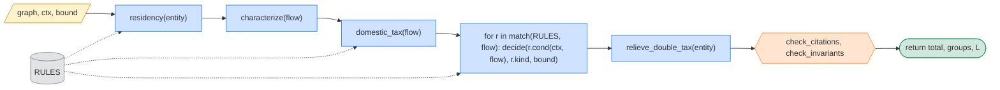
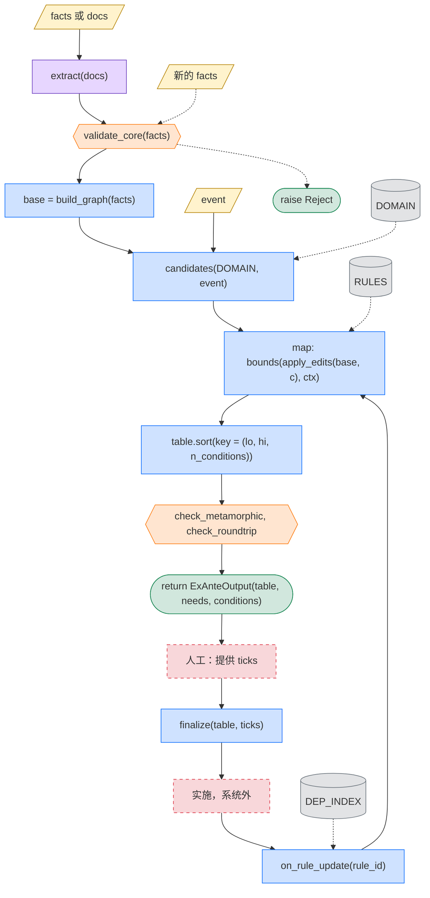
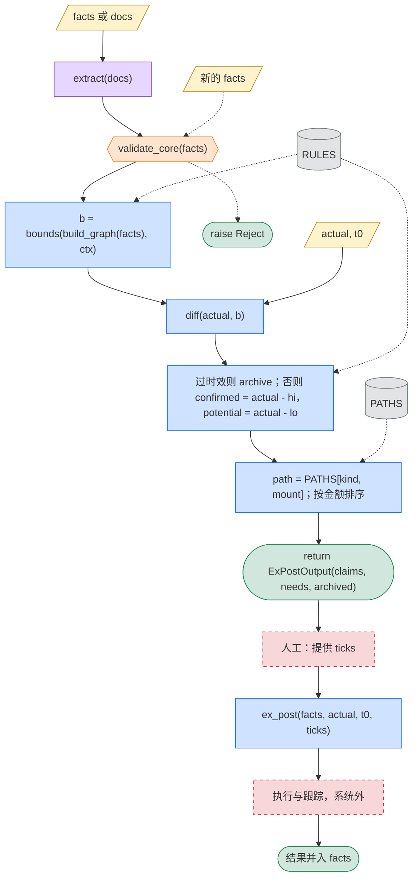

# 第一版：陆港新，企业

**定位**：在三节点图 `{CN, HK, SG}` 上，对 `COMPANY` 实现两个入口函数。`ex_ante()` 返回总税负最低的可行结构，`ex_post()` 返回可收回的税额。两者共用 `engine()`。类型见 [图模型.md](图模型.md)，字段见 [信息收集.md](信息收集.md)，函数体见 [伪代码.md](伪代码.md)。

## 0. 约定

| 设计概念 | 程序对应 | 图中样式 |
|---|---|---|
| 外部输入 | 函数参数 | 黄色，平行四边形 |
| 内部信息源 | 模块级常量，带版本 | 灰色，圆柱 |
| 程序 | 纯函数，确定性，可单测 | 蓝色，矩形 |
| LLM | 非确定函数，只在循环外调用 | 紫色，矩形 |
| 检查 | `assert`，不过则 `raise Defect` | 橙色，六边形 |
| 产出 | 返回值 | 绿色，圆角 |
| 人工 | 参数 `ticks` 的提供者；系统外实施 | 红色，虚线框 |

契约：

```python
# I1 目标唯一
ex_ante : argmin(total_tax)      # 现金口径，event.horizon 内；成本不进目标，只可作 event.budget 约束
ex_post : argmax(recoverable)

# I2 不猜
cond(ctx, elem) -> Tri           # T | F | U；U 是返回值，来源 MISSING | PLAN | DISCRETION
bounds(graph, ctx) -> (lo, hi)   # U 按 CEILING、FLOOR 各算一次；不取单值，不做组合分支

# I3 异常只有两种
Reject                           # validate_core() 不过
Defect                           # 任一 assert 不过

# I4 人工一轮
finalize(table, ticks) -> Row    # 纯函数；之后不再需要人工

# I5 循环内无 LLM
extract(), narrate()             # 不得出现在任何 for / map 内
```

## 1. 范围

```python
JURISDICTIONS = {CN, HK, SG}                  # CN：母国 + 运营地；HK、SG：枢纽
TREATY = {
    pair(CN, HK): ARRANGEMENT,
    pair(CN, SG): DTA,
    pair(HK, SG): NONE,                       # 只有航运航空有限协定，视同无
}
ENTITY_TYPES = {COMPANY}
IMPLEMENTED  = {DIVIDEND, INTEREST, ROYALTY, SHARE_TRANSFER}    # 转让含直接与间接
ENUM_ONLY    = {SERVICE_FEE, OTHER}
OUT_OF_SCOPE = {pillar_two, transfer_pricing, vat, risk_scoring}
```

## 2. 参数与常量

```python
# 参数：随案例而变
event  : Event                 # flows, horizon, budget=None
facts  : FactPack              # graph + values + evidence；表单填写，或 extract(docs)
actual : Labels                # 实际征税记录，仅 ex_post
t0     : date                  # 快照时刻，仅 ex_post
ticks  : dict[Need, bool]      # 人工勾选，仅 finalize

# 常量：对单案固定，按版本更新
RULES     : list[Rule]                               # rules/cn.py, hk.py, sg.py, treaty.py
DOMAIN    : dict[Var, list]                          # 第 4 节
PATHS     : dict[tuple[Deviation, Mount], Path]      # 第 5 节
FIELDS    : dict[FieldId, Field]                     # 信息收集.md
GOLD      : list[Case]                               # 金标准
DEP_INDEX : dict[RuleId, set[CaseId]]                # 由引用链反查
```

规则模块的三条约定：

```python
rate = min(domestic_rate, treaty_cap)     # 不假设协定更低；NONE 时 treaty_cap = inf
module(...) -> list[TaxItem]              # 返回税项组合，不是单一税率
rule.claim : ClaimProc                    # SELF_ASSESS | RESIDENCE_CERT；是数据，不是分支
```

## 3. 函数

| 函数 | 签名 | 类型 |
|---|---|---|
| `extract` | `(docs) -> FactPack` | LLM，循环外 |
| `validate_core` | `(facts) -> None`，不过则 `raise Reject` | 检查 |
| `required_fields` | `(graph) -> set[FieldKey]` | 纯函数 |
| `build_graph` | `(facts) -> Graph` | 纯函数 |
| `candidates` | `(DOMAIN, event) -> Iterator[Candidate]` | 纯函数 |
| `apply_edits` | `(base, cand) -> Graph` | 纯函数 |
| `engine` | `(graph, ctx, bound) -> (Money, Groups, Labels)` | 纯函数 |
| `bounds` | `(graph, ctx) -> Bounds` | 纯函数 |
| `finalize` | `(table, ticks) -> Row` | 纯函数 |
| `diff` | `(actual, L_should) -> list[Deviation]` | 纯函数 |
| `affected_cases` | `(rule_id) -> set[CaseId]` | 纯函数 |
| `narrate` | `(output) -> str` | LLM，可选 |

`engine` 的内部步骤：



## 4. ex_ante

```python
out  = ex_ante(event, facts)         # -> ExAnteOutput(table, needs, conditions)
best = finalize(out.table, ticks)    # 人工提供 ticks 之后

def on_rule_update(rule_id):         # 维护
    for case in affected_cases(rule_id):
        new = rerun(case)
        if new.best != case.best or not feasible(case.implemented):
            notify(case)
```



```python
# 候选空间 = 模板（场景.md §2）：自由角色的法域 × 结构变量；OP / ULT / BUYER 由案例固定在客户所在地，任一法域都可作主体
Template.free      = {HOLD: [None, CN, HK, SG]}  |  {IPCO: [None, CN, HK, SG]}  |  {SERVICER: [CN, HK, SG]}
Template.structure = {financing: [EQUITY, DEBT], exit_route: [DIRECT, INDIRECT], payment: [False, True],
                      repatriation: [DIVIDEND, CAPITAL_REDUCTION, LIQUIDATION]}   # payment = cross_year：推到下一公历年
# candidates() 只取与 event 相关的结构变量，只剪"描述不出图"的组合（无 HOLD 却间接退出）；不按推理剪重复（scenarios.py）
# 时点不让税消失：事件内每条流的税都计入（I1），推迟只通过依赖日期的规则起作用（持股期、制度起始日、抵免窗口、规则版本）

ADJUSTABLE = {substance, holding_ratio, holding_months}
# 不枚举：单一目标下永远取最高。EX_ANTE 下读这些字段的条件返回 U(PLAN)，条件本身即落实条件。

```

反避税条件，按能否编码分两类：

| 管辖区 | `ctx.test()`，可编码 | `ctx.discretion()`，返回 `U(DISCRETION)` |
|---|---|---|
| CN | 受益所有人安全港（9号公告）；持股比例与持股期门槛 | 受益所有人不利因素；间接转让合理商业目的（7号公告）；一般反避税 |
| 协定 | 无 | 主要目的测试 PPT |
| HK | FSIE 实质门槛；居民身份证明书条件 | FSIE 实质充分性 |
| SG | 境外来源收入免税条件；境外资产处置条款的实质门槛 | 控制与管理地；实质充分性 |

## 5. ex_post

```python
out = ex_post(facts, actual, t0)             # -> ExPostOutput(claims, needs, archived)
out = ex_post(facts, actual, t0, ticks)      # 人工勾选后代入重算
```



`PATHS` 的内容：

| 键 `Deviation` | 典型情形 | 值 `Path`：程序与文书 |
|---|---|---|
| `OVER_WITHHELD`，付方在 CN | 股息按国内法扣缴，实际符合《安排》或 DTA 优惠但未主张 | 35号公告自行主张，向主管税务机关申请退税，时效按征管法 |
| `OVER_WITHHELD`，付方在 SG | 对付给 CN 的利息、特许权使用费全额扣缴 | 凭 CN 居民身份证明向 IRAS 申请退税 |
| `NO_TREATY_EDGE` | SG 对付给 HK 的利息全额扣缴 | 无协定救济；查 HK FSIE 下单边抵免是否可用 |
| `MISSED_CREDIT` | CN 公司境外所得抵免未申报，或分国与综合方式选择不当 | 更正申报，追补抵免 |
| `BO_DENIED` | CN 否定 HK 或 SG 公司的受益所有人身份 | MAP；或补足实质后就后续年度重新主张 |
| `INDIRECT_TRANSFER_TAXED` | 7号公告认定间接转让应税 | 先行政复议，协定层面 MAP |

## 6. 检查

```python
validate_core(facts)       # 入口          实体、资金流、日期齐全                 否则 raise Reject
check_provenance(facts)    # extract 之后  每个字段回指出处                       无出处的字段降为 U(MISSING)，不抛异常
check_citations(L)         # engine 之后   每个数字引用一条在 flow.on 有效的规则  否则 raise Defect
check_invariants(L)        # engine 之后   rate <= domestic；refund <= withheld；
                           #               sum(by_jurisdiction) == total；NONE 时 cap == inf
check_interval(b)          # bounds 之后   lo <= hi；任一待定组改为有利不使税负上升
check_metamorphic(f)       # 返回之前      无关字段改动结果不变；金额缩放税额等比
check_roundtrip(row)       # 返回之前      把 row 的 L_should 当作 actual 跑 ex_post，偏差为零
```

## 7. 并行

```python
facts  = merge(await gather(*(extract(d) for d in docs)))      # 先建实体登记表；文档间冲突的字段降为 U(MISSING)
table  = pool.map(lambda c: bounds(apply_edits(base, c), ctx), cands)    # map
best   = min(table, key=rank)                                  # reduce
claims = pool.map(judge, deviations)
text   = await gather(*(narrate(s) for s in sections(out)))
# 构建期：RULES 按 (jurisdiction, income) 分片并行起草，专家评审后合并。并行收益最大的地方
```

串行点：`validate_core`；`reduce`；`check_roundtrip` 依赖 `best`；`finalize` 在人工之后。

## 8. 测试与人工

```python
def test_gold():
    for case in GOLD:
        assert run(case.input, case.ticks) == case.expected

GOLD.append(Case(input, ticks, expected))     # 每次人工勾选后，回归集增长
```

- 构建期：专家评审常量 `RULES`、`PATHS`、`GOLD`。
- 运行时：第 6 节检查。
- 产出后：人工只提供 `ticks`，不评价方案好坏，好坏由目标函数定义。
- 快照场景（`cases.py`，`data/gold.py` 94 行）：A 陆 OP / 港 HOLD / 新 ULT 分红与退出；B 镜像（新 OP、陆 ULT，内地为居民侧）；C 特许权；D 服务费；E 分红 vs 减资 vs 清算。`ex_post` 的 roundtrip 在 A 与 E 上跑（场景.md §7）。

## 9. 模块布局

```text
tax_graph/
  model.py                    # 图模型.md：Entity, HoldEdge, FlowEdge, Graph, TREATY（已实现）
  facts.py                    # 图 → 一条流的事实（持股、来源地、间接转让标的、100% 持有链）（已实现）
  fields.py   check_fields.py # 信息收集.md：FIELDS = CORE ∪ reads；required/missing_fields(graph)；对照文档（已实现，0 不一致）
  rules/                      # 规则层.md：model, tri, compile, eval, spec_{sg,cn,hk}, procedure_{sg,cn,hk}, mutation_check（已实现）
  engine.py                   # 伪代码.md：engine, bounds, by_source, Reject/Defect（已实现）
  scenarios.py  cases.py      # 场景.md：五个角色模板（持股、IP、服务、资金回流、融资）、案例、候选生成、主体视角；六个案例（已实现）
  claims.py   check_scope.py  # 已缴税项的主张与封存；范围 v1.1 机制的用例（支柱二、CFC、实际管理机构、增值税、融资、印花税、多年度）
  run.py                      # 入口：cases/<案例>.json → 候选表、税项、待定项、主张、未给字段 → out/<案例>.md（已实现；首例 cases/meridian.json）
  ex_ante.py   ex_post.py   claims.py   # 候选表（支配行标记、主体份额、脆弱度）、finalize；已缴税项的主张与封存（场景.md §8）；整流实缴额的旧入口（已实现）
  check_engine.py  check_entity.py  check_coverage.py  # 5 模板 × 全部候选（94 行、不变式、roundtrip、视角求和、等比缩放）；实体级 6 例；覆盖矩阵 42 格
  params.py                   # 只读访问 official/params.csv
  sg_s45.py   check_sg_s45.py # 新加坡第45条预提税计算器（规则层的消费者）；对官方计算器标签的检查
  cn_wht.py   check_cn_wht.py # 内地预提税（规则层的消费者）；条文手读用例的检查（无官方计算器）
  hk_tax.py   check_hk_tax.py # 香港利得税：对外特许权、FSIE、附表 17K（规则层的消费者）；条文手读用例
  flow_tax.py check_flow_tax.py # 通用消费者：一条流、一个法域、两个 bound；股权转让、新加坡接收侧、抵免的用例
  checks.py
  data/   domain.py（Event, ADJUSTABLE, 结构常量；候选空间在 scenarios.py）  paths.py（PATHS → DEADLINE 规则）  gold.py + gold/（快照，oracle_kind = snapshot）
  llm/    extract.py（已实现：字段清单驱动的两遍抽取、证据校验、类型由规则谓词推出；模型为参数，check_extract 13 项）  narrate.py
  tests/
```
