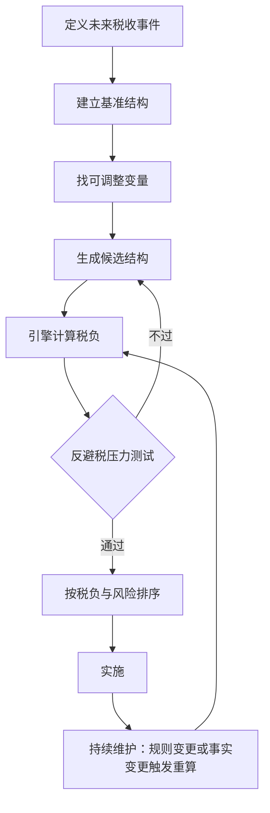
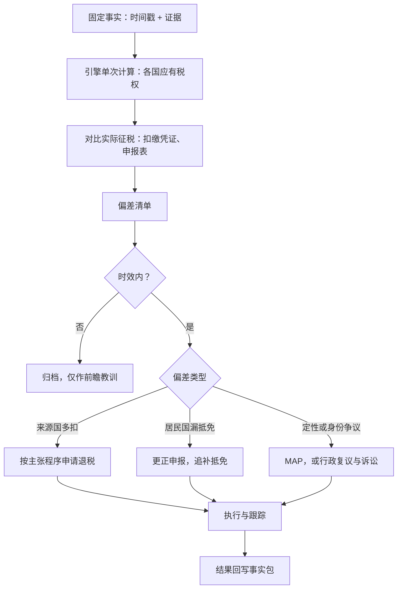

# 第一版：陆港新，企业

**定位**：在中国大陆、香港、新加坡三节点图上，只对企业纳税人，实现一个共享的税权计算引擎，让“发生前的结构规划”和“发生后的权利主张与纠错”两条流程都调用它。

## 1. 范围

| 项 | 第一版取值 |
|---|---|
| 节点 | 中国大陆（母国 + 运营地）、香港（枢纽）、新加坡（枢纽） |
| 协定边 | 内地—香港《安排》；内地—新加坡 DTA；香港—新加坡 无全面协定（航运航空有限协定视同无） |
| 纳税人 | 企业。个人只保留节点类型与居民身份字段，不实现规则 |
| 收入类型（实现） | 股息、利息、特许权使用费、股权转让（直接、间接） |
| 收入类型（仅枚举） | 服务费、雇佣所得、其他 |
| 不做 | 支柱二、转让定价、增值税、个人规则 |

## 2. 图结构

| 对象 | 关键字段 |
|---|---|
| 管辖区节点 J | 税制类型（全球 / 地域）；国内规则模块；反避税规则表；救济程序表 |
| 实体节点 E | 类型 = 企业；所在 J；居民身份判定结果；实质字段（人员、场所、决策、资金）；持股关系 |
| 资金流边 F | 付方 E、收方 E；收入类型；金额；日期；持股比例；持股期 |
| 协定边 T | J_a、J_b；文书类型 ∈ {安排, DTA, 无}；各收入类型的上限与条件；反滥用条款；MAP 可用 |
| 规则 R | 生效区间 [起, 止)；条件；结果（税率或税项组合）；主张程序 ∈ {自行判断+留存, 居民证明, 事先备案}；时效；出处 |

三条设计原则，第一版就定死，为第二版预留：

1. 国内法与协定取低，不假设协定一定更低。
2. 国内模块输出税项组合，不输出单一税率。
3. 减免的主张程序是规则上的数据字段，不是代码分支。

## 3. 共享引擎

输入：事实包 + 结构。输出：每个管辖区的应有税权，附规则引用链。

## 4. 发生前：结构规划

可调变量：

| 变量 | 取值 |
|---|---|
| 控股公司所在地 | 无、香港、新加坡 |
| 融资方式 | 股权、债权 |
| 知识产权所在地 | 内地、香港、新加坡 |
| 实质投入档位 | 人员、场所、决策、资金 |
| 持股比例与持股期 | 是否达到协定优惠门槛 |
| 退出方式 | 直接转让、间接转让 |
| 支付路径与时点 | 经枢纽或直接；跨年安排 |

压力测试：

| 管辖区 | 测试内容 |
|---|---|
| 内地 | 受益所有人（9号公告安全港与不利因素）；间接转让合理商业目的（7号公告）；一般反避税 |
| 协定 | 主要目的测试 PPT |
| 香港 | 境外收入豁免制度 FSIE 的经济实质要求；居民身份证明书审查 |
| 新加坡 | 境外来源收入免税条件；境外资产处置收益条款的经济实质；居民证明的控制与管理地 |

## 5. 发生后：权利主张与纠错

偏差类型与纠正路径：

| 偏差 | 典型情形 | 纠正路径 |
|---|---|---|
| 来源国多扣 | 内地股息按国内法扣缴，实际符合《安排》或 DTA 优惠但未主张 | 35号公告自行主张，向主管税务机关申请退税，时效按征管法 |
| 来源国多扣 | 新加坡对付给内地的利息、特许权使用费全额扣缴 | 凭内地居民身份证明向 IRAS 申请退税 |
| 无协定边 | 新加坡对付给香港的利息全额扣缴 | 无协定救济；查香港 FSIE 下单边抵免是否可用 |
| 居民国漏抵免 | 内地公司境外所得抵免未申报，或分国与综合方式选择不当 | 更正申报，追补抵免 |
| 受益所有人被否 | 内地否定香港或新加坡公司的受益所有人身份 | MAP；或补足实质后就后续年度重新主张 |
| 间接转让被征 | 7号公告认定间接转让应税 | 先行政复议，协定层面 MAP |

## 6. 验证与基准场景

- 专家：内地、香港、新加坡各一位；协定模块由内地或香港专家兼；AI 出跨模块整合表。
- 场景 A（发生前）：内地运营公司分红与退出，控股公司放香港、新加坡还是不设。
- 场景 B（发生后）：控股公司收股息被按国内法扣缴，实际符合优惠但未主张，走退税；受益所有人被否走 MAP。
- 验收：两个场景的金标准答案由专家给出，引擎输出逐条对齐，规则引用逐条打勾。

## 7. 交付物

引擎、三个国家模块、协定模块、事实包模板、整合表模板、两个基准场景及验证记录。
