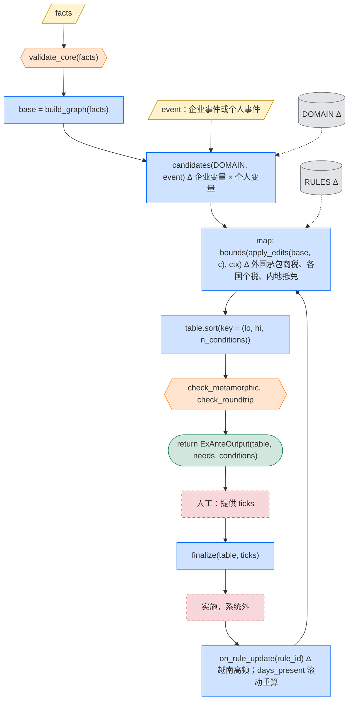
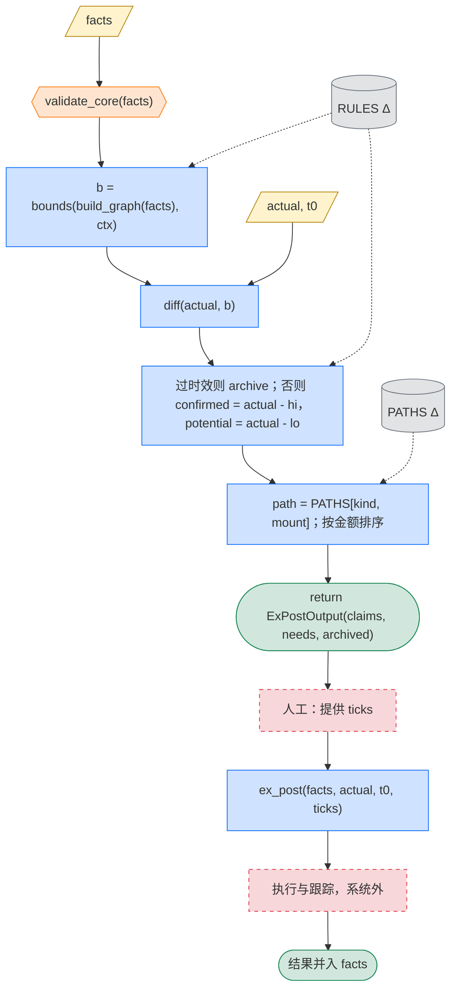

# 第二版：加越南，加个人

**定位**：对第一版的增量。预期 `engine()`、`bounds()`、`ex_ante()`、`ex_post()`、`finalize()` 的函数体不变，只改常量、规则模块和字段。实际改了哪些函数，就是“图结构是否可扩展”的证据。契约 I1 至 I5 同第一版。类型见 [图模型.md](图模型.md)，字段见 [信息收集.md](信息收集.md)。

## 0. 三地以外的法域节点（2026-10-13 决定）

- 开曼、英属维尔京群岛等三地以外的法域，作为节点与越南同归本阶段：第一版不建模。
- 第一版的处理：它们只在结构最上层或旁支时，案例截取三地部分并注明（案例采集.md §6）；夹在三地公司之间、截掉就改变交易的，案例暂缓，放 `cases/v2/`。
- 暂缓的案例：K4-yunnanwater-2023（香港公司出售持有内地项目公司的 BVI 公司）。暂缓的官方算例：内地操作指南示例三（甲至戊国的多层预提）、香港 FSIE Example 34/35（下游三个法域与零税的 F）。
- 本阶段要补：这类法域的公司所得税（多为零）、与三地之间无协定、持股链经过它们时的内地间接转让与香港、新加坡境外所得规则。

## 1. 常量的增量

```python
JURISDICTIONS |= {VN}                                      # 运营地
TREATY        |= {pair(CN, VN): DTA, pair(HK, VN): DTA, pair(SG, VN): DTA}    # pair(HK, SG) 仍为 NONE
ENTITY_TYPES  |= {INDIVIDUAL}
IMPLEMENTED   |= {SERVICE_FEE, EMPLOYMENT, INDIVIDUAL_DIVIDEND, INDIVIDUAL_GAIN}
ClaimProc     |= {PRIOR_NOTIFICATION}                      # 越南事先备案，带时限
RULES         += rules/vn.py + rules/individual.py         # 内地个税、香港薪俸税、新加坡个人所得税、越南个税；
                                                           # 协定的雇佣、董事费、加比规则条款
OUT_OF_SCOPE  不变                                          # pillar_two、transfer_pricing 只打标记
```

新机制：

```python
ctx.discretion(e, "permanent_establishment")              # 常设机构判定返回 U(DISCRETION)
domestic_tax(f) -> [TaxItem(VAT, ...), TaxItem(CIT, ...)] # 越南外国承包商税是复合扣缴
HoldEdge.holder : EntityId                                # 可以指向 INDIVIDUAL，即个人—企业混合边
```

## 2. 改动清单

| 改动点 | 预期 | 实际（做完填） |
|---|---|---|
| `JURISDICTIONS` 加 `VN` | 只改常量 | |
| `module() -> list[TaxItem]` | 第一版已预留，函数签名不变 | |
| `ClaimProc` 加 `PRIOR_NOTIFICATION` | 只改枚举与规则数据 | |
| `rate = min(domestic, cap)` | 越南利息国内税率低于协定上限，逻辑不变 | |
| 常设机构 | 第一版为桩，本版实现为 `discretion()` | |
| `rules/individual.py` | 新模块，与企业规则并列 | |
| 个人—企业混合边 | `HoldEdge.holder` 放宽类型；内地个税受控外国企业条款 | |
| `DOMAIN` 扩展 | 见下 | |
| `FIELDS` 扩展 | 见下 | |
| `on_rule_update` | 越南更新频率高，`DEP_INDEX` 调用更频繁，函数不变 | |

```python
DOMAIN     |= {domicile, secondment_employer, holding_mode, vn_holding_path, vn_payment_path}
ADJUSTABLE |= {days_present}             # 不枚举；返回 U(PLAN)，输出为居住天数上限

FIELDS |= {
    # mount=ENTITY, active_if: e.type is INDIVIDUAL
    nationality, domicile, days_present, centre_of_vital_interests, six_year_count, secondment_contract,
    # mount=FLOW, active_if: loc(f.payer) is VN
    contract_type, fct_method, incentive_period, pe_facts,
}
```

## 3. ex_ante 的增量

函数体不变。图中 Δ 标出读到新常量的节点。



反避税条件的增量：

| 管辖区 | `ctx.test()`，可编码 | `ctx.discretion()`，返回 `U(DISCRETION)` |
|---|---|---|
| VN | 优惠适用条件；事先备案的时限 | 协定反滥用的主要目的与受益所有人；常设机构；转让定价 |
| CN，个人 | 六年规则，按 `days_present` 计算 | 个税反避税条款；受控外国企业条款 |
| HK、SG，个人 | 来源与居留判定；`pair(HK, SG)` 上双重居民各按国内法 | 无 |

## 4. ex_post 的增量

函数体不变。



`PATHS` 的增量：

| 键 `Deviation` | 典型情形 | 值 `Path`：程序与文书 |
|---|---|---|
| `OVER_WITHHELD`，付方在 VN，服务费 | 按国内法扣外国承包商税，收款方无常设机构本可享协定豁免，但未备案 | 补交协定备案与退税申请，时效需核实 |
| `OVER_WITHHELD`，付方在 VN，特许权使用费 | 协定税率低于国内法但未备案 | 同上 |
| `MISSED_CREDIT`，个人 | 外派越南的中国籍员工，越南个税已缴，内地未抵免或抵免不足 | 内地境外所得追补申报抵免；越南年度清算退税 |
| `DUAL_RESIDENT` | 个人同时构成两地居民 | 协定加比规则；`pair(HK, SG)` 上只能各按国内法 |
| `LOOK_THROUGH` | 内地个税受控外国企业条款或反避税调整穿透个人持股架构 | 行政复议；协定层面 MAP |

## 5. 检查、并行、测试的增量

```python
check_freshness(RULES, VN)             # 越南规则版本新鲜度
check_day_count(facts)                 # days_present 与 six_year_count 的程序核对
# 并行：rules/vn.py 与 rules/individual.py 并行起草；vn 是最大的一块
```

- 新增专家：越南一位，需越南语一手法规，可能只能依赖二手资料，这本身是要记录的结论；个税一位。构建期评审常量，产出后只提供 `ticks`。
- `GOLD[2]`，场景 C，`ex_ante`，企业：CN 母公司经 SG 或 HK 持有 VN 工厂，服务费与特许权使用费的 `vn_payment_path`。
- `GOLD[3]`，场景 D，`ex_post`，企业：VN 服务费外国承包商税未备案，补备案退税。
- `GOLD[4]`，场景 E，`ex_ante`，个人：中国籍经理外派 VN，`domicile` 与 `secondment_employer` 的取值，`days_present` 上限作为落实条件。
- `GOLD[5]`，场景 F，`ex_post`，个人：VN 个税已缴，内地抵免未主张。

## 6. 对比指标

| 指标 | 第一版 | 第二版 |
|---|---|---|
| `len(JURISDICTIONS)` | 3 | 4 |
| 协定边 / `NONE` 边 | 2 / 1 | 5 / 1 |
| `len(ENTITY_TYPES)` | 1 | 2 |
| `len(IMPLEMENTED)` | 4 | 8 |
| `len(ClaimProc)` | 2 | 3 |
| `len(DOMAIN)` / 候选总数 | 5 / 144 | 10 / 做完填 |
| `discretion()` 调用点数 | 做完填 | 做完填 |
| 专家数 | 3 | 5 |
| `len(GOLD)` | 2 | 6 |
| 被修改的函数体数 | 0 | 做完填 |
