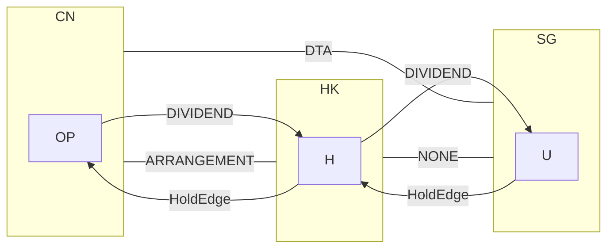

# 图模型

**定位**：`model.py`。两条流程、所有版本共用的类型与计算语义。流程文档只引用，细节以本文为准。

## 1. 类型

```python
class Jurisdiction(Enum): CN; HK; SG
class Instrument(Enum):   ARRANGEMENT; DTA; NONE
class Income(Enum):       DIVIDEND; INTEREST; ROYALTY; SHARE_TRANSFER; SERVICE_FEE; OTHER
class Mount(Enum):        EVENT; ENTITY; HOLD; FLOW; PATH; SUBGRAPH

# 管辖区层：常量
@dataclass
class TreatyEdge:
    pair: frozenset[Jurisdiction]
    instrument: Instrument               # NONE 是一等状态，不是异常
    map_available: bool
# 上限、条件、反滥用不挂在边上，是规则层的 RuleObj，其 Scope(source, residence) 带方向；见 规则层.md

# 案例层：参数
@dataclass
class Entity:
    id: EntityId
    type: EntityType
    loc: Jurisdiction
    attrs: dict[FieldId, Any]            # 居民身份、实质等条件字段

@dataclass
class HoldEdge:
    holder: EntityId; held: EntityId
    ratio: float; since: date; cost: Money

@dataclass
class FlowEdge:
    payer: EntityId; payee: EntityId
    income: Income; amount: Money; currency: str; on: date
    hold: HoldEdge | None

@dataclass
class Graph:                             # 异构、带属性、多重、带时间
    entities: dict[EntityId, Entity]
    holds: list[HoldEdge]
    flows: list[FlowEdge]

@dataclass
class Label:                             # 挂在元素上的结果
    items: list[TaxItem]                 # 税额、税率
    cites: list[RuleId]                  # 引用链

Labels = dict[ElemId, Label]             # L_should 有 lo、hi 两套；L_actual 一套
```

`DEP_INDEX` 由 `Label.cites` 反查得到：规则变更时只重算用到它的案例。

## 2. 规则

```python
Rule = RuleObj          # 定义见 规则层.md §1：scope 带方向，effect 分类型，grade 分四级，overrides 显式；reads 由 cond 推出
```

| `scope.mount` | 匹配对象 | 第一版例子 |
|---|---|---|
| `ENTITY` | 单个实体或管辖区 | 居民身份判定；国内税率；HK FSIE 与 SG 境外资产处置条款的实质门槛 |
| `FLOW` | 一条资金流边及其协定边 | 预提税；协定上限；持股门槛与持股期 |
| `PATH` | 相邻两条以上资金流边 | 受益所有人的背对背支付：`v` 收到后短期内转付给 `w` |
| `SUBGRAPH` | 某节点的子树、可达集或环 | 7号公告：`subtree(target)` 含 CN 资产；返程投资：`holds` 上的环 |

## 3. 时间

```python
def holding_months(h: HoldEdge, on: date) -> int:  return months(on - h.since)
def version(rule_id, on: date) -> Rule:            # 取 valid 覆盖 on 的版本
def in_time(paid_on, limit, t0) -> bool:           return t0 <= paid_on + limit
# ex_post 固定快照 t0；ex_ante 对 event.horizon 求值，规则取当时已知的最新版
```

## 4. 传播语义

```python
rate(f)  = min(domestic_rate(f), cap(f))           # cap = inf if treaty(f).instrument is NONE
net(path) = compose(transform(x) for x in path)    # 每条边扣缴，每个节点征税与抵免
total(L) = sum(label.tax for label in L.values())
# 规则按 effect 分阶段叠加：边上 CHARGE → BASE → RATE_CAP → EXEMPT → CREDIT → DEFER → DEDUCTION；阶段内可交换，见 规则层.md §3
```

求值过程中没有 LLM 调用。`engine` 的实现见 [伪代码.md](伪代码.md)。

## 5. 编辑操作

```python
Candidate = dict[Var, Value]
EDITS: dict[Var, Callable[[Graph, Value], Graph]]
def apply_edits(base, cand) -> Graph:  return reduce(lambda g, kv: EDITS[kv[0]](g, kv[1]), cand.items(), base)
```

| `Var` | `EDITS[var]` 做什么 |
|---|---|
| `holdco_loc` | 插入或删除实体节点；改 `loc` |
| `financing` | `HoldEdge` 改为债权；`flow.income` 由 `DIVIDEND` 改 `INTEREST` |
| `ip_loc` | 改知识产权实体的 `loc`；改 `ROYALTY` 边的起点 |
| `exit_route` | 被转让节点取上层还是下层 |
| `payment` | 改资金流边的路径与 `on` |

`ADJUSTABLE` 中的属性不在 `EDITS` 里。`EX_ANTE` 下读它们的条件返回 `U(PLAN)`。

搜索：`product(*DOMAIN.values())` 上穷举，先剪掉与 `event` 无关的变量。排序键 `(lo, hi, n_conditions)`。第一版域很小，不需要启发式。

## 6. 标注差

```python
def diff(actual: Labels, b: Bounds) -> list[Deviation]:
    return [Deviation(e, actual[e].tax - b.L_hi[e].tax, actual[e].tax - b.L_lo[e].tax)
            for e in actual if actual[e].tax > b.L_lo[e].tax]
```

每条偏差定位到一个元素，由元素决定：主管机关 = `loc(f.payer)` 或 `e.loc`；程序与时效 = `rule.claim`、`rule.limit`；MAP = `treaty(f).map_available`。

## 7. 反事实（可选）

```python
def counterfactual(graph, v) -> Money:             # 节点 v 带来的协定利益；只用于说明
    return bounds(bypass(graph, v)).lo - bounds(graph).lo
```

## 8. 整合表

```python
integration: DataFrame                             # index = 图元素；columns = [cn, hk, sg, treaty, total]
assert no_conflict(integration)                    # 同一行两列冲突 = 规则库缺陷，raise Defect，不调和
```

## 9. 示例：场景 A 的基准图

```python
base = Graph(
    entities = {"OP": Entity("OP", COMPANY, CN), "H": Entity("H", COMPANY, HK), "U": Entity("U", COMPANY, SG)},
    holds    = [HoldEdge("U", "H", ...), HoldEdge("H", "OP", ...)],
    flows    = [FlowEdge("OP", "H", DIVIDEND, ...), FlowEdge("H", "U", DIVIDEND, ...)])
# holdco_loc=None 即删去 H，让 U 直接持有 OP
```



## 10. 边界

- 判断题不在图里：合理商业目的、主要目的、实质是否充分，只返回 `U(DISCRETION)`。
- 非局部规则留口：集团层面的规则要整图计算，第一版不做。
- 第一版把图当数据模型与模式语言用，不做图算法。节点变多、`DOMAIN` 变大时再升级。
